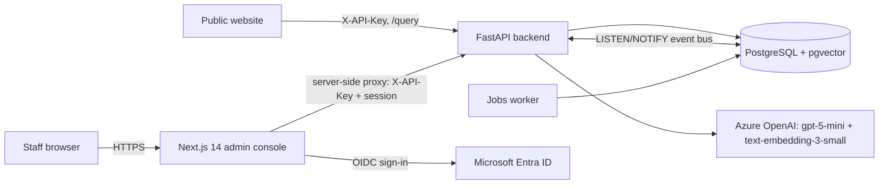

# AskDIQ

AskDIQ is the AI assistant for the DeployIQ platform website (Exigo Tech), and
the admin console that runs it. Website visitors ask questions; AskDIQ answers
from a curated knowledge base with citations, guardrails and a grounded
fallback. Staff sign in with Microsoft Entra ID to monitor usage, cost,
quality and governance, manage the knowledge base and users, and white-label
the product.

- **Plan and status:** [docs/plan.md](docs/plan.md)
- **Deploy to production:** [docs/deployment/deployment-guide.md](docs/deployment/deployment-guide.md)
- **Production `.env` and SSO:** [docs/deployment/environment-and-sso.md](docs/deployment/environment-and-sso.md)
- **Technical reference:** [docs/technical/](docs/technical/README.md)

## Architecture



| Part | What it does |
|---|---|
| **Frontend** (`frontend/`) | Next.js 14 App Router. The browser only talks to its own origin: `/api/proxy/*` is a server-side route handler that adds the service key (`X-API-Key`) and the session (`X-Session`), so no secret reaches the browser. Sign-in routes under `/auth/*`. Nonce-based CSP. |
| **Backend** (`backend/`) | FastAPI with async SQLAlchemy. RAG pipeline, auth and RBAC, admin APIs, audit, security headers, RFC 9457 errors, rate limits. |
| **Database** | One PostgreSQL with the `pgvector` extension for relational data, embeddings (1536-dim), sessions, jobs and shared state. Migrations with Alembic. |
| **LLM** | Azure OpenAI: `gpt-5-mini` for answers, `text-embedding-3-small` for embeddings; both can be changed at runtime in Settings > Models & Pricing. |
| **Jobs worker** | Postgres `SKIP LOCKED` job queue (insights classification, backfills). Runs in-process by default, or as `python -m app.jobs.worker`. |
| **Event bus** | Postgres `LISTEN/NOTIFY` for cross-worker cache invalidation and live governance events (served to the console over SSE). |

### RAG pipeline

1. **Pre-checks**: length, spam/gibberish, unsafe input and prompt injection.
2. **Retrieval**: pgvector cosine recall, dedupe, cross-encoder rerank
   (`fastembed`, reorder only), and a cross-document quota so one document
   cannot crowd out another. Compound questions are split and merged.
3. **Relevance gate**: off-topic questions get a helpful "what I can help
   with" reply instead of a refusal.
4. **Generation** with token-budgeted context and recent history.
5. **Post-checks**: semantic groundedness against the cited chunks, with a
   generation retry; citations returned as sources.
6. **Accounting**: per-stage latency, tokens and cost on every turn; sampled
   online evaluation; insights classification in the background.

## Features

**Chat (AskDIQ)**: answers with source citations, feedback (thumbs and
reasons), server-side chat sessions, an embeddable chat widget.

**Admin console** (pages filtered by role: superadmin, admin, operator):

| Page | What it shows |
|---|---|
| Dashboard | KPI trend cards, charts that drill into the other pages, activity feed, health |
| AskDIQ | The chat, for staff |
| Knowledge | Knowledge-base documents: upload (Markdown, `.docx` converted server-side), inventory, citations and detail pages |
| Visitors | Visitors with charts, timelines and deep links to their conversations |
| Usage & Cost | Token volumes and USD cost by stage, users, sessions and queries; test-IP management; CSV export |
| Conversation Logs | Every conversation and turn, with an inspector |
| Feedback | Triage workspace: review queue, golden cases, preference data, knowledge gaps |
| Evaluation | Live answer-quality evaluation records and trends |
| Governance | Overview, monitoring, traces, logs, live incident stream, audit trail, CSV export |
| Analytics | Intents, topics, flows, drop-off and conversation insights from the classifier |
| User Management | Users, access requests, roles and permissions, sign-in audit (superadmin) |
| Settings | Branding (names, colours, logos, login copy), Insights Taxonomy, Models & Pricing (superadmin) |

Light and dark themes, guided tours, a command palette and keyboard shortcuts
work across the console.

## Repository layout

```text
backend/     FastAPI app (app/), Alembic migrations, scripts/, tests/, knowledge base (data/real_docs/)
frontend/    Next.js 14 app (app/, components/, lib/), tests/ (vitest + Testing Library)
infra/       deploy kit builder, server deploy/rollback scripts, compose files, nginx confs, prod env templates
docs/        plan.md, deployment/, technical/, walkthroughs/ (one per console page), architecture/ (system diagram)
.github/     CI workflow, Dependabot, PR template, audit allow-lists
```

Dockerfiles stay next to their code (`backend/Dockerfile*`,
`frontend/Dockerfile*`) because they are the build contexts.

## Local development

Prerequisites: Python 3.14, Node 20, PostgreSQL with `pgvector` (or Docker),
and an Azure OpenAI resource.

### Database

```bash
docker compose -f infra/docker-compose.yml up -d postgres   # pgvector on localhost:5433, db ragdb
```

### Backend

The virtual environment is `backend\venv` on Windows (used by the editor
settings and the local CI script); `.venv` works elsewhere. Always call the
venv's Python.

```powershell
cd backend
python -m venv venv
venv\Scripts\python.exe -m pip install -r requirements.txt
Copy-Item .env.example .env            # fill in DATABASE_URL, AZURE_OPENAI_*, API_KEY_NAME, SESSION_SECRET
venv\Scripts\python.exe -m alembic upgrade head
venv\Scripts\python.exe scripts\ingest_real_docs.py
venv\Scripts\python.exe -m uvicorn main:app --reload --port 8000 --timeout-graceful-shutdown 5
```

Linux/macOS: `python -m venv .venv`, `cp .env.example .env`, then the same
commands with `.venv/bin/python`.

For local sign-in without Entra, set `ENV=development`, `AUTH_DEV_MOCK=true`
and your email in `SUPERADMIN_EMAILS` (backend) and `AUTH_DEV_MOCK=true`
(frontend): "Sign in with Microsoft" then opens a local mock identity
provider. The backend refuses to start with the mock outside development.

### Frontend

```powershell
cd frontend
npm ci --legacy-peer-deps
Copy-Item .env.local.example .env.local   # API_BASE_URL, API_KEY (= backend API_KEY_NAME), APP_BASE_URL
npm run dev                               # http://localhost:3000
```

### Full stack in Docker

```bash
docker compose -f infra/docker-compose.yml up --build    # Postgres 5433, API 8000, console 3000
```

Details, the proxy and sign-in contract, and the scale-out reference:
[docs/deployment/docker-and-auth-contract.md](docs/deployment/docker-and-auth-contract.md).

Never commit `.env` or `.env.local`; only the `*.example` files are tracked.

## Testing and CI

```powershell
cd backend
venv\Scripts\python.exe -m pytest -q            # needs TEST_DATABASE_URL (a separate Postgres DB) for DB tests
venv\Scripts\ruff.exe check . ; venv\Scripts\ruff.exe format --check . ; venv\Scripts\pylint.exe app

cd ..\frontend
npm run lint ; npm run typecheck ; npm test ; npm run build
```

GitHub Actions (`.github/workflows/ci.yml`) runs on every pull request and on
pushes to `main`: backend lint (ruff, pylint, bandit, pip-audit), backend tests
against Postgres with pgvector (single Alembic head, downgrade round-trip,
coverage gate), frontend checks (lint, typecheck, vitest, npm audit, build),
a full-stack smoke test, and an optional performance smoke. Run the same
checks locally before pushing. Details:
[docs/technical/09-development.md](docs/technical/09-development.md).

## Deployment

Production runs on `Internal-Dev-Ubuntu` under `/opt/askdiq` behind the shared
`et-platform-nginx-1` reverse proxy, with the shared `et-platform-postgres-1`
database:

| Host | Serves |
|---|---|
| `https://askdiq.ethub.co` | `askdiq-api` (public website, API key) |
| `https://askdiqui.ethub.co` | `askdiq-web` (admin console, SSO) |

Only committed `backend/` and `frontend/` source is shipped (built with
`infra/build_kit.ps1`); the server owns its compose file, nginx conf and
`.env` files. Follow [docs/deployment/deployment-guide.md](docs/deployment/deployment-guide.md)
and [docs/deployment/environment-and-sso.md](docs/deployment/environment-and-sso.md).

## Documentation

| Document | Content |
|---|---|
| [docs/plan.md](docs/plan.md) | Current plan: work in progress, open items, decisions, risks, completed work |
| [docs/deployment/](docs/deployment/deployment-guide.md) | Deployment guide, runbook, environment and SSO, local Docker and auth contract |
| [docs/technical/](docs/technical/README.md) | Architecture, repository guide, API, database, configuration, security, operations, development, website integration, frontend contracts and audits |
| [docs/walkthroughs/](docs/walkthroughs/) | One walkthrough per console page |
| [docs/architecture/index.html](docs/architecture/index.html) | Interactive architecture diagram |
