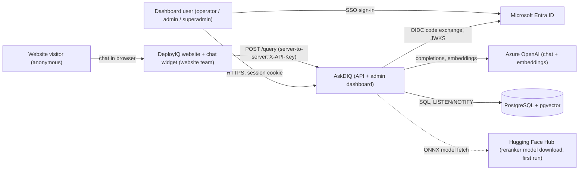
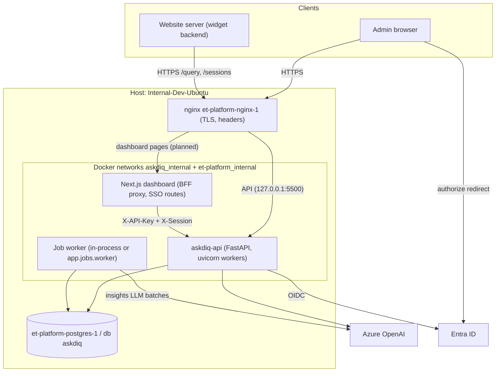
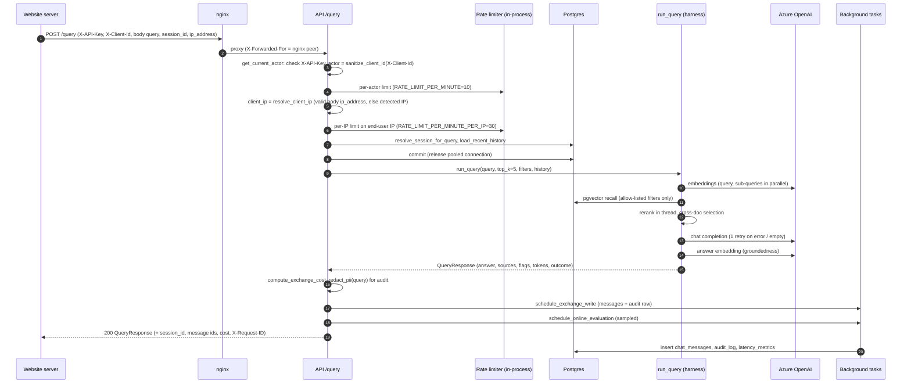
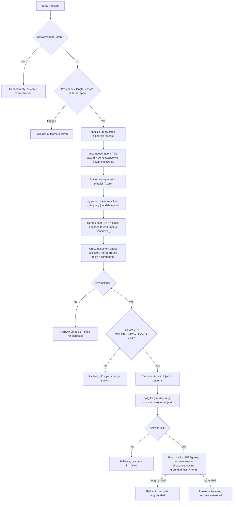
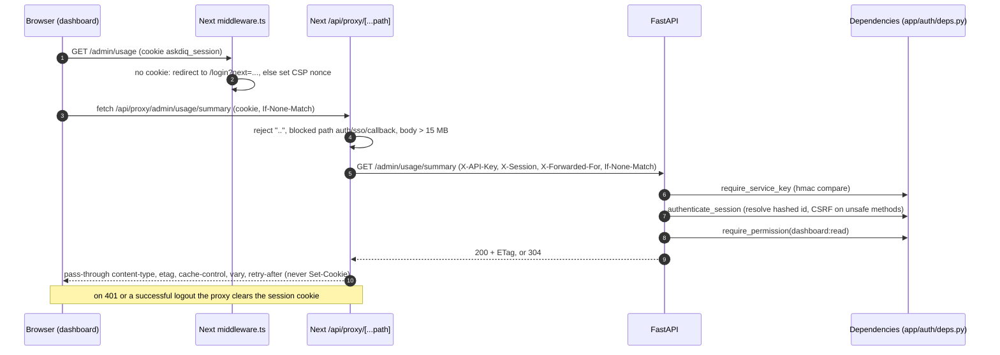
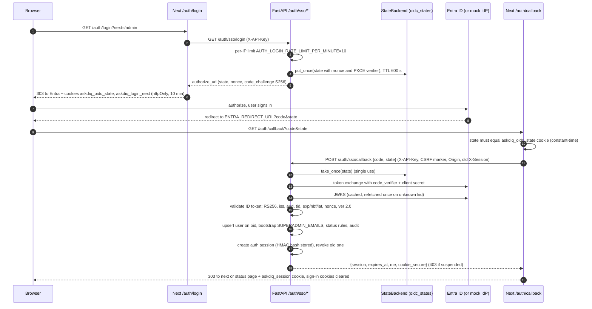
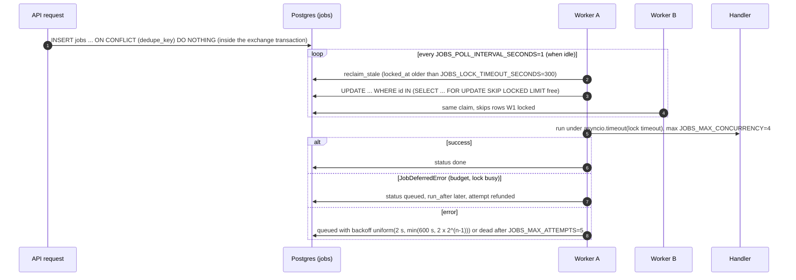
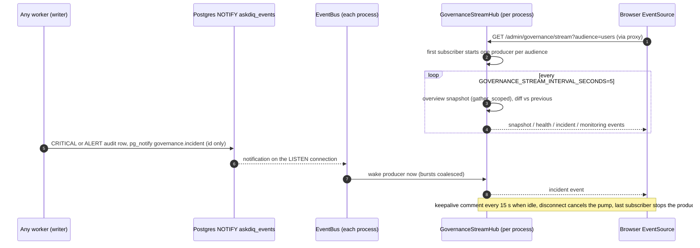
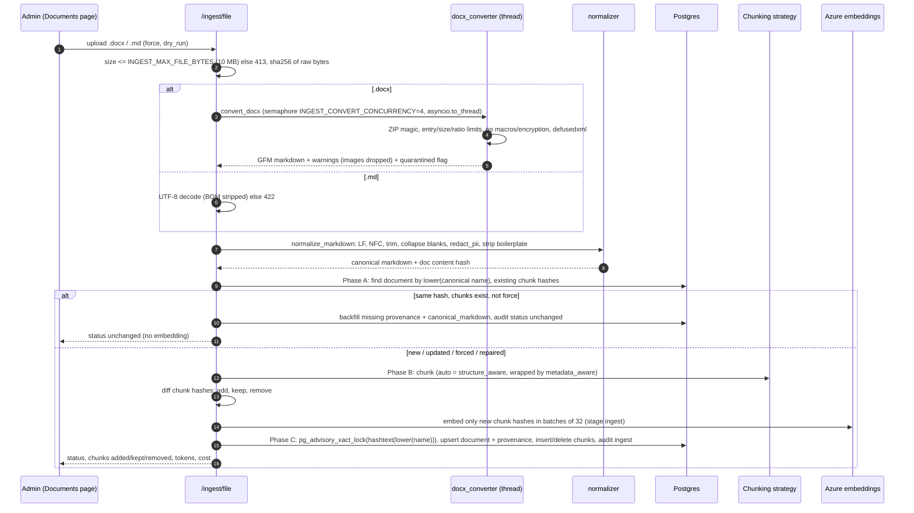

# Architecture

Scope: the runtime components of AskDIQ, how they connect, and how the main requests flow
through them (query pipeline, dashboard proxy, SSO, jobs and events, ingestion), plus the
concurrency, caching and rate-limiting design. Written from the code at `preview/view`
(`9115c45`); differences on the production line (`main` + `hotfix/query-filters-ip-ingest`)
are called out. Terms are defined in the [Overview glossary](01-overview.md#glossary).

Contents

- [1. Components](#1-components)
- [2. Context view](#2-context-view)
- [3. Container view](#3-container-view)
- [4. Request flows](#4-request-flows)
- [5. Async and concurrency design](#5-async-and-concurrency-design)
- [6. Caching](#6-caching)
- [7. Rate limiting and quotas](#7-rate-limiting-and-quotas)
- [8. Resilience and error handling](#8-resilience-and-error-handling)
- [9. Production line vs revamp line](#9-production-line-vs-revamp-line)
- [10. In-flight changes](#10-in-flight-changes)

## 1. Components

| Component | Code | Runs as | Responsibility |
|---|---|---|---|
| API | `backend/main.py`, `backend/app/api/routes/*` | uvicorn (`main:app`), `WEB_CONCURRENCY` workers per container | All HTTP routes; lifespan starts the event bus, thread pool, reranker preload, optional job worker. |
| RAG harness | `backend/app/harness/` | in the API process | Orchestrates guardrails, retrieval, LLM call, post-checks (`run_query`). |
| Retrieval | `backend/app/retrieval/` | in the API process | Azure embeddings, pgvector search, ONNX cross-encoder rerank (in threads), cross-document selection. |
| Guardrails | `backend/app/guardrails/` | in the API process | Conversational intercept, pre-checks, groundedness post-checks. |
| Ingestion | `backend/app/ingestion/`, `backend/app/chunking/` | in the API process (request) or CLI scripts | DOCX conversion, normalisation, chunking, embedding, upsert. |
| Governance | `backend/app/governance/` | in the API process | Audit log, PII, costing, audience scoping, traces, logs, monitoring, SSE hub, online eval. |
| Auth | `backend/app/auth/` | in the API process | OIDC client, sessions, RBAC dependencies, user management, mock IdP. |
| Job worker | `backend/app/jobs/` | in-process (`JOBS_WORKER_ENABLED=true`, default) or standalone `python -m app.jobs.worker` | Claims jobs from `jobs` with `SKIP LOCKED`; handlers for insights, golden runs, state cleanup. |
| Event bus | `backend/app/core/events.py` | one LISTEN connection per process | Postgres LISTEN/NOTIFY fan-out: cache invalidation, incident wake-ups. |
| Admin dashboard | `frontend/` | Next.js 14 (`node server.js`, standalone) | UI, SSO hand-off routes, BFF proxy `/api/proxy/[...path]`, CSP middleware. |
| PostgreSQL + pgvector | external | `et-platform-postgres-1` (prod), `pgvector/pgvector:pg18` (local compose) | Relational data, vectors, job queue, rate-limit buckets, OIDC state, NOTIFY. |
| Azure OpenAI | external | - | Chat completions (`AZURE_DEPLOYMENT_NAME`), embeddings (`text-embedding-3-small`). |
| Microsoft Entra ID | external | - | OIDC identity provider for the dashboard. |
| nginx | `et-platform-nginx-1` (shared) | external to this repo | TLS, security headers, reverse proxy; template `infra/scale-out/askdiq-api.conf`. |
| Website widget | website team's code | external to this repo | Public chat UI; calls `/query` server-to-server. See [Website integration](10-website-integration.md). |

Middleware order (outermost first), from the `add_middleware` calls in `backend/main.py`:
`SecurityHeadersMiddleware` -> `SSEAwareGZipMiddleware` -> `LatencyMiddleware` ->
`CORSMiddleware` -> router. Exception handlers return problem+json
(`backend/app/core/exceptions.py`).

## 2. Context view

## 3. Container view

Notes:

- Production today runs only the API container `askdiq-api` (image `askdiq-api:latest`, host
  port `127.0.0.1:5500`). The dashboard container and nginx routing for it are planned
  (branch `chore/prod-deploy-fullstack`); see
  [Deployment](08-deployment-operations.md#6-planned-full-stack-deploy-dashboard-container).
- `infra/scale-out/docker-compose.yml` describes a scaled layout (two API replicas `api-1`/`api-2` behind
  `upstream askdiq_api { least_conn; }` in `infra/scale-out/askdiq-api.conf`, plus a standalone `worker` with
  `JOBS_WORKER_ENABLED=false` on the API replicas). It is a template only; it must not be
  shipped to prod (it was the cause of the 2026-10-16 outage, see
  [Deployment](08-deployment-operations.md#121-2026-10-16-deploy-outage-crash-loop-502)).

## 4. Request flows

### 4.1 Website query flow (POST /query)

This is the production contract (`main` + `hotfix/query-filters-ip-ingest`), the one the
website team integrates against ([Website integration](10-website-integration.md)).

Revamp line (`preview/view`) differences, same handler shape
(`backend/app/api/routes/query.py`):

| Step | `preview/view` |
|---|---|
| Admission | Route dependency `llm_capacity` holds one of `LLM_MAX_CONCURRENCY=64` slots or returns 429 + `Retry-After: 2`. |
| Auth | `rate_limited_actor` -> `require_chat_actor`: needs `X-API-Key`, then either a valid SSO session in `X-Session` (actor = user's email, CSRF on writes) or, for the website (no `X-Session`, no `X-AskDIQ-Proxy` marker), actor = sanitised `X-Client-Id` (email-shaped ids map to `default@local`). |
| Rate limits | Per user and per IP, both inside `rate_limited_actor`, through the shared Postgres state backend. The IP is `get_client_ip` (X-Forwarded-For only when `TRUST_PROXY_HEADERS=true`). |
| `ip_address` in body | Honoured only when `ENV != production`. |
| Filters | Every key applied as `chunk_metadata[key] == value` (no allow-list; the hotfix allow-list is not merged). |
| Empty retrieval flag | `off_topic` (hotfix: `no_sources`). |
| LLM call | Wrapped by the circuit breaker (`get_llm_breaker().guard()`). |
| After write | Exchange write also enqueues `insights.classify` in the same transaction. |

The website widget keeps the production contract on `preview/view`: `X-API-Key` + `X-Client-Id`
on the same paths, no session (see [Website integration](10-website-integration.md)).

### 4.2 Query pipeline detail (`run_query`)

`backend/app/harness/orchestrator.py`. Every exit returns a `QueryResponse`; fallbacks use a
fixed polite answer chosen by flag.

Retrieval sizing (`backend/app/core/config.py`, `backend/app/retrieval/`):

| Setting | Default | Effect |
|---|---|---|
| `DEFAULT_TOP_K` | 5 | Final sources per answer. |
| `COMPOUND_QUERY_TOP_K` | 9 | Budget when the question was decomposed (capped at 10). |
| `RETRIEVAL_CANDIDATE_MULTIPLIER` / `RETRIEVAL_CANDIDATE_MIN` | 1 / 8 | Candidate pool = `max(k x mult, min)`. |
| `CROSS_DOC_QUOTA_MAX_DOCUMENTS` | 3 | Documents that share the slots round-robin before backfill. |
| `ENABLE_RERANKER` / `RERANKER_MODEL` | true / `Xenova/ms-marco-MiniLM-L-6-v2` | Reorders the pool only; reported scores stay cosine. Falls back to cosine order on any error. |
| `ENABLE_QUERY_DECOMPOSITION` | true | Compound detection runs on the user's own text, never on history-folded text. |
| `MAX_LLM_RETRIES` | 1 | One extra LLM attempt on error/empty; ungrounded answers are not re-sampled; open breaker stops retries. |
| `GROUNDEDNESS_THRESHOLD` | 0.45 | Answer-to-source cosine needed to pass. Source embeddings are reused from ingestion. |

Persistence after the response is built (`backend/app/core/sessions.py`
`schedule_exchange_write`, `_write_exchange`): one background task, own session, one
transaction that writes the new `chat_sessions` row (if any) + `session_created` audit, the
two `chat_messages` rows (tokens, cost, pricing snapshot in `token_details`, outcome), the
`query` audit row (PII-redacted query, source ids and scores, cost), and the
`insights.classify` job (SAVEPOINT; a failure never loses the exchange). Message ids are
generated before the write so the response does not wait for the database. Latency and stage
timings are written separately by `LatencyMiddleware` via `spawn()`.

Stage tokens: `embedding_tokens_sink` (a ContextVar) collects `(stage, tokens)` from every
embedding call in the request; `query` and `guardrail` stages are summed separately and fed
to `compute_exchange_cost` with the LLM prompt/completion/reasoning/cached tokens.

### 4.3 Dashboard request through the BFF proxy

The browser never calls FastAPI directly and never sees the service key or the session id.

CSRF for state-changing methods (POST/PUT/PATCH/DELETE): the proxy adds
`X-Requested-With: askdiq` and forwards the browser's own `Origin`; `enforce_csrf` rejects
(403) unless the marker is present and `Origin` equals `APP_BASE_URL`'s origin. Cookies are
`httpOnly`, `SameSite=Lax`, `Secure` when `SESSION_COOKIE_SECURE=true`. Details in
[Security](07-security.md).

### 4.4 SSO sign-in (OIDC authorization code + PKCE)

Frontend routes `frontend/app/auth/login/route.ts`, `frontend/app/auth/callback/route.ts`
(aliases `/auth/callback/[provider]` and `/api/auth/callback/[provider]`); backend
`backend/app/api/routes/auth.py`, `backend/app/auth/oidc.py`, `service.py`, `sessions.py`.

The callback endpoint returns the raw session id, so the BFF proxy blocks
`auth/sso/callback`; only the server-side callback handler may call it. With
`AUTH_DEV_MOCK=true` (development only) the same code path talks to the mock IdP mounted at
`/mock-idp/{tenant}/...` (`backend/app/auth/mock_idp.py`), which mirrors Entra v2.0
discovery, authorize, token and JWKS endpoints.

Session lifetime: absolute `SESSION_TTL_MINUTES=480`, idle `SESSION_IDLE_MINUTES=60`,
`last_seen_at` written at most every `SESSION_TOUCH_INTERVAL_SECONDS=60`. The user row is
loaded on every request, so role or status changes apply immediately.

### 4.5 Job queue, event bus and SSE

Revamp line only. Queue `backend/app/jobs/`, events `backend/app/core/events.py`, SSE
`backend/app/core/sse.py`, hub `backend/app/governance/stream.py`. Tables: [Database](05-database.md#jobs-and-shared-state).

Registered job types:

| Type | Enqueued by | Handler |
|---|---|---|
| `insights.classify` | every exchange write (transactional, dedupe `insights.classify:<message_id>`) | `backend/app/insights/jobs.py` |
| `insights.rollup` | itself, hourly | same |
| `insights.backfill` | `scripts/backfill_turn_insights.py` | same |
| `eval.golden_run` | `POST .../golden/{case_id}/run` (dedupe per case) | `backend/app/feedback/jobs.py` |
| `state.cleanup` | the worker every `STATE_CLEANUP_INTERVAL_SECONDS=60` | `backend/app/jobs/handlers.py` (expired rate buckets, OIDC states, `done` jobs older than `JOBS_RETENTION_DAYS=7`) |

The worker polls; it does not LISTEN for new jobs. On shutdown it stops claiming and drains
in-flight jobs for `JOBS_SHUTDOWN_TIMEOUT_SECONDS=30`; anything left is reclaimed later by
lock expiry.

Event bus and live governance stream:

- Payloads carry ids only (Postgres NOTIFY limit ~8 KB; guarded at 7900 bytes).
- Topic `cache.invalidate` drops local caches on every other process: id `branding`
  (branding cache), `audience` (audience/test-IP cache), or an aggregation-cache prefix.
- The listener reconnects with exponential backoff up to `EVENTS_RECONNECT_MAX_SECONDS=30`.
- DB load of the stream is O(audiences x processes), not O(clients). Slow clients lose their
  oldest queued event rather than blocking the producer.
- nginx disables buffering for paths ending in `stream` or `events` and allows 1 h reads
  (`infra/scale-out/askdiq-api.conf`); `SSEAwareGZipMiddleware` never compresses `text/event-stream`.

### 4.6 Ingestion pipeline

`POST /ingest/file` (multipart) or `POST /ingest` (JSON); permission `documents:write`.
Route `backend/app/api/routes/ingest.py`, service `backend/app/ingestion/service.py`.

- Statuses: `new`, `updated` (incremental by chunk hash), `forced` (all chunks replaced),
  `repaired` (document row with no chunks), `unchanged`. `dry_run=true` returns the plan and
  an estimated embedding cost without writing.
- Provenance stored in `documents.doc_metadata`: canonical format, converter
  (`mammoth+gfm` / `markdown-normalizer`), original/canonical sizes, chunking strategy,
  embedding model and dimension, `DOC_HASH_VERSION=v1`, `PIPELINE_VERSION=v3`, PII types.
  An unchanged re-upload fills only fields that were never recorded (stored values win;
  origin format is kept, e.g. a `.md` re-upload of a `.docx`-born document stays `docx`).
- The DOCX converter quarantines documents whose text matches the prompt-injection patterns
  (`UNSAFE_PATTERNS`).
- Observation: the service docstring says Phase B holds no DB connection, but there is no
  commit between Phase A's reads and Phase B, so the request session keeps its pooled
  connection checked out during chunking and embedding.
- CLI path: `backend/scripts/ingest_real_docs.py` ingests `backend/data/real_docs/*.md` with
  the same `ingest_text` (the hotfix ships these files in the image).

## 5. Async and concurrency design

| Mechanism | Where | Detail |
|---|---|---|
| Async everywhere | all routes, SQLAlchemy `AsyncSession` + asyncpg, `AsyncAzureOpenAI`, httpx | `tests/test_async_only.py` and `tests/loop_guard.py` (`LoopBlockingDetector`) guard against blocking calls on the event loop. |
| Thread pool for CPU work | `backend/app/core/concurrency.py` `configure_thread_pool` | Lifespan replaces the loop's default executor with `THREAD_POOL_WORKERS=100` threads (`askdiq-*`). Used by `asyncio.to_thread`: rerank, DOCX conversion, reranker preload. |
| Rerank concurrency | `backend/app/retrieval/reranker.py` | `threading.BoundedSemaphore(RERANK_MAX_CONCURRENCY=4)` around ONNX inference; model loaded once under a lock and preloaded at startup. `RERANK_BATCH_SIZE=1`. |
| LLM admission gate | `LLMGate` / `llm_capacity` | Non-blocking cap `LLM_MAX_CONCURRENCY=64` per process; 429 + `Retry-After` when full. |
| Connection release | `query.py`, `vector_store.py`, `auth/deps.py` | Commit right after the short reads so the pooled connection is free during embed/rerank/LLM (`expire_on_commit=False` keeps rows usable). |
| Parallel aggregates | `gather_scoped` / `ScopedRunner` | Each task gets its own short-lived session (an `AsyncSession` is not concurrency-safe), bounded by `AGG_MAX_CONCURRENCY=4`; `TaskGroup` semantics, first error re-raised. |
| Single flight | `SingleFlight` | Identical concurrent computations share one execution (branding load, cache misses). |
| Supervised tasks | `backend/app/core/tasks.py` `spawn` / `drain` | Strong references, failures logged (PII-masked), drained up to `TASK_DRAIN_TIMEOUT_SECONDS=10` at shutdown. Used for latency persistence, audit flush, incident NOTIFY. |
| Exchange writes | `schedule_exchange_write` | `asyncio.create_task` tracked per user (`drain_pending_writes`) and per message (online eval waits for the write via `after=`). |
| Online eval | `backend/app/governance/online_eval.py` | Sampled, `ONLINE_EVAL_MAX_CONCURRENCY=4`, skipped when TPM headroom is low. |
| Dashboard read bounds | `read_only_session` in `database.py` | `SET LOCAL statement_timeout = DASHBOARD_STATEMENT_TIMEOUT_MS (5000)`; a cancelled statement becomes 503 + `Retry-After: 5`. |
| DB pool | `backend/app/core/database.py` | `DB_POOL_SIZE=20`, `DB_MAX_OVERFLOW=10` per process, `pool_pre_ping=true`, `pool_recycle=1800` s. Sizing rule: replicas x workers x (pool + overflow) <= Postgres `max_connections` - 20 (`docker-compose.prod.yml` overrides 10 + 5 per API process, worker 5 + 5). |
| Multi-worker safety | `Dockerfile.prod` | `--workers ${WEB_CONCURRENCY:-1}`; rate limits, OIDC state, job queue and event fan-out are shared through Postgres, so workers and replicas need no sticky sessions. |
| 50+ concurrency gate | `backend/tests/test_concurrency_50.py` (`perf` marker, CI Postgres) | 60 simultaneous requests (30 `/query` with a 1 s fake LLM, 20 dashboard GETs, 10 feedback POSTs) must all succeed in under 3 s wall time. |
| Load scripts | `backend/scripts/run_concurrency_test.py`, `run_admin_load_test.py` | Manual load tests. |

Replicas and load balancing: `infra/scale-out/askdiq-api.conf` defines `upstream askdiq_api` with `least_conn`,
`max_fails=3 fail_timeout=10s`, keepalive 32, and `proxy_next_upstream error timeout
http_502 http_503` (non-idempotent requests are never retried once sent). Production
currently runs one container; see [Deployment](08-deployment-operations.md#11-scaling-workers-and-pool-sizing).

## 6. Caching

| Layer | Where | Behaviour |
|---|---|---|
| HTTP conditional GET | `backend/app/core/http_cache.py` `cached_response` | Weak ETag (sha256 of the JSON body, 32 hex); `If-None-Match` match returns 304. `Cache-Control: private, max-age=HTTP_CACHE_MAX_AGE_SECONDS (0: always revalidate, 304 when unchanged)` + `Vary: X-API-Key, X-Client-Id` for admin data; `public` only for `GET /branding` (`BRANDING_HTTP_MAX_AGE_SECONDS=300`). The proxy forwards `If-None-Match` and passes `etag`/`cache-control`/`vary` back. |
| TTL cache | `backend/app/core/cache.py` `TTLCache` | In-process, monotonic expiry, bounded size, `get_or_compute` with single flight. Instances: branding (`BRANDING_CACHE_TTL_SECONDS=60`) and `aggregation_cache` (15 s; on `preview/view` only its prefix invalidation is wired, `perf/dashboard-load-speed` starts using it for usage cards). |
| Usage summary cache | `backend/app/api/routes/admin_usage.py` | Per (audience, range) dict cache, `USAGE_SUMMARY_CACHE_TTL_SECONDS=15`, global lock on `preview/view` (per-key single flight on the perf branch); badge counts cached the same way. |
| Audience classification | `backend/app/governance/audience.py` | `AUDIENCE_CACHE_TTL_SECONDS=30`, single flight; invalidated across workers by `cache.invalidate/audience`. |
| OIDC metadata / JWKS | `backend/app/auth/oidc.py` | `OIDC_METADATA_CACHE_SECONDS=3600`; JWKS refetched once on an unknown `kid`. |
| Small pure caches | `lru_cache` | `needs_conversation_context` (1024), reranker model, LLM breaker, permissions. |
| Compression | `backend/app/core/compression.py` | GZip for responses >= `GZIP_MINIMUM_SIZE=1024` bytes when the client accepts it; SSE passed through uncompressed. |
| Frontend query cache | `frontend/lib/query-cache.ts` | One in-flight promise per key, stale-while-revalidate (`DEFAULT_STALE_TIME_MS=30000`), abort on unmount, revalidate on focus/visibility, `invalidate(prefix)`, intent prefetch after 120 ms dwell, idle prefetch of the next page, optimistic mutations with rollback and 409 handling. |
| Frontend polling | `frontend/lib/use-visibility-polling.ts` | Polls only while the tab is visible; immediate run on return. |
| Branding in Next | `frontend/lib/brand-server.ts` | `BRANDING_REVALIDATE_SECONDS=300`, `BRANDING_TIMEOUT_MS=2500`, defaults on failure (ISR on `preview/view`; in-process cache on the timeouts branch, see section 10). |

Cross-worker consistency: writers invalidate their own cache and publish
`cache.invalidate`; other processes drop their copy on the NOTIFY (section 4.5). Without the
bus (tests, scripts) caches simply expire by TTL.

## 7. Rate limiting and quotas

Limits are sliding windows of 60 s, enforced per key and returned as 429 with `Retry-After`
and a problem+json body. Rejections by the `/query`, feedback and admin-analytics limiters emit a `rate_limited` audit event.

| Scope | Limit | Key | Code |
|---|---|---|---|
| `/query` per user | `RATE_LIMIT_PER_MINUTE=10` | actor (email; prod: client id). `RATE_LIMIT_EXEMPT_ACTORS` bypass (load tests). | `rate_limited_actor` |
| `/query` per IP | `RATE_LIMIT_PER_MINUTE_PER_IP=30` | client IP (prod hotfix: forwarded end-user IP) | same / hotfix route |
| Feedback | 30/min per actor and per IP | | `aenforce_feedback_rate_limit` |
| Heavy admin analytics / exports | 60/min per actor and per IP | | `rate_limited_admin_analytics` |
| SSO login + callback | `AUTH_LOGIN_RATE_LIMIT_PER_MINUTE=10` per IP | `rl:auth-login:<ip>` | `login_rate_limit` |
| LLM concurrency | `LLM_MAX_CONCURRENCY=64` in flight per process | - | `llm_capacity` |

State backend (`backend/app/core/state.py`, `STATE_BACKEND=auto`):

| Backend | When | How |
|---|---|---|
| `PostgresState` | default outside `ENV=test` | UNLOGGED table `rate_limit_buckets (key, window_start, count)`; the window is approximated by 6 fixed 10 s sub-windows; one autocommit upsert + sum per check (~1 ms). Keys are SHA-256 hashed (no raw emails/IPs stored). Also holds single-use OIDC state in `oidc_states`. |
| `MemoryState` | `ENV=test` or `STATE_BACKEND=memory` | Exact in-process sliding window. |

Production line: the in-memory limiter only (no `state.py`), so limits are per uvicorn
process.

Quotas and budgets (not request limits):

| Item | Setting | Effect |
|---|---|---|
| Azure TPM/RPM telemetry | `AZURE_OPENAI_TPM_LIMIT`, `AZURE_OPENAI_RPM_LIMIT`, embedding equivalents | `quota_monitor` (`backend/app/core/quota.py`) tracks rolling 60 s usage, Azure `x-ratelimit-remaining-*` headers, 429s and retries; feeds governance health (`GOVERNANCE_HEALTH_QUOTA_*_PCT`) and online-eval skipping. Process-local. |
| Insights LLM spend | `INSIGHTS_DAILY_TOKEN_BUDGET=200000` per local day (`INSIGHTS_TIMEZONE`) | Over budget, classify jobs are deferred to the next day. |
| Monthly cost | `MONTHLY_COST_BUDGET_USD` (optional) | Forecast vs budget on the dashboard and usage pages; no enforcement. |
| Pricing | `PRICE_EMBED_PER_MILLION=0.02`, `PRICE_PROMPT_PER_MILLION=0.25`, `PRICE_OUTPUT_PER_MILLION=2.00`, `PRICE_CACHED_PER_MILLION=0.125` | `compute_exchange_cost` (Decimal math); rates snapshotted on each message. |

Client IP: `get_client_ip` uses the left-most `X-Forwarded-For` hop only when
`TRUST_PROXY_HEADERS=true`, else the TCP peer. Startup logs a warning if `ENV=production` and
it is false. Note: `infra/scale-out/askdiq-api.conf` sets `X-Forwarded-For $remote_addr` (overwrites, does not
append), so behind nginx the forwarded value is the nginx client.

## 8. Resilience and error handling

| Concern | Mechanism |
|---|---|
| LLM outage | Circuit breaker `azure_openai_chat`: opens after `LLM_BREAKER_FAILURE_THRESHOLD=5` transient failures (timeouts, connection errors, 429, 5xx) within `LLM_BREAKER_WINDOW_SECONDS=60`; fails fast for `LLM_BREAKER_RESET_SECONDS=30`; one half-open probe. A 400 counts as success (dependency reachable). Open breaker -> outcome `llm_failed`, no retry. |
| Outbound timeouts | `OUTBOUND_TIMEOUT_SECONDS=30` and `AZURE_OPENAI_MAX_RETRIES=2` on the OpenAI clients; `OIDC_HTTP_TIMEOUT_SECONDS=10`. |
| Reranker unavailable | Falls back to cosine order; never fails the request. |
| Groundedness embedding fails | Treated as not grounded (`groundedness_check_failed`). |
| Startup | `init_db` ensures the `vector` extension; one embedding + one LLM call are logged as a health check (never blocks); reranker preloaded. |
| Shutdown | Governance SSE producers closed, event bus and worker stopped, supervised tasks drained (bounded). uvicorn drains in-flight requests on SIGTERM. |
| Errors | All errors are problem+json with `request_id`; no stack traces; 5xx recorded as audit rows (`record_server_error`). |
| Health | `GET /health`: DB `SELECT 1`, reranker loaded or `lazy_load`; Docker `HEALTHCHECK` curls it. |

## 9. Production line vs revamp line

| Area | Production (`main` + hotfix) | Revamp (`preview/view`) |
|---|---|---|
| `backend/app` packages | `api chunking core db evaluation governance guardrails harness ingestion models retrieval schemas` | adds `auth branding dashboard documents entities feedback insights jobs` |
| `backend/app/core` | no `circuit`, `events`, `sse`, `state`, `tasks`, `http_cache`, `compression`, `exceptions`, `security_headers` | all present |
| `/query` auth | `X-API-Key` + `X-Client-Id` (`app/governance/auth.py` `get_current_actor`) | `X-API-Key` + SSO session, or `X-API-Key` + `X-Client-Id` (`require_chat_actor`) |
| Filters | allow-listed (`RETRIEVAL_FILTER_KEYS`) | unfiltered keys applied |
| Body `ip_address` | used when valid and `ALLOW_CLIENT_IP_OVERRIDE` (config default true; `.env.example` false; prod value Unverified) | used only outside production |
| DB pool | `pool_pre_ping=False`, recycle 1800 | pre-ping on, configurable |
| Dashboard | not deployed | Next.js app (deploy planned) |

## 10. In-flight changes

Each item is described from its diff against `preview/view`. Current status of all work:
[plan](../plan.md).

### Proxy timeouts, retries and connection leak fixes

**In progress (branch `fix/chat-page-fetch-timeouts`)**, uncommitted in
`C:\Projects\askdiq-wt\fix-chat-timeouts`. Root cause recorded in the new
`backend/tests/test_connection_release.py`: pooled connections leaked ("garbage collector is
trying to clean up non-checked-in connection"), the pool was exhausted, backend calls hung,
and frontend fetches failed with `HeadersTimeoutError`.

| Change | Files |
|---|---|
| `GET /branding` single-flight load opens its own session (a cancelled caller used to close the session under the shared load and strand its connection); bounded by `BRANDING_LOAD_TIMEOUT_SECONDS=5`, defaults served on timeout | `backend/app/branding/service.py`, `routes/branding.py` |
| `release_connection(db)` before fan-out to `gather_scoped` so a request never holds one pool slot while waiting for more (dashboard, monitoring, feedback analytics, conversation stats, health) | `backend/app/core/database.py`, `routes/admin.py`, `admin_governance.py`, `admin_feedback.py`, `entities/conversations.py`, `routes/health.py` |
| Process-wide fan-out cap: `pool_size + max_overflow - AGG_POOL_RESERVE (5)` slots for parallel aggregation, so sign-in, `/health` and plain reads always find a connection | `backend/app/core/concurrency.py` `fanout_slots` |
| `pool_timeout = DB_POOL_TIMEOUT_SECONDS=120` (bursts queue rather than fail); `/health` reports `pool` (`size`, `max_overflow`, `checked_out`, `idle`) | `database.py`, `health.py` |
| SSE producer snapshot bounded by `GOVERNANCE_STREAM_SNAPSHOT_TIMEOUT_SECONDS=60`; on timeout it logs and retries next tick | `backend/app/governance/stream.py` |
| Proxy: wait for backend response headers at most `BACKEND_TIMEOUT_MS=60000` (reads) / `BACKEND_WRITE_TIMEOUT_MS=180000` (writes), then 504; streams never cut once headers arrive; browser abort propagates upstream | `frontend/app/api/proxy/[...path]/route.ts`, `frontend/lib/server/backend.ts` |
| Proxy: retry idempotent calls (GET/HEAD/OPTIONS and logout) after connection errors or 502/503/504, `BACKEND_RETRIES=2` (max 5), jittered backoff 250-500 ms, 500-1000 ms; timeouts not retried | same |
| Query cache: failed keys back off 1 s, 2 s, 4 s ... 60 s before mount/focus/stale checks refetch (stops polling loops hammering a failing backend); explicit refetch still allowed | `frontend/lib/query-cache.ts` |
| Branding in the root layout: in-process cache with single-flight bounded refresh instead of Next ISR (whose background refresh held page responses open until undici's 300 s timeout) | `frontend/lib/brand-server.ts`, `frontend/app/layout.tsx` |
| `global-error.tsx`: last-resort boundary for root-layout failures (no providers, plain link home) | `frontend/app/global-error.tsx` |

### Dashboard load speed

**In progress (branch `perf/dashboard-load-speed`)**, 2 commits (`3bf8142`, `2e6bd62`).

| Change | Effect (author's local measurements) |
|---|---|
| Migration `b2d6e08d82b3`: partial index `ix_chat_messages_user_created_desc` on `chat_messages (created_at DESC NULLS LAST) WHERE role = 'user'`, built `CONCURRENTLY` (down revision `254857d10a20`) | usage queries page 3.9 s -> 58 ms |
| `usage/summary`: json operators for `cached_tokens`, six aggregates in parallel via `ScopedRunner.gather`, per-key single flight instead of a global lock | 6.8 s -> 0.9 s |
| `governance/logs` level chips computed once per row; `traces/page` unfiltered total skips lateral joins | 3.4 s -> 1.3 s; 1.4 s -> 0.1 s |
| `usage/embedding`, `usage/reranker` aggregate in SQL; `usage/llm` cached via `aggregation_cache` (15 s, single flight) | - |
| Root layout preloads `/auth/me` server-side (`frontend/lib/server/session-me.ts`, `ME_PRELOAD_TIMEOUT_MS=1500`) and hands it to `AuthProvider`, so the first HTML has the shell | removes a client round trip |
| Usage summary moved onto the shared query cache (15 s stale time); KPI hover prefetch writes the target page's cache entry; governance tabs and evaluation charts split with `next/dynamic` | - |

### Production hotfix (live)

**In progress (branch `hotfix/query-filters-ip-ingest`)**, deployed to production on top of
`main`, not merged into `preview/view`.

- `resolve_client_ip`: a valid IPv4/IPv6 `ip_address` in the body of `/query`,
  `POST /sessions` and feedback is used as the end-user IP when `ALLOW_CLIENT_IP_OVERRIDE`
  is true; otherwise the detected IP.
- Per-IP rate limit moved from the auth dependency into the `/query` route so it applies to
  that end-user IP (the website server's own IP would otherwise share one bucket).
- `usable_filters`: only `RETRIEVAL_FILTER_KEYS` (`source_type`, `corpus`,
  `ingestion_source`) with scalar values are applied; others are logged and ignored (fixes
  Swagger's `{"additionalProp1": {}}` emptying every answer).
- Empty retrieval returns flag `no_sources` (same polite answer as `off_topic`).
- `backend/.dockerignore` keeps `data/real_docs/*.md` in the image so container ingestion works.

### Dashboard chat drawer

**In progress (branch `feat/askdiq-chat-widget`)**: a floating AskDIQ mascot launcher
(bottom-right of every dashboard page, hidden on `/chat`, Ctrl/Cmd+/ toggles) opens a
right-side drawer that reuses the `/chat` conversation (`ChatConversation` + `useChat`):
suggested prompts, sources, feedback, retry, recent chats, "Open full chat". The drawer is
lazy-loaded and non-modal from 640 px, a full-screen modal with a focus trap below that. No
backend change; it calls `/query` through the same proxy (SSO session required). This is
the internal dashboard widget, not the public website widget.
