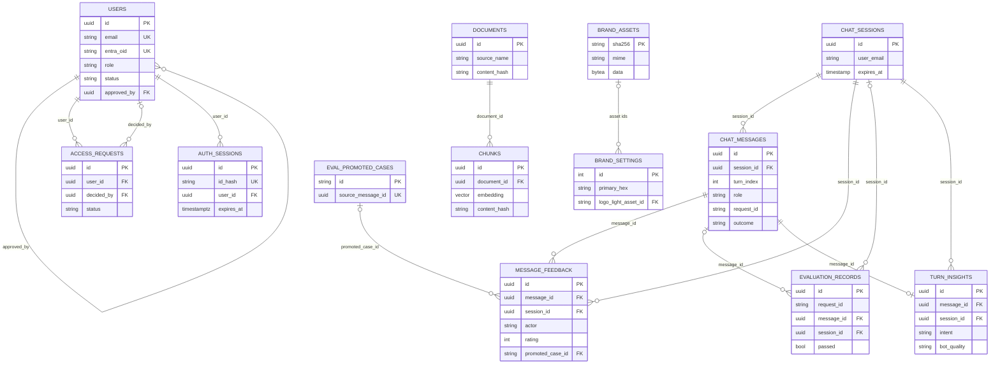

# Database

Scope: the single PostgreSQL database (with the pgvector extension) behind the AskDIQ backend. It covers
every table, column, constraint, index, trigger and relationship, the async engine and session setup,
the Alembic migration chain (code head vs prod head), schema changes still on branches, and the
maintenance scripts that write to these tables. Source of truth: `backend/app/models/db_models.py`,
`backend/alembic/versions/*.py` and `backend/app/core/database.py` on `preview/view` (9115c45).

## Contents

- [Overview](#overview)
- [Engine and sessions](#engine-and-sessions)
- [pgvector](#pgvector)
- [Entity-relationship diagram](#entity-relationship-diagram)
- [Conventions](#conventions)
- [Content and RAG](#content-and-rag)
- [Chat](#chat)
- [Audit and governance](#audit-and-governance)
- [Auth and RBAC](#auth-and-rbac)
- [Feedback](#feedback)
- [Evaluation](#evaluation)
- [Insights](#insights)
- [Branding](#branding)
- [Jobs and shared state](#jobs-and-shared-state)
- [Model and migration drift](#model-and-migration-drift)
- [Migration history](#migration-history)
- [Prod migration status](#prod-migration-status)
- [In-flight schema and DB changes](#in-flight-schema-and-db-changes)
- [Data maintenance scripts](#data-maintenance-scripts)

## Overview

| Item | Value |
|---|---|
| Engine | PostgreSQL, one database for relational data and embeddings (no separate vector store) |
| Extension | `vector` (pgvector), created by migration `99cb28f36610` |
| App driver | `asyncpg` (`DATABASE_URL=postgresql+asyncpg://...`) |
| Alembic driver | Sync URL derived in `backend/alembic/env.py` by replacing `postgresql+asyncpg://` with `postgresql://` |
| ORM | SQLAlchemy 2.x declarative (`Base` in `backend/app/core/database.py`) |
| Tables | 22 (19 ORM models + `jobs`, `rate_limit_buckets`, `oidc_states` via raw SQL) |
| Code head | `254857d10a20` |
| Prod head | `d6e7f8a9b0c1` (9 migrations behind, see [Prod migration status](#prod-migration-status)) |
| Prod DB | host `et-platform-postgres-1:5432`, database `askdiq` (see [Deployment](08-deployment-operations.md)) |

`alembic/env.py` uses `target_metadata = Base.metadata` with `compare_type=True`, so autogenerate sees
only ORM tables; `jobs`, `rate_limit_buckets` and `oidc_states` are migration-only.

## Engine and sessions

Defined in `backend/app/core/database.py`; settings in `backend/app/core/config.py`
(see [Configuration](06-configuration.md)).

| Setting | Env var | Default | Purpose |
|---|---|---|---|
| `pool_size` | `DB_POOL_SIZE` | `20` | Persistent pooled connections per process |
| `max_overflow` | `DB_MAX_OVERFLOW` | `10` | Extra burst connections per process |
| `pool_pre_ping` | `DB_POOL_PRE_PING` | `true` | Validate on checkout (stale sockets) |
| `pool_recycle` | `DB_POOL_RECYCLE_SECONDS` | `1800` | Recycle connections after 30 min |
| `echo` | `DB_ECHO` | `false` | SQL logging (would log 1536-float vectors) |
| statement timeout | `DASHBOARD_STATEMENT_TIMEOUT_MS` | `5000` | Used by `read_only_session` |
| fan-out limit | `AGG_MAX_CONCURRENCY` | `4` | Default `gather_scoped` parallelism |

| Object | Kind | Behaviour |
|---|---|---|
| `engine` | `create_async_engine` | Module-level, one pool per process (API and job worker each have their own) |
| `AsyncSessionLocal` | `async_sessionmaker` | `expire_on_commit=False` |
| `get_db()` | FastAPI dependency | One session per request |
| `read_only_session()` | FastAPI dependency | Runs `SET LOCAL statement_timeout = <DASHBOARD_STATEMENT_TIMEOUT_MS>`; a cancelled query (SQLSTATE `57014`) becomes `503` with `Retry-After: 5` and detail "The query took too long. Please retry or narrow the range." |
| `get_session_factory()` | FastAPI dependency | Returns `AsyncSessionLocal`; tests override it to route `gather_scoped` through their transaction |
| `is_statement_timeout(exc)` | helper | True for `DBAPIError` with SQLSTATE `57014` |
| `init_db()` | helper | `CREATE EXTENSION IF NOT EXISTS vector`; not called by the app on `preview/view` (the migration creates the extension) |

`gather_scoped(*factories, limit=None, session_factory=None)` (`backend/app/core/concurrency.py`) runs
dashboard aggregation coroutines in parallel, each with its own short-lived session (an `AsyncSession`
is not concurrency-safe), bounded by an `asyncio.Semaphore(AGG_MAX_CONCURRENCY)` inside an
`asyncio.TaskGroup`; results keep input order and the first error is re-raised. Used by
`app/dashboard/queries.py`, `app/governance/overview.py`, `app/governance/timeseries.py`,
`app/feedback/analytics.py`, `app/entities/visitors.py`, `app/api/routes/insights.py` and
`app/api/routes/admin_entities.py`. Worst-case connections per process: `DB_POOL_SIZE + DB_MAX_OVERFLOW`
= 30; with N API replicas plus the worker, keep the total under Postgres `max_connections`.

## pgvector

- The `vector` extension must be installable on the server (pgvector package present). Migration
  `99cb28f36610` runs `CREATE EXTENSION IF NOT EXISTS vector`, which needs a role allowed to create
  extensions on a fresh database. Unverified: whether the prod role `askdiq` has that privilege (the
  extension already exists in prod since the chain is applied up to `d6e7f8a9b0c1`).
- `chunks.embedding` is `vector(1536)` (set by `f9462f0a85c6`, originally `vector(768)`).
- The ORM declares `Vector(settings.embedding_dim)`; `EMBEDDING_DIM` defaults to `1536` and must match
  the column and the embedding model (`EMBEDDING_MODEL`, e.g. `text-embedding-3-small`). Changing it
  needs a new migration that alters the column and a full re-embed.
- No ANN index (HNSW or ivfflat) exists. Retrieval (`backend/app/retrieval/vector_store.py`) orders by
  `Chunk.embedding.cosine_distance(query)` with `LIMIT candidate_k`, i.e. an exact scan over `chunks`.
  Fine at the current corpus size; add an HNSW index with `vector_cosine_ops` if the corpus grows large.

## Entity-relationship diagram

Key columns only. Tables with no foreign keys (`latency_metrics`, `audit_log`, `test_ip_configs`,
`insight_taxonomy`, `insight_daily_rollup`, `insight_llm_usage`, `jobs`, `rate_limit_buckets`,
`oidc_states`) are omitted; `audit_log`, `latency_metrics` and `evaluation_records` join to
`chat_messages` logically on `request_id` (no FK).



## Conventions

- Nullability: `Mapped[T]` is `NOT NULL`, `Mapped[T | None]` is nullable (matches the migrations).
- Defaults: "py" = Python-side ORM default (not in the DB; raw SQL inserts must supply the value);
  "db" = `server_default` in the DB.
- Timestamps: older tables use naive `timestamp` holding UTC (`datetime.utcnow`); newer tables
  (auth, insights, branding, jobs, shared state) use `timestamptz`.
- `JSON` = Postgres `json`; `JSONB` = `jsonb`.
- `uuid` PKs default to `uuid.uuid4()` (py) unless noted; `turn_insights`, `insight_llm_usage` and
  `jobs` also have `gen_random_uuid()` (db) from their migrations.

## Content and RAG

### documents

Model `Document`. One row per knowledge-base source file.

| Column | Type | Null | Default | Notes |
|---|---|---|---|---|
| `id` | uuid | no | py uuid4 | PK |
| `source_name` | varchar(512) | no | | Unique case-insensitively (index below) |
| `source_type` | varchar(64) | no | | `pdf`, `markdown`, `html`, ... |
| `created_at` | timestamp | no | py utcnow | |
| `updated_at` | timestamp | yes (DB) | py utcnow, onupdate; db `now()` | Added by `e5f6a7b8c9d0` as nullable with `DEFAULT now()` |
| `content_hash` | varchar(64) | yes | | Document hash for incremental ingestion (`a1b2c3d4e5f6`) |
| `doc_metadata` | json | no | py `{}` | Provenance etc. |
| `canonical_markdown` | text | yes | | Normalised Markdown of the upload; `deferred=True` (not loaded by list queries); NULL for docs ingested before `254857d10a20` |

Indexes: `uq_documents_source_name_lower` UNIQUE on `lower(source_name)` (migration-only, `e5f6a7b8c9d0`).
Relationship: `chunks` (ORM `cascade="all, delete-orphan"`).

### chunks

Model `Chunk`. Embedded text chunks used for retrieval.

| Column | Type | Null | Default | Notes |
|---|---|---|---|---|
| `id` | uuid | no | py uuid4 | PK |
| `document_id` | uuid | no | | FK `documents.id`, no `ondelete` (deletes cascade via the ORM only) |
| `content` | text | no | | |
| `embedding` | vector(1536) | no | | `Vector(EMBEDDING_DIM)` |
| `strategy` | varchar(64) | no | | Chunking strategy name |
| `chunk_index` | integer | no | | |
| `chunk_metadata` | json | no | py `{}` | section, page, parent_id, ...; retrieval filters match `chunk_metadata[key]` |
| `content_hash` | varchar(64) | yes | | `sha256(PIPELINE_VERSION || content)`; backfilled by `a1b2c3d4e5f6` |

Indexes: `ix_chunks_document_hash` (`document_id`, `content_hash`). No vector index (see [pgvector](#pgvector)).

## Chat

### chat_sessions

Model `ChatSession`. One conversation thread; `expires_at` is refreshed on every message
(`app/core/sessions`); an expired session is replaced transparently on the next query.

| Column | Type | Null | Default | Notes |
|---|---|---|---|---|
| `id` | uuid | no | py uuid4 | PK |
| `user_email` | varchar(320) | no | | Owner identity (end-user/visitor email) |
| `title` | varchar(256) | no | py `'New chat'` | |
| `created_at` | timestamp | no | py utcnow | |
| `last_activity_at` | timestamp | no | py utcnow | |
| `expires_at` | timestamp | no | | |
| `created_ip` | varchar(64) | yes | | IP that created the session |

Indexes: `ix_chat_sessions_user_email`, `ix_chat_sessions_created_ip`.
Relationship: `messages` ordered by `created_at`, ORM cascade delete-orphan.

### chat_messages

Model `ChatMessageRecord`. One row per user or assistant message; a user+assistant pair shares `turn_index`.

| Column | Type | Null | Default | Notes |
|---|---|---|---|---|
| `id` | uuid | no | py uuid4 | PK |
| `session_id` | uuid | no | | FK `chat_sessions.id` ON DELETE CASCADE |
| `turn_index` | integer | no | | Shared by the pair, so a turn deletes atomically |
| `role` | varchar(16) | no | | `user` / `assistant` |
| `content` | text | no | | |
| `created_at` | timestamp | no | py utcnow | |
| `request_id` | varchar(64) | yes | | Joins to `audit_log`, `latency_metrics`, `evaluation_records` |
| `grounded` | boolean | yes | | |
| `guardrail_flags` | json | yes | | |
| `ip_address` | varchar(64) | yes | | Sender IP |
| `outcome` | varchar(24) | yes | | Turn outcome |
| `prompt_tokens` / `completion_tokens` / `total_tokens` | integer | yes | | Actual Azure OpenAI `usage`; assistant rows only |
| `reasoning_tokens` / `embedding_tokens` / `guardrail_tokens` | integer | yes | | Stage accounting (`b2c3d4e5f6a8`) |
| `cost_usd` | float | yes | | |
| `token_details` | json | yes | | Per-stage breakdown |

Indexes: `ix_chat_messages_session_id`, `ix_chat_messages_outcome`,
`ix_chat_messages_session_turn` (`session_id`, `turn_index`), `ix_chat_messages_created_at`,
`ix_chat_messages_ip_created` (`ip_address`, `created_at`), `ix_chat_messages_request_role`
(`request_id`, `role`; built `CONCURRENTLY` by `72125f44984d`).
Extended statistics: `stx_chat_messages_session_turn` (ndistinct on `session_id, turn_index`,
`bd75f2033c21`) to fix row estimates for per-turn grouping.

## Audit and governance

### audit_log

Model `AuditLog`. Append-only event log (queries, ingests, guardrail blocks, admin actions).

| Column | Type | Null | Default | Notes |
|---|---|---|---|---|
| `id` | uuid | no | py uuid4 | PK |
| `created_at` | timestamp | no | py utcnow | |
| `request_id` | varchar(64) | no | | |
| `actor` | varchar(256) | no | | User or API-key identity |
| `action` | varchar(64) | no | | `query`, `ingest`, `guardrail_block`, ... |
| `detail` | json | no | py `{}` | |
| `ip_address` | varchar(64) | yes | | |

Indexes:

| Index | Columns | Source |
|---|---|---|
| `ix_audit_log_action_created_at` | `action, created_at DESC` | `d4e5f6a7b8c9` (migration-only) |
| `ix_audit_log_request_id` | `request_id` | `d4e5f6a7b8c9` (migration-only) |
| `ix_audit_log_ip_created` | `ip_address, created_at` | `d5e6f7a8b9c0` |
| `ix_audit_log_created_id` | `created_at, id` (keyset) | `72125f44984d`, CONCURRENTLY |
| `ix_audit_log_action_created_id` | `action, created_at, id` (keyset) | `72125f44984d`, CONCURRENTLY |
| `ix_audit_log_request_action` | `request_id, action` | `72125f44984d`, CONCURRENTLY |
| `ix_audit_log_created_action` | `created_at, action` | Model only; no migration creates it (see [drift](#model-and-migration-drift)) |

Append-only trigger (`d4e5f6a7b8c9`, OWASP A09):

```sql
CREATE OR REPLACE FUNCTION prevent_audit_log_modification() RETURNS TRIGGER AS $$
BEGIN
    RAISE EXCEPTION 'audit_log is append-only and cannot be updated or deleted';
END;
$$ LANGUAGE plpgsql;

CREATE TRIGGER trg_audit_log_immutable
BEFORE UPDATE OR DELETE ON audit_log
FOR EACH ROW EXECUTE FUNCTION prevent_audit_log_modification();
```

Consequences: no retention purge of `audit_log` is possible without dropping/disabling the trigger
(a superuser/owner action); `TRUNCATE` is not covered by a row trigger. Seed scripts intentionally keep
their audit rows. See [Security](07-security.md).

### latency_metrics

Model `LatencyRecord`. Per-request stage timings.

| Column | Type | Null | Default | Notes |
|---|---|---|---|---|
| `id` | uuid | no | py uuid4 | PK |
| `request_id` | varchar(64) | no | | |
| `created_at` | timestamp | no | py utcnow | |
| `total_ms` | float | no | | |
| `embedding_ms`, `retrieval_ms`, `guardrail_pre_ms`, `llm_ms`, `guardrail_post_ms`, `reranker_ms` | float | yes | | `reranker_ms` added by `b2c3d4e5f6a7` |

Indexes: `ix_latency_metrics_request_id`, `ix_latency_metrics_created_id` (`created_at`, `id`; keyset).

### test_ip_configs

Model `TestIpConfig`. IPs excluded from user metrics (the "testing" audience), managed in the dashboard.

| Column | Type | Null | Default | Notes |
|---|---|---|---|---|
| `id` | uuid | no | py uuid4 | PK |
| `ip_address` | varchar(64) | no | | Unique |
| `description` | varchar(256) | yes | | |
| `is_active` | boolean | no | py `True`; db `true` | |
| `created_at` | timestamp | no | py utcnow; db `now()` | |

Indexes: `ix_test_ip_configs_ip_address` UNIQUE.

## Auth and RBAC

### users

Model `User`. Dashboard users signing in through Entra ID SSO, keyed on `entra_oid`.

| Column | Type | Null | Default | Notes |
|---|---|---|---|---|
| `id` | uuid | no | py uuid4 | PK |
| `full_name` | varchar(256) | no | | |
| `email` | varchar(320) | no | | Unique |
| `password_hash` | varchar(256) | yes | | Legacy; made nullable by `a9b0c1d2e3f4` |
| `created_at` | timestamp | no | py utcnow | |
| `entra_oid` | varchar(64) | yes | | Unique (`uq_users_entra_oid`) |
| `tenant_id` | varchar(64) | yes | | |
| `role` | varchar(16) | yes | | |
| `status` | varchar(16) | no | `'pending'` (py + db) | |
| `last_login_at` | timestamptz | yes | | |
| `approved_by` | uuid | yes | | FK `users.id` ON DELETE SET NULL |
| `approved_at` | timestamptz | yes | | |
| `version` | integer | no | `1` (py + db) | Optimistic concurrency; bumped on role/status change |

Constraints: `ck_users_role` (`role IS NULL OR role IN ('superadmin','admin','operator')`),
`ck_users_status` (`status IN ('pending','active','rejected','suspended')`).
Indexes: `ix_users_email` UNIQUE.

### access_requests

Model `AccessRequest`. A signed-in user's request for dashboard access.

| Column | Type | Null | Default | Notes |
|---|---|---|---|---|
| `id` | uuid | no | py uuid4 | PK |
| `user_id` | uuid | no | | FK `users.id` ON DELETE CASCADE |
| `requested_role` | varchar(16) | yes | | |
| `justification` | text | yes | | |
| `status` | varchar(16) | no | `'pending'` (py + db) | |
| `decided_by` | uuid | yes | | FK `users.id` ON DELETE SET NULL |
| `decided_at` | timestamptz | yes | | |
| `decision_note` | text | yes | | |
| `created_at` | timestamptz | no | py now(UTC); db `now()` | |

Constraints: `ck_access_requests_status` (`pending`, `approved`, `rejected`),
`ck_access_requests_requested_role` (NULL or `superadmin`/`admin`/`operator`).
Indexes: `ix_access_requests_user_id`; `uq_access_requests_one_pending` UNIQUE on `user_id`
WHERE `status = 'pending'` (one open request per user, partial).

### auth_sessions

Model `AuthSession`. Server-side sign-in sessions; only an HMAC-SHA256 of the session id is stored.

| Column | Type | Null | Default | Notes |
|---|---|---|---|---|
| `id` | uuid | no | py uuid4 | PK |
| `id_hash` | varchar(64) | no | | Unique (`uq_auth_sessions_id_hash`) |
| `user_id` | uuid | no | | FK `users.id` ON DELETE CASCADE |
| `created_at` | timestamptz | no | py now(UTC); db `now()` | |
| `expires_at` | timestamptz | no | | Absolute expiry |
| `idle_expires_at` | timestamptz | no | | Sliding idle expiry |
| `last_seen_at` | timestamptz | no | | |
| `revoked_at` | timestamptz | yes | | |
| `ip_address` | varchar(64) | yes | | |
| `user_agent` | varchar(512) | yes | | |

Indexes: `ix_auth_sessions_user_revoked` (`user_id`, `revoked_at`).
OIDC login state lives in `oidc_states` ([below](#oidc_states)).

## Feedback

### message_feedback

Model `MessageFeedback`. End-user ratings on assistant messages plus the admin triage (RLHF) loop.

| Column | Type | Null | Default | Notes |
|---|---|---|---|---|
| `id` | uuid | no | py uuid4 | PK |
| `message_id` | uuid | no | | FK `chat_messages.id` ON DELETE CASCADE |
| `session_id` | uuid | no | | FK `chat_sessions.id` ON DELETE CASCADE |
| `actor` | varchar(256) | no | | Rater identity |
| `rating` | integer | no | | 1-5 |
| `comment` | text | yes | | |
| `created_at` | timestamp | no | py utcnow; db `now()` | |
| `updated_at` | timestamp | no | py utcnow, onupdate; db `now()` | |
| `reason_tags` | jsonb | no | py `[]`; db `'[]'::jsonb` | |
| `corrected_answer` | text | yes | | |
| `triage_status` | varchar(16) | no | `'new'` (py + db) | |
| `reviewed_by` | varchar(256) | yes | | |
| `reviewed_at` | timestamp | yes | | |
| `review_note` | text | yes | | |
| `promoted_case_id` | varchar(64) | yes | | FK `eval_promoted_cases.id` ON DELETE SET NULL (`fk_message_feedback_promoted_case`) |
| `version` | integer | no | `1` (py + db) | Optimistic concurrency (409 on stale version) |

Constraints: `ck_message_feedback_rating_range` (`rating BETWEEN 1 AND 5`),
`ck_message_feedback_triage_status` (`new`, `reviewed`, `promoted`, `dismissed`),
`uq_message_feedback_message_actor` UNIQUE (`message_id`, `actor`) (one rating per rater per message).
Indexes: `ix_message_feedback_message_id`, `ix_message_feedback_session_id`, `ix_message_feedback_actor`,
`ix_message_feedback_triage_created` (`triage_status`, `created_at`),
`ix_message_feedback_created_id` (`created_at`, `id`; keyset).

## Evaluation

### eval_promoted_cases

Model `EvalPromotedCase`. Golden regression cases promoted from feedback. Migration `5712ebd9d3c9`
also imports the legacy file `backend/data/promoted_test_cases.json` into this table.

| Column | Type | Null | Default | Notes |
|---|---|---|---|---|
| `id` | varchar(64) | no | | PK (string case id) |
| `query` | text | no | | |
| `case_type` | varchar(32) | no | `'robustness'` (py + db) | |
| `expect_grounded` | boolean | no | `true` (py + db) | |
| `expected_outcome` | varchar(24) | yes | | |
| `source_message_id` | uuid | yes | | Unique (`uq_eval_promoted_cases_source_message_id`); deliberately no FK (legacy cases may reference deleted messages) |
| `feedback_id` | uuid | yes | | No FK |
| `reference_answer` | text | yes | | |
| `reason_tags` | jsonb | no | `[]` (py + db) | |
| `promoted_by` | varchar(256) | no | | |
| `promoted_at` | timestamp | no | py utcnow; db `now()` | |
| `last_run_at` | timestamp | yes | | Last golden run (`eval.golden_run` job) |
| `last_run_passed` | boolean | yes | | |
| `last_run_detail` | jsonb | yes | | |

Indexes: `ix_eval_promoted_cases_promoted_at`.

### evaluation_records

Model `EvaluationRecord`. Continuous (online) evaluation of production turns.

| Column | Type | Null | Default | Notes |
|---|---|---|---|---|
| `id` | uuid | no | py uuid4 | PK |
| `request_id` | varchar(64) | no | | |
| `message_id` | uuid | yes | | FK `chat_messages.id` ON DELETE CASCADE |
| `session_id` | uuid | yes | | FK `chat_sessions.id` ON DELETE CASCADE |
| `audience` | varchar(32) | no | py `'users'`; db `'users'` | `users` / `testing` |
| `query`, `answer` | text | no | | |
| `passed` | boolean | no | py `True` | |
| `grounded` | boolean | yes | | |
| `confidence`, `faithfulness`, `relevance`, `completeness`, `citation_precision`, `citation_coverage`, `retrieval_recall` | float | yes | | Judge scores |
| `outcome` | varchar(32) | yes | | |
| `safety_passed` | boolean | no | py `True` | |
| `guardrail_flags`, `retrieved_chunks`, `unsupported_claims` | json | yes | | |
| `judge_reason` | text | yes | | |
| `latency_ms` | float | yes | | |
| `created_at` | timestamp | no | py utcnow; db `now()` | |

Indexes: `ix_evaluation_records_request_id`, `ix_evaluation_records_message_id`,
`ix_evaluation_records_session_id`, `ix_evaluation_records_audience`, `ix_evaluation_records_created_at`,
`ix_eval_records_audience_created` (`audience`, `created_at`), `ix_eval_records_passed`
(model names it `ix_evaluation_records_passed`; see [drift](#model-and-migration-drift)).

## Insights

All created by `4c1e9a7d2b65`. Populated by the `insights.classify`, `insights.rollup` and
`insights.backfill` jobs (`backend/app/insights/jobs.py`).

### insight_taxonomy

Model `InsightTaxonomy`. Editable label lists with stable codes; seeded with system rows
(`is_system = true`) for intents, bot qualities and issues.

| Column | Type | Null | Default | Notes |
|---|---|---|---|---|
| `id` | integer | no | `GENERATED BY DEFAULT AS IDENTITY` | PK |
| `kind` | varchar(16) | no | | `intent`, `bot_quality`, `issue` |
| `code` | varchar(32) | no | | e.g. `SVC`, `SEC` |
| `label` | varchar(128) | no | | |
| `description` | text | yes | | |
| `color` | varchar(16) | yes | | |
| `group` | varchar(64) | yes | | Intent group, used to derive a conversation's user type |
| `substantive` | boolean | no | db `true` | |
| `handled` | boolean | no | db `false` | |
| `sort_order` | integer | no | db `0` | |
| `is_active` | boolean | no | db `true` | |
| `is_system` | boolean | no | db `false` | |
| `created_at`, `updated_at` | timestamptz | no | db `now()` | |

Constraints: `uq_insight_taxonomy_kind_code` UNIQUE (`kind`, `code`);
`ck_insight_taxonomy_kind` and `ck_insight_taxonomy_code` (`code ~ '^[A-Z][A-Z0-9_]{0,31}$'`) are
migration-only.

### turn_insights

Model `TurnInsight`. Classifier labels for one exchange, keyed by its assistant message.

| Column | Type | Null | Default | Notes |
|---|---|---|---|---|
| `id` | uuid | no | py uuid4; db `gen_random_uuid()` | PK |
| `message_id` | uuid | no | | FK `chat_messages.id` ON DELETE CASCADE; unique (`uq_turn_insights_message_id`) |
| `session_id` | uuid | no | | FK `chat_sessions.id` ON DELETE CASCADE |
| `intent` | varchar(32) | no | | |
| `bot_quality` | varchar(32) | no | | |
| `issue` | varchar(32) | yes | | |
| `substantive`, `handled` | boolean | no | | |
| `friction` | varchar(16) | yes | | |
| `confidence` | float | no | py `1.0`; db `1.0` | |
| `classified_by` | varchar(8) | no | | |
| `model` | varchar(64) | yes | | |
| `classified_at` | timestamptz | no | db `now()` | |

Constraints (migration-only): `ck_turn_insights_classified_by` (`rule`, `llm`, `manual`),
`ck_turn_insights_friction` (NULL, `hostile`, `abandoned`), `ck_turn_insights_confidence` (0..1).
Indexes: `ix_turn_insights_session_id`, `ix_turn_insights_intent`, `ix_turn_insights_bot_quality`,
`ix_turn_insights_classified_at`.

### insight_daily_rollup

Model `InsightDailyRollup`. Per-day counts, recomputed by `insights.rollup`.

| Column | Type | Null | Notes |
|---|---|---|---|
| `day` | date | no | PK part |
| `audience` | varchar(16) | no | PK part; `users` / `testing` (`ck_insight_daily_rollup_audience`, migration-only) |
| `intent` | varchar(32) | no | PK part |
| `quality` | varchar(32) | no | PK part |
| `outcome` | varchar(24) | no | PK part |
| `count`, `handled`, `substantive` | integer | no | |
| `computed_at` | timestamptz | no | db `now()` |

PK: `pk_insight_daily_rollup` (`day`, `audience`, `intent`, `quality`, `outcome`).
Indexes: `ix_insight_daily_rollup_computed_at`.

### insight_llm_usage

Model `InsightLlmUsage`. One row per classifier LLM call; source for the daily token budget.

| Column | Type | Null | Default |
|---|---|---|---|
| `id` | uuid | no | py uuid4; db `gen_random_uuid()` (PK) |
| `created_at` | timestamptz | no | db `now()` |
| `model` | varchar(64) | no | |
| `turns`, `prompt_tokens`, `completion_tokens`, `total_tokens` | integer | no | |
| `cost_usd` | float | no | |
| `token_details` | jsonb | yes | |

Indexes: `ix_insight_llm_usage_created_at`.

## Branding

Created by `b0c1d2e3f4a5`.

### brand_assets

Model `BrandAsset`. Content-addressed images (PNG, WebP or sanitised SVG).

| Column | Type | Null | Default | Notes |
|---|---|---|---|---|
| `sha256` | varchar(64) | no | | PK; lowercase hex of the bytes |
| `mime` | varchar(32) | no | | |
| `data` | bytea | no | | Image bytes stored in the DB |
| `size_bytes` | integer | no | | |
| `width`, `height` | integer | yes | | |
| `created_by` | varchar(320) | yes | | |
| `created_at` | timestamptz | no | py now(UTC); db `now()` | |

Constraints: `ck_brand_assets_mime` (`image/png`, `image/webp`, `image/svg+xml`),
`ck_brand_assets_sha256` (`sha256 ~ '^[0-9a-f]{64}$'`).

### brand_settings

Model `BrandSettings`. Single white-label row (`id = 1`), seeded by the migration with DeployIQ/AskDIQ
defaults (product `DeployIQ`, assistant `AskDIQ`, company `Exigo Tech`, primary `#008080`).

| Column | Type | Null | Notes |
|---|---|---|---|
| `id` | integer | no | PK, py default 1; `ck_brand_settings_singleton` (`id = 1`) |
| `product_name`, `assistant_name` | varchar(80) | no | |
| `company_name` | varchar(120) | no | |
| `support_email` | varchar(320) | no | |
| `access_contact_email` | varchar(320) | yes | |
| `primary_hex` | varchar(7) | no | |
| `accent_hex`, `tint_hex` | varchar(7) | yes | |
| `logo_light_asset_id`, `logo_dark_asset_id`, `mark_light_asset_id`, `mark_dark_asset_id`, `favicon_asset_id` | varchar(64) | yes | FK `brand_assets.sha256` ON DELETE SET NULL |
| `login_eyebrow` (60), `login_headline` (160), `login_subtext` (400), `login_description` (1000) | varchar | yes | |
| `privacy_url`, `terms_url`, `help_url` | varchar(2048) | yes | |
| `chat_sample_questions` | json | no | py `[]`; db `'[]'` |
| `updated_by` | varchar(320) | yes | |
| `updated_at` | timestamptz | no | py now(UTC); db `now()` |
| `version` | integer | no | `1` (py + db); optimistic concurrency |

Constraints: `ck_brand_settings_hex` (`primary_hex`, and `accent_hex`/`tint_hex` when set, match `^#[0-9a-f]{6}$`).

## Jobs and shared state

These three tables have no ORM model; they are accessed with raw SQL. Behaviour is described in
[Architecture](02-architecture.md).

### jobs

Created by `e7f8a9b0c1d2`. Postgres job queue used by `backend/app/jobs/queue.py` and the worker
(`python -m app.jobs.worker`).

| Column | Type | Null | Default |
|---|---|---|---|
| `id` | uuid | no | db `gen_random_uuid()` (PK) |
| `type` | varchar(100) | no | |
| `payload` | jsonb | no | db `'{}'::jsonb` |
| `status` | varchar(16) | no | db `'queued'` |
| `attempts` | integer | no | db `0` |
| `max_attempts` | integer | no | db `5` (enqueue uses `JOBS_MAX_ATTEMPTS`) |
| `run_after` | timestamptz | no | db `now()` |
| `locked_by` | varchar(128) | yes | |
| `locked_at` | timestamptz | yes | |
| `last_error` | text | yes | |
| `dedupe_key` | varchar(255) | yes | |
| `created_at` | timestamptz | no | db `now()` |
| `finished_at` | timestamptz | yes | |

Constraints: `ck_jobs_status` (`queued`, `running`, `done`, `failed`, `dead`).
Indexes: `ix_jobs_status_run_after` (`status`, `run_after`); `uq_jobs_dedupe_key_active` UNIQUE on
`dedupe_key` WHERE `dedupe_key IS NOT NULL AND status IN ('queued','running')` (partial: blocks a
duplicate only while one is pending, so periodic jobs can be re-enqueued).

Usage:

- Claim: `UPDATE jobs SET status='running', locked_by, locked_at, attempts=attempts+1 WHERE id IN
  (SELECT id FROM jobs WHERE status='queued' AND run_after <= now AND type = ANY(:types)
  ORDER BY run_after, created_at LIMIT n FOR UPDATE SKIP LOCKED) RETURNING ...` - concurrent workers
  never claim the same row.
- Failure: re-queued with exponential backoff (`JOBS_BACKOFF_BASE_SECONDS`, `JOBS_BACKOFF_MAX_SECONDS`)
  or set `dead` when `attempts >= max_attempts`. `failed` is allowed by the check but not written by
  `fail()` on `preview/view`.
- Defer (`JobDeferredError`, e.g. insights over daily budget): back to `queued` with the attempt refunded.
- Stale locks older than `JOBS_LOCK_TIMEOUT_SECONDS` (300) are reclaimed (`queued` or `dead`).
- Retention: `state.cleanup` deletes `done` jobs older than `JOBS_RETENTION_DAYS` (7); `dead` jobs are kept.
- Job types on `preview/view`: `state.cleanup`, `insights.classify`, `insights.rollup`,
  `insights.backfill`, `eval.golden_run`.
- Workers poll every `JOBS_POLL_INTERVAL_SECONDS` (1.0). LISTEN/NOTIFY (`backend/app/core/events.py`,
  channel `EVENTS_CHANNEL` = `askdiq_events`) is a separate cross-process event bus (cache invalidation,
  governance incident stream) via `pg_notify`; it does not use a table.

### rate_limit_buckets

Created by `f8a9b0c1d2e3` as `CREATE UNLOGGED TABLE` (no WAL; a crash only resets counters, and the
table is not replicated to physical standbys). Used by `PostgresState` in `backend/app/core/state.py`
(`STATE_BACKEND=auto` = postgres outside `ENV=test`).

| Column | Type | Null | Default |
|---|---|---|---|
| `key` | text | no | PK part |
| `window_start` | timestamptz | no | PK part |
| `count` | integer | no | `0` |

PK (`key`, `window_start`). Index: `ix_rate_limit_buckets_window_start`. Rows older than the retention
(default 3600 s) are deleted by `state.cleanup` (`STATE_CLEANUP_INTERVAL_SECONDS` = 60).

### oidc_states

Created by `f8a9b0c1d2e3` (regular, logged table). Holds pending OIDC login state between redirect and callback.

| Column | Type | Null |
|---|---|---|
| `state_hash` | text | no (PK) |
| `payload` | jsonb | no |
| `expires_at` | timestamptz | no |

Index: `ix_oidc_states_expires_at`. Consumed with a single `DELETE ... WHERE state_hash = :h AND
expires_at > now() RETURNING` (one-time use); expired rows removed by `state.cleanup`.

## Model and migration drift

Differences between `db_models.py` and what the migrations create. They matter if a schema is built with
`Base.metadata.create_all` (e.g. tests) instead of `alembic upgrade head`, or for `alembic revision --autogenerate`.

| Item | Model | Migrations |
|---|---|---|
| `ix_audit_log_created_action` (`created_at, action`) | Declared | Never created; prod DB lacks it. Unverified: whether any query depends on it (`ix_audit_log_action_created_at` / `ix_audit_log_created_id` cover similar access paths) |
| `evaluation_records.passed` index | `ix_evaluation_records_passed` (`index=True`) | Named `ix_eval_records_passed` |
| `uq_documents_source_name_lower`, `ix_audit_log_action_created_at`, `ix_audit_log_request_id` | Not declared | Created |
| Check constraints on `insight_taxonomy`, `turn_insights`, `insight_daily_rollup` | Not declared | Created |
| Server defaults on `message_feedback.created_at/updated_at`, `test_ip_configs`, `evaluation_records.audience/created_at`, `documents.updated_at` | Python defaults only | `server_default` present |
| `documents.updated_at` nullability | `NOT NULL` implied | Nullable |
| `jobs`, `rate_limit_buckets`, `oidc_states` | No model | Created |

## Migration history

Directory: `backend/alembic/versions/` (23 files, linear, single head). Verified with
`alembic heads` (`254857d10a20 (head)`) and `alembic history` via the venv with CI env vars (offline).
Note the file name with a space and an upper-case first letter: `A1b2c3d4e5f6 add_content_hashes.py`
(revision id inside is lowercase `a1b2c3d4e5f6`). Several early ids are sequential placeholders
(`a1b2c3d4e5f6`, `b2c3d4e5f6a7`, ...); new revisions must use random ids (`uuid.uuid4().hex[:12]`).

| # | Revision | Down revision | Date | What it does |
|---|---|---|---|---|
| 1 | `99cb28f36610` | base | 2026-09-23 | Initial schema: `CREATE EXTENSION vector`; `users`, `documents`, `chunks` (`vector(768)`), `latency_metrics`, `audit_log` |
| 2 | `f9462f0a85c6` | `99cb28f36610` | (no date) | `chunks.embedding` to `vector(1536)` |
| 3 | `6264fc8f10c0` | `f9462f0a85c6` | 2026-09-29 | `chat_sessions`, `chat_messages` |
| 4 | `5491a7bdb113` | `6264fc8f10c0` | 2026-09-29 | IP columns: `audit_log.ip_address`, `chat_sessions.created_ip`, `chat_messages.ip_address` |
| 5 | `a1b2c3d4e5f6` | `5491a7bdb113` | (no date) | `content_hash` on `documents`/`chunks`, backfills chunk hashes, `ix_chunks_document_hash` |
| 6 | `b2c3d4e5f6a7` | `a1b2c3d4e5f6` | (no date) | `latency_metrics.reranker_ms` |
| 7 | `c3d4e5f6a7b8` | `b2c3d4e5f6a7` | 2026-10-07 | `chat_messages` prompt/completion/total tokens |
| 8 | `d4e5f6a7b8c9` | `c3d4e5f6a7b8` | 2026-10-13 | `audit_log` append-only trigger + `ix_audit_log_action_created_at`, `ix_audit_log_request_id` |
| 9 | `e5f6a7b8c9d0` | `d4e5f6a7b8c9` | 2026-10-13 | `documents.updated_at`; unique `lower(source_name)` (aborts if case-variant duplicates exist; fix with `reconcile_document_names.py`) |
| 10 | `f6a7b8c9d0e1` | `e5f6a7b8c9d0` | 2026-10-13 | `message_feedback` table |
| 11 | `b2c3d4e5f6a8` | `f6a7b8c9d0e1` | 2026-10-13 | `chat_messages` stage tokens, `cost_usd`, `token_details`; session/turn and created_at indexes |
| 12 | `c4d5e6f7a8b9` | `b2c3d4e5f6a8` | 2026-10-13 | `test_ip_configs` table |
| 13 | `d5e6f7a8b9c0` | `c4d5e6f7a8b9` | 2026-10-13 | `chat_messages.outcome`; IP/request indexes on messages, latency, audit, sessions |
| 14 | `d6e7f8a9b0c1` | `d5e6f7a8b9c0` | 2026-10-14 | `evaluation_records` table. **Prod head.** |
| 15 | `e7f8a9b0c1d2` | `d6e7f8a9b0c1` | 2026-10-15 | `jobs` table (SKIP LOCKED queue) |
| 16 | `f8a9b0c1d2e3` | `e7f8a9b0c1d2` | 2026-10-15 | UNLOGGED `rate_limit_buckets`, `oidc_states` |
| 17 | `a9b0c1d2e3f4` | `f8a9b0c1d2e3` | 2026-10-15 | SSO/RBAC columns on `users`; `access_requests`, `auth_sessions` |
| 18 | `4c1e9a7d2b65` | `a9b0c1d2e3f4` | 2026-10-15 | Insights tables + taxonomy seed |
| 19 | `bd75f2033c21` | `4c1e9a7d2b65` | 2026-10-16 | `CREATE STATISTICS stx_chat_messages_session_turn` + `ANALYZE chat_messages` |
| 20 | `b0c1d2e3f4a5` | `bd75f2033c21` | 2026-10-15 | `brand_assets`, `brand_settings` + seed row |
| 21 | `5712ebd9d3c9` | `b0c1d2e3f4a5` | 2026-10-15 | Feedback triage columns, `eval_promoted_cases`, imports `backend/data/promoted_test_cases.json` |
| 22 | `72125f44984d` | `5712ebd9d3c9` | 2026-10-15 | Keyset/join indexes, `CREATE INDEX CONCURRENTLY IF NOT EXISTS` in an autocommit block |
| 23 | `254857d10a20` | `72125f44984d` | 2026-10-16 | `documents.canonical_markdown`. **Code head on `preview/view`.** |

Create Date headers are not monotonic with the chain (e.g. #19 is dated after #20-#22); the
`down_revision` links define the order.

## Prod migration status

- Code head on `preview/view`: `254857d10a20` (verified with `alembic heads`).
- Prod head (ops notes): `d6e7f8a9b0c1`. Unverified from here: no prod DB access was used.
- Prod still needs these 9 migrations, in order:

| Order | Revision | Notes for the deploy |
|---|---|---|
| 1 | `e7f8a9b0c1d2` | Creates `jobs`; needed before the job worker or any enqueue (insights, golden runs, state cleanup) |
| 2 | `f8a9b0c1d2e3` | Shared state tables; needed for rate limiting and OIDC login with `STATE_BACKEND=auto` |
| 3 | `a9b0c1d2e3f4` | Alters `users` (adds `NOT NULL` `status`/`version` with server defaults, unique `entra_oid`); SSO sign-in depends on it |
| 4 | `4c1e9a7d2b65` | Insights tables + seed |
| 5 | `bd75f2033c21` | Extended statistics + `ANALYZE chat_messages` (brief load) |
| 6 | `b0c1d2e3f4a5` | Branding tables + seed row |
| 7 | `5712ebd9d3c9` | Feedback triage columns; reads `backend/data/promoted_test_cases.json` from the image |
| 8 | `72125f44984d` | Concurrent index builds (no write lock; runs outside a transaction) |
| 9 | `254857d10a20` | Adds nullable `documents.canonical_markdown` (existing docs stay NULL until re-ingested) |

Run with `alembic upgrade head` inside the `askdiq-api` container (see
[Deployment and operations](08-deployment-operations.md)). Missing migrations in prod are one of the
recorded incidents (see [Incident history](08-deployment-operations.md#12-incident-history-and-lessons-learned)).

## In-flight schema and DB changes

Checked with `git diff --stat preview/view...<branch>` limited to `backend/alembic`, `backend/app/models`,
`backend/app/core/database.py`, `backend/scripts` and the entrypoint, plus worktree status for the two
uncommitted branches.

| Branch | DB-relevant change | Status |
|---|---|---|
| `perf/dashboard-load-speed` | New migration `b2d6e08d82b3_add_chat_messages_user_created_index.py` (Revises `254857d10a20`): partial index `ix_chat_messages_user_created_desc` on `chat_messages (created_at DESC NULLS LAST) WHERE role = 'user'`, built `CONCURRENTLY IF NOT EXISTS` in an autocommit block; matching `Index(...)` added to `ChatMessageRecord.__table_args__`. Speeds `GET /admin/usage/queries` newest-first paging (3.9 s to 58 ms on ~16k user turns per its docstring). The brief described it as untracked; it is now committed on the branch (commit `3bf8142`) and the worktree is clean. New head would be `b2d6e08d82b3` | **In progress (branch `perf/dashboard-load-speed`)** |
| `fix/chat-page-fetch-timeouts` (uncommitted) | `database.py`: `pool_timeout=DB_POOL_TIMEOUT_SECONDS` (new, default 120); `release_connection(session)` commits the read transaction before a fan-out so the request does not hold a pool slot while waiting; `pool_stats()` for `/health`. `concurrency.py`: process-wide `fanout_slots()` semaphore of `DB_POOL_SIZE + DB_MAX_OVERFLOW - AGG_POOL_RESERVE` (new, default 5) wrapping `gather_scoped`. No migrations | **In progress (branch `fix/chat-page-fetch-timeouts`)** |
| `chore/prod-deploy-fullstack` | `backend/docker-entrypoint.sh` + `backend/scripts/prestart.py`: before uvicorn, wait for Postgres, run `alembic upgrade head` under advisory lock `0x41534B4449510001` (fatal on error), ingestion under lock `...0002` (non-fatal), optional `backfill_usage_accounting.py --apply` (`RUN_USAGE_BACKFILL`). The worker never migrates. No schema change | **In progress (branch `chore/prod-deploy-fullstack`)** |
| `feat/realistic-demo-data` | `scripts/seed_realistic_activity.py` + `seed_realistic_corpus.py`: seeds sessions, messages, latency, audit, feedback, evaluation records, insights, test IPs (tagged `seed-` request ids, `.example` emails, model `seed-synthetic`); `--purge` deletes them except `audit_log` rows (trigger). No schema change | **In progress (branch `feat/realistic-demo-data`)** |
| `fix/shell-nav-logout-theme-dates` | Only `scripts/smoke_e2e.py`; no schema change | **In progress (branch `fix/shell-nav-logout-theme-dates`)** |
| `feat/askdiq-chat-widget` | None | - |
| `hotfix/query-filters-ip-ingest` | None (live in prod; no migrations) | - |

## Data maintenance scripts

Run from `backend/` with the venv (see [Development](09-development.md)).

| Script | Tables | What it does |
|---|---|---|
| `scripts/backfill_evaluation_records.py` | reads `chat_messages`, `latency_metrics`; writes `evaluation_records` | Builds evaluation rows for the latest 500 assistant turns without one (rule scanners + scoring); writes immediately, no flags/dry-run |
| `scripts/backfill_turn_insights.py` | `jobs` (enqueue), later `turn_insights` | Enqueues `insights.backfill` jobs for unlabelled history; `--limit`, `--since`, `--chunk-size`, `--dry-run`; no inline LLM calls |
| `scripts/backfill_usage_accounting.py` | `chat_messages` | Fills missing `outcome` and estimated `cost_usd` (marked `is_actual=false`) on legacy assistant rows; dry-run by default, `--apply`, `--batch-size`, `--from-id`, `--db-url` |
| `scripts/rescan_pii.py` | reads `chunks` | Read-only scan of stored chunks for unredacted PII; reports documents to re-upload; exit 1 if any found; `--verbose` |
| `scripts/reconcile_document_names.py` | `documents` | Reports case-variant `source_name` collisions and applies safe renames with `--apply`; prerequisite for migration `e5f6a7b8c9d0` |

No scheduled retention exists for `chat_messages`, `audit_log` (blocked by trigger), `latency_metrics`,
`evaluation_records` or `insight_llm_usage`; only `jobs` (done > 7 days), `rate_limit_buckets` and
`oidc_states` are pruned automatically by `state.cleanup`.
