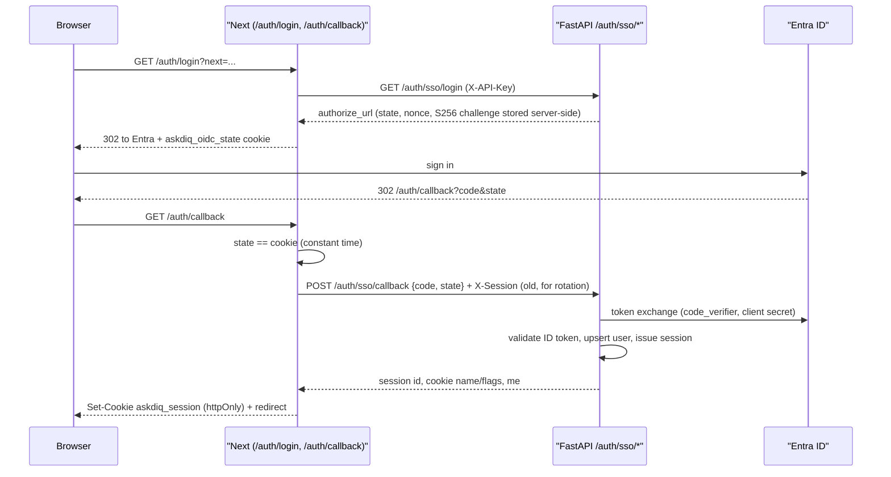

# Security

Scope: how AskDIQ authenticates callers and users, authorizes them (RBAC), defends against CSRF,
injection and abuse, handles errors, PII, audit, client IPs and secrets, and how its controls map
to the OWASP Top 10:2025. It documents two code lines that differ sharply: `main` plus
`hotfix/query-filters-ip-ingest` (what production runs) and `preview/view` (9115c45, the documented
base with SSO and RBAC). Code is the source of truth; plan intent (`newplan.md` section 12,
`planchanges4.md` section 2.1) is noted where it differs.

## Contents

- [Two security models](#two-security-models)
- [Public API auth in production (main and hotfix)](#public-api-auth-in-production-main-and-hotfix)
- [API auth on preview/view (proxy contract)](#api-auth-on-previewview-proxy-contract)
- [Dashboard sign-in (Entra OIDC)](#dashboard-sign-in-entra-oidc)
- [Sessions and cookies](#sessions-and-cookies)
- [User statuses, access requests and superadmin bootstrap](#user-statuses-access-requests-and-superadmin-bootstrap)
- [Mock IdP (development only)](#mock-idp-development-only)
- [RBAC](#rbac)
- [Frontend gating](#frontend-gating)
- [CSRF](#csrf)
- [Security headers](#security-headers)
- [Errors (problem+json)](#errors-problemjson)
- [Input validation](#input-validation)
- [Prompt-injection and abuse guardrails](#prompt-injection-and-abuse-guardrails)
- [PII redaction](#pii-redaction)
- [Audit log](#audit-log)
- [Client IP handling](#client-ip-handling)
- [Rate limiting and capacity](#rate-limiting-and-capacity)
- [Secrets handling](#secrets-handling)
- [Dependency and code scanning](#dependency-and-code-scanning)
- [API docs exposure](#api-docs-exposure)
- [In-flight security changes](#in-flight-security-changes)
- [OWASP Top 10:2025 mapping](#owasp-top-102025-mapping)
- [Known gaps](#known-gaps)

## Two security models

| Aspect | Production: `main` + hotfix | `preview/view` |
|---|---|---|
| Caller auth | Shared `X-API-Key` (= `API_KEY_NAME`) on every protected route | `X-API-Key` (service key, proves "our proxy") **and** `X-Session` (user session) |
| User identity | `X-Client-Id` header (client-chosen, sanitized) | Entra ID user (email), from server-side session |
| Authorization | None beyond the key: any key holder can call admin routes | Role -> permission table, deny by default |
| CSRF | n/a (no cookies) | `X-Requested-With: askdiq` + `Origin == APP_BASE_URL` on state changes |
| Security headers | None from the app (`SecurityHeadersMiddleware` absent); nginx may add them (Unverified for prod) | Backend middleware + Next headers + nonce CSP + `askdiq.conf` |
| Errors | FastAPI defaults | RFC 9457 problem+json, no internals |
| Rate-limit state | In-process memory (per worker) | Postgres shared state (all workers/replicas) |
| Public website `/query` | Yes: server-to-server with the API key | Yes, same contract on chat routes only (`require_chat_actor`); the dashboard proxy adds `X-AskDIQ-Proxy: 1`, so a browser behind it always needs a session |

The website integration contract is in [Website integration](10-website-integration.md).

## Public API auth in production (main and hotfix)

`get_current_actor` in `backend/app/governance/auth.py` is the only auth dependency on `/query`,
`/sessions*`, feedback and all admin/governance/documents/ingest/metrics routes:

| Step | Behaviour |
|---|---|
| Key check | `X-API-Key` must equal `API_KEY_NAME`, else 401 `"Access Denied!"`. Empty `API_KEY_NAME` rejects everything. Compared with `!=` (not constant time). |
| Actor | `X-Client-Id` is sanitized by `sanitize_client_id`: UUID or `[a-zA-Z0-9_\-\.@]{1,64}`. Missing or invalid -> shared actor `default@local` (all such callers share one chat history and one per-user rate-limit bucket). |
| Boundary | `X-Client-Id` is not a security boundary (spoofable); it only partitions chat sessions. The key is the only gate. |
| Swagger | `APIKeyHeader` registers the "Authorize" button; docs are off when `ENV=production`. |
| Leftover | `API_JWT_SECRET` is required by `Settings` but unused. |

Consequence: the API key must stay server-side (website backend, Next proxy). Anyone holding it can
read every admin endpoint.

## API auth on preview/view (proxy contract)

`backend/app/auth/deps.py`. The Next.js proxy (`frontend/app/api/proxy/[...path]/route.ts`) is the only
intended caller.

| Header | Rule | Failure |
|---|---|---|
| `X-API-Key` | `hmac.compare_digest` against `API_KEY_NAME` (`require_service_key`); empty setting fails closed | 401 `Access Denied!` |
| `X-Session` | Raw session id from the httpOnly cookie; resolved by `SessionService.resolve` (hash lookup, not expired/idle/revoked) | 401 `Not authenticated.` |
| `X-Requested-With: askdiq` + `Origin` | Required on POST/PUT/PATCH/DELETE when a session is presented (`enforce_csrf`) | 403 `Cross-site request rejected.` |
| `X-Forwarded-For` | Client IP, honoured only when `TRUST_PROXY_HEADERS=true` | n/a |

Dependency family (deny by default; each marked with `__auth_guard__`):

| Dependency | Grants | Used for |
|---|---|---|
| `current_user` | service key + valid session, any status | `/auth/me`, `/auth/logout` |
| `require_role_or_chat` | not suspended (`active`, `pending`, `rejected`) | `/query`, `/sessions*`, feedback, `/auth/access-request` |
| `require_active_user` | `active` with a role | any dashboard route |
| `require_permission(p)` | active and role grants `p` | admin routes |

The user row is loaded on every request, so role or status changes (including suspension) apply to the
next request. Public routes (no guard) are allow-listed in `backend/tests/test_route_guards.py`:
`/health`, `/branding`, `/branding/assets/*`, `/auth/sso/*` (still needs the service key) and
`/mock-idp/*` (only mounted with `AUTH_DEV_MOCK`).

## Dashboard sign-in (Entra OIDC)

Authorization code flow with PKCE (`backend/app/auth/oidc.py`, `backend/app/api/routes/auth.py`,
`frontend/app/auth/login/route.ts`, `frontend/app/auth/callback/route.ts`).

| Control | Detail |
|---|---|
| `state`, `nonce`, PKCE | `secrets.token_urlsafe(32)` values; verifier stored in shared state (`oidc_states` table), single use, TTL `OIDC_STATE_TTL_SECONDS` (600). S256 challenge. |
| Browser binding | `askdiq_oidc_state` cookie (10 min) compared with `safeEqual`; `askdiq_login_next` holds a validated `next`. |
| ID token | RS256 only; JWKS signature (refetched once on unknown `kid`); `iss` pinned to the tenant; `aud == ENTRA_CLIENT_ID`; `tid == ENTRA_TENANT_ID`; `exp`/`nbf`/`iat` with `OIDC_CLOCK_SKEW_SECONDS`; `nonce` match; required claims `exp, iat, nbf, iss, aud, sub`. |
| Discovery | Must advertise RS256; issuer must contain the configured tenant. |
| Errors | Bad/replayed state 400; invalid token 401 `Sign-in failed.`; IdP down 502. Every outcome audited (`login_success` / `login_denied` with reason). |
| Callback exposure | The proxy blocks `auth/sso/callback` (`BLOCKED_PATHS`), so only the Next callback handler can obtain a raw session id. |
| Rate limit | `AUTH_LOGIN_RATE_LIMIT_PER_MINUTE` (10) per client IP across both steps, shared state, 429 + `Retry-After`. |

## Sessions and cookies

`backend/app/auth/sessions.py`, `frontend/lib/server/auth-cookies.ts`.

| Property | Value |
|---|---|
| Id | `secrets.token_urlsafe(32)` (43 chars); ids longer than 128 chars rejected without a lookup. |
| Storage | Only `HMAC-SHA256(SESSION_SECRET, id)` in `auth_sessions.id_hash`; a DB leak yields no usable ids. |
| Absolute timeout | `SESSION_TTL_MINUTES` (480). |
| Idle timeout | `SESSION_IDLE_MINUTES` (60), capped by absolute expiry; `last_seen_at` touched at most every `SESSION_TOUCH_INTERVAL_SECONDS` (60). |
| Rotation | On login the previous cookie value (sent as `X-Session`) is revoked before a new id is issued. |
| Revocation | `POST /auth/logout` revokes the row; admins can revoke all sessions of a user (`session_revoked` audited). |
| Cookie | `askdiq_session` (configurable): `HttpOnly`, `SameSite=Lax`, `Path=/`, `Secure` when `SESSION_COOKIE_SECURE=true`, `Expires` = session expiry. |
| Exposure | The proxy never forwards cookies to the backend nor backend `Set-Cookie` to the browser; a 401 clears the cookie. |

## User statuses, access requests and superadmin bootstrap

`backend/app/auth/service.py`, `backend/app/auth/admin_service.py`.

| Status | Session issued | Chat | Dashboard |
|---|---|---|---|
| `pending` (new user, no role) | Yes | Yes | 403 `Dashboard access requires approval.` |
| `active` + role | Yes | Yes | Per permissions |
| `rejected` | Yes | Yes | 403 |
| `suspended` | No (sign-in 403, `access_contact_email` returned) | No | No |

- Users are upserted on Entra `oid`; an invited row with the same email and no `oid` is linked. A
  conflicting identity is denied (`identity_conflict`).
- `POST /auth/access-request` (pending/rejected users): one open request per user; 409 when active or
  already pending. Decisions are audited (`access_approved` / `access_rejected`).
- `SUPERADMIN_EMAILS`: an email in the list becomes an active superadmin on sign-in only while
  `pending`, so it never overrides a later decision (a suspended superadmin email stays suspended).
- Last-superadmin rule: the last active superadmin cannot be demoted or suspended (409,
  `DETAIL_LAST_SUPERADMIN`), with superadmin rows locked to serialise the check.

## Mock IdP (development only)

`backend/app/auth/mock_idp.py` mirrors Entra v2.0 (discovery, JWKS, authorize, token).

| Guard | Where |
|---|---|
| `AUTH_DEV_MOCK=true` with `ENV != development` refuses to start | `Settings._validate_auth`; tested by `test_mock_mode_is_refused_outside_development`, `test_app_refuses_to_boot_with_mock_outside_development` |
| Router mounted only when `AUTH_DEV_MOCK` is on | `mount_mock_idp()` in `main.py` |
| Frontend forwarding of `/mock-idp/*` only when frontend `AUTH_DEV_MOCK === "true"` | `frontend/app/mock-idp/[...path]/route.ts` |

## RBAC

Single table in `backend/app/auth/permissions.py`; the frontend reads the same list from `/auth/me`.
Only an `active` user with a role holds permissions.

| Permission | Operator | Admin | Superadmin |
|---|---|---|---|
| `dashboard:read` | Yes | Yes | Yes |
| `documents:write` | - | Yes | Yes |
| `feedback:triage` | - | Yes | Yes |
| `feedback:export` | - | Yes | Yes |
| `eval:run` | - | Yes | Yes |
| `testip:write` | - | Yes | Yes |
| `usage:export` | - | Yes | Yes |
| `users:manage` | - | - | Yes |
| `audit:auth:read` | - | - | Yes |
| `branding:write` | - | - | Yes |
| `taxonomy:write` | - | - | Yes |

Chat is not a permission: any non-suspended signed-in user may chat (`CHAT_STATUSES`). Unknown roles
map to no permissions. Chat sessions and feedback are scoped to the signed-in user's email (IDOR tests
in `backend/tests/test_auth_rbac.py`).

## Frontend gating

UX only; the API is the boundary.

| File | Role |
|---|---|
| `frontend/middleware.ts` | Redirects to `/login?next=` when the session cookie is absent (public: `/login`, `/suspended`); sets the per-request CSP nonce. Matcher excludes `api/`, `auth/callback`, `auth/login`, `mock-idp/`, `branding/assets/`, Next internals and static files. |
| `frontend/lib/auth-gate.ts` | `gateDecision(me, pathname)`: no session -> `login`; suspended -> `suspended`; active with role -> `app`; otherwise `/chat` only, else `access-required`. `postLoginPath` sends non-active users to `/chat`. |
| `frontend/lib/permissions.ts` | Mirrors roles, statuses and permissions; `hasPermission` denies by default. |

## CSRF

| Layer | Control |
|---|---|
| Cookie | `SameSite=Lax`, `HttpOnly`. |
| Proxy | Adds `X-Requested-With: askdiq` on unsafe methods and forwards the browser's `Origin` unchanged (never synthesised). |
| Backend | `enforce_csrf`: unsafe method needs the marker and `Origin` equal to `APP_BASE_URL`'s origin, else 403. Applied wherever a session is authenticated. |
| Login CSRF | `state` bound to the browser by the `askdiq_oidc_state` cookie. |
| Open redirect | `next` validated (`safeNextPath`, `frontend/tests/lib/safe-redirect.test.ts`). |

## Security headers

| Source | Headers |
|---|---|
| Backend `backend/app/core/security_headers.py` (pure ASGI, outermost) | `X-Content-Type-Options: nosniff`, `Referrer-Policy`, `Permissions-Policy`, `Cross-Origin-Opener-Policy`, `X-Frame-Options`, `Content-Security-Policy: default-src 'none'; frame-ancestors 'none'` (skipped on `/docs`, `/redoc`), HSTS only when `ENV=production`. Values from `SECURITY_*` settings; route-set values win. |
| Next `frontend/next.config.js` `headers()` | Same static set on every path; HSTS when `NODE_ENV=production`; `poweredByHeader: false`. |
| Next `frontend/middleware.ts` | Per-request nonce CSP: `default-src 'self'`; `script-src 'self' 'nonce-<n>' 'strict-dynamic'`; `style-src 'self' 'unsafe-inline'`; `img-src 'self' data: blob:`; `font-src 'self' data:`; `connect-src 'self'`; `object-src 'none'`; `base-uri 'self'`; `form-action 'self'`; `frame-ancestors 'none'`. Dev adds `'unsafe-eval'` and `ws: wss:`. |
| nginx `askdiq.conf` | `server_tokens off`, `client_max_body_size 15m`, `proxy_hide_header` for upstream duplicates, then `add_header ... always` for HSTS, nosniff, Referrer-Policy, Permissions-Policy, COOP, `X-Frame-Options DENY`, API CSP. Sets `X-Forwarded-For $remote_addr` (overwrites, not appends). |
| Brand assets | Served with explicit `Content-Type` and `X-Content-Type-Options: nosniff` (`backend/app/api/routes/branding.py`). |
| Cache | ETag GETs send `Cache-Control: private, max-age=...` with `Vary: X-API-Key, X-Client-Id` (`backend/app/core/http_cache.py`); `/auth/me` varies on `X-API-Key, X-Session`; OIDC responses `no-store`. |

Unverified: the live prod nginx config (et-platform-nginx-1) is not in this repo; `askdiq.conf` is the
intended config for the preview topology.

## Errors (problem+json)

`backend/app/core/exceptions.py` (preview/view only).

| Case | Response |
|---|---|
| `HTTPException` | `application/problem+json` with `type`, `title`, `status`, `detail` (unchanged text), `request_id`; headers kept (e.g. `Retry-After`). |
| Validation | 422, `type: urn:askdiq:problem:validation-error`, `errors[]` with `loc` and PII-masked `msg` only (no `input`/`ctx`, so submitted values are never echoed). |
| Unhandled | 500, `type: urn:askdiq:problem:internal-error`, generic detail quoting the `request_id`; no stack trace; traceback logged PII-masked; `server_error` audit row. |
| Domain errors | `ForbiddenError`, `ConflictError`, `NotFoundError` mapped to problem bodies (with optional extras such as `access_contact_email`). |

Tests: `backend/tests/test_error_handling.py`.

## Input validation

| Control | Where |
|---|---|
| Pydantic schemas on every body; `query` 1..2000 chars | `backend/app/schemas/*.py` |
| Sort allow-lists (400 with the allowed set) | `_ALLOWED_USER_SORTS`, `_ALLOWED_SESSION_SORTS`, `_ALLOWED_QUERY_SORTS` in `backend/app/api/routes/admin_usage.py`; `USER_SORT_COLUMNS` in `backend/app/auth/user_repository.py`; `_SORT_KEYS` in `backend/app/feedback/repository.py` |
| `LIKE`/`ILIKE` escaping | `escape_like_expression` (`backend/app/db/query_builders.py`), `escape_like` (`backend/app/auth/user_repository.py`), `escape="\\"` clauses in `admin_usage.py` |
| Bounded pagination | `USAGE_PAGE_MAX_LIMIT` (200), `USAGE_MAX_OFFSET` (10000); keyset pagination for governance logs (`backend/app/governance/pagination.py`); export caps (`USAGE_EXPORT_MAX_ROWS`, `GOVERNANCE_EXPORT_MAX_ROWS`) |
| CSV formula injection | `DANGEROUS_CSV_PREFIXES` (`=`, `+`, `-`, `@`, tab, CR) neutralised in `backend/app/core/serialization.py` |
| SVG uploads | Element/attribute allow-list sanitizer (`backend/app/branding/assets.py`); PNG/WebP/SVG only; size and dimension caps |
| `/query` filter allow-list | **Hotfix only** (prod): `usable_filters()` keeps `RETRIEVAL_FILTER_KEYS` with scalar values, logs dropped keys. On `preview/view` arbitrary keys are applied as JSON equality filters (parameterised, but an unknown key empties retrieval). |
| Proxy path hygiene | Rejects `..`, `/`, `\` in path segments; 15 MB body cap (`frontend/app/api/proxy/[...path]/route.ts`) |
| `X-Client-Id` sanitizer | `sanitize_client_id` (main/hotfix) |

## Prompt-injection and abuse guardrails

| Stage | Control | Where |
|---|---|---|
| Pre-check | Length/empty (`query_too_long`, `empty_query`); `UNSAFE_PATTERNS` regexes for "ignore/override ... instructions", "reveal ... system prompt", "system prompt" -> `unsafe_input_detected`; spam (URLs, promo phrases, repeats, gibberish, keyboard mash) -> `spam_detected` / `unclear_input` | `backend/app/guardrails/pre_checks.py` |
| Retrieval | `MIN_RETRIEVAL_SCORE` off-topic gate | `backend/app/retrieval/` |
| Post-check | Sources present; semantic groundedness >= `GROUNDEDNESS_THRESHOLD`; `$`/`%` figures must appear in sources | `backend/app/guardrails/post_checks.py` |
| Classifier (insights) | PII-masked, truncated user text sent only inside a JSON-escaped `<turns_data>` block declared untrusted data; output constrained to the taxonomy; daily token budget | `backend/app/insights/llm.py` |
| Rendering | Markdown rendered as React elements, no `dangerouslySetInnerHTML` (`frontend/components/documents/MarkdownView.tsx`). `dangerouslySetInnerHTML` is used only for the nonce'd theme pre-paint script and server-built brand CSS in `frontend/app/layout.tsx`. |

## PII redaction

`backend/app/governance/pii.py` `redact_pii(text, allowlist)` detects, in order: credit cards (Luhn),
Medicare (check digit), ABN (mod-89), TFN (mod-11), AU/international phones, emails. Checksums avoid
false positives on dates and SKUs. `PII_ALLOWLIST` exempts strings.

| Applied to | Where |
|---|---|
| Ingested documents (before chunking/embedding) | `backend/app/ingestion/normalizer.py` |
| Audit `detail` values (strings capped at 500 chars, recursive) | `mask_detail` in `backend/app/governance/audit.py` |
| `/query` audit detail (`query` redacted) | `backend/app/api/routes/query.py` |
| Feedback comments and corrected answers | `backend/app/core/sessions.py` |
| Auth audit free text; target emails masked `a***@domain` | `mask_text`, `mask_email` in `backend/app/auth/audit.py` |
| Error logs, validation messages, middleware errors | `exceptions.py`, `middleware.py` |
| Classifier input | `backend/app/insights/llm.py`, `analytics_service.py` |
| Rescan | `backend/scripts/rescan_pii.py`: read-only report of stored chunks with unredacted PII (re-upload needed) |

Note: `chat_messages` store the user's raw question text (`schedule_exchange_write(user_text=body.query)`);
only the audit copy is redacted.

## Audit log

| Item | Detail |
|---|---|
| Table | `audit_log`, append-only: trigger `trg_audit_log_immutable` (`BEFORE UPDATE OR DELETE`, raises) from migration `d4e5f6a7b8c9` (present on `main` too). |
| Writers | `record_audit_event` (same transaction as the change) and `emit_audit_event` (fire-and-forget, queued, batch-flushed by a supervised task, queue cap 5000) in `backend/app/governance/audit.py`. |
| Request events | Every query (request id, actor, chunk ids, scores, guardrail flags, outcome), ingest, guardrail, `rate_limited` (429), `server_error` (5xx), LLM failures. |
| Auth events | `login_success`, `login_denied`, `access_requested`, `access_approved`, `access_rejected`, `role_changed`, `user_suspended`, `user_reactivated`, `session_revoked`, `logout`, `user_invited` (`backend/app/auth/audit.py`), with actor, IP and request id. |
| Read access | Auth audit needs `audit:auth:read` (superadmin). |
| Tests | `backend/tests/test_audit_sources.py`, `backend/tests/test_phase0_security.py` |

## Client IP handling

| Function | Branch | Behaviour |
|---|---|---|
| `get_client_ip(request)` | all | First `X-Forwarded-For` hop only when `TRUST_PROXY_HEADERS=true`, else TCP peer (`"unknown"` if none). |
| `/query` body `ip_address` | `preview/view`, `main` | Used only when `ENV != production`. |
| `valid_ip(value)` | hotfix | Normalised IPv4/IPv6 via `ipaddress.ip_address` (first hop of a comma list), else `None`. |
| `resolve_client_ip(request, supplied)` | hotfix | With `ALLOW_CLIENT_IP_OVERRIDE` (code default `true`; hotfix `.env.example` says `false`), a valid body `ip_address` on `/query`, `POST /sessions` and feedback wins; otherwise `get_client_ip`. |

The Next proxy forwards the browser's `X-Forwarded-For`; `askdiq.conf` overwrites it with
`$remote_addr`. With `ENV=production` and `TRUST_PROXY_HEADERS=false` the app logs
`production_startup_warning`. Trust implication of the hotfix: any API-key holder chooses the IP that is
stored and rate-limited, so the per-IP limit protects only against callers without the key.

## Rate limiting and capacity

`backend/app/core/rate_limit.py`, sliding 60 s window, 429 + `Retry-After`.

| Limit | Value | Key | Scope |
|---|---|---|---|
| `/query` per user | 10/min (`RATE_LIMIT_PER_MINUTE`) | actor (email on preview; `X-Client-Id` on main) | `rate_limited_actor` |
| `/query` per IP | 30/min (`RATE_LIMIT_PER_MINUTE_PER_IP`) | client IP (hotfix: resolved end-user IP, applied in the route) | |
| Feedback | 30/min per user and per IP | | `enforce_feedback_rate_limit` |
| Heavy admin analytics/exports | 60/min per user and per IP | | `rate_limited_admin_analytics` (needs `dashboard:read` on preview) |
| SSO login + callback | 10/min per IP (`AUTH_LOGIN_RATE_LIMIT_PER_MINUTE`) | | preview only |
| Exempt | `RATE_LIMIT_EXEMPT_ACTORS` | | preview only, load tests |

| State | Branch |
|---|---|
| In-process `deque` per key, swept every 500 calls; per worker, so limits multiply with workers (prod runs one) | `main` / hotfix |
| `StateBackend.incr_window` on the UNLOGGED `rate_limit_buckets` table, shared by all workers/replicas; memory when `ENV=test` or `STATE_BACKEND=memory`; every 429 emits a `rate_limited` audit event | `preview/view` |

Capacity (preview/view): `llm_capacity` (`backend/app/core/concurrency.py`) caps in-flight LLM calls at
`LLM_MAX_CONCURRENCY` (64) per process, 429 + `Retry-After: LLM_SATURATED_RETRY_AFTER_SECONDS`. The LLM
circuit breaker (`backend/app/core/circuit.py`) opens after `LLM_BREAKER_FAILURE_THRESHOLD` transient
failures (429/5xx, timeouts) in `LLM_BREAKER_WINDOW_SECONDS`, fails fast with `CircuitOpenError` (graceful
`llm_failed` outcome), then half-opens after `LLM_BREAKER_RESET_SECONDS`. Insights spend is capped by
`INSIGHTS_DAILY_TOKEN_BUDGET`.

## Secrets handling

| Rule | Detail |
|---|---|
| No defaults for secrets | `DATABASE_URL`, `AZURE_OPENAI_API_KEY`, `SESSION_SECRET` required; `API_KEY_NAME` empty fails closed. |
| Typed secrets | `SESSION_SECRET`, `ENTRA_CLIENT_SECRET` are `SecretStr`. |
| Never committed | `.gitignore` covers `.env`, `.env.local`, `.env*.local`, `backend/.env`, `frontend/.env.local`; `backend/.dockerignore` excludes `.env*`. |
| Never shipped | Deploy packages contain only `backend/` via `git archive`; prod env lives only in `/opt/askdiq/backend/.env` (see [Deployment](08-deployment-operations.md)). |
| Browser | The API key is read only by server-side route handlers (`frontend/lib/server/backend.ts`); no `NEXT_PUBLIC_*` variables. Session ids live in an httpOnly cookie. |
| Session secret strength | >= 32 bytes enforced in production; rotation logs everyone out. |
| CI | Only test values in `.github/workflows/ci.yml`; `permissions: contents: read`. |

## Dependency and code scanning

| Tool | Gate | Where |
|---|---|---|
| `bandit -r app -ll` | Medium+ findings fail CI | `.github/workflows/ci.yml` backend-lint |
| `pip-audit -r requirements.txt` | Fails on any advisory not in `.github/audit/pip-audit-ignore.txt`; each entry needs `expires YYYY-MM-DD`, expired entries fail. Current entries: 7 starlette 0.38.6 advisories (framework upgrade to fastapi>=0.133 deferred), expiring 2026-12-31. | ci.yml |
| `npm run audit:gate` | `frontend/scripts/audit-gate.mjs`: `npm audit --omit=dev`, fails on high/critical not in `.github/audit/npm-audit-allowlist.json` (entries need `expires`; current Next 14 DoS advisories expire 2026-12-31) | ci.yml |
| Ruff `S` (bandit rules) | Lint | `backend/pyproject.toml` |
| Dependabot | Weekly grouped minor/patch for pip, npm, GitHub Actions | `.github/dependabot.yml` |
| Pins | `backend/requirements.txt` fully `==` pinned; `frontend/package.json` still uses caret ranges (lockfile pins) | |

## API docs exposure

| Branch | Rule |
|---|---|
| `preview/view` | `/docs`, `/redoc`, `/openapi.json` return 404 when `ENV=production` unless `ENABLE_API_DOCS=true` (`api_docs_enabled` in `backend/main.py`). |
| `main` / hotfix | Disabled whenever `ENV=production`. |

Unverified: the 2026-10-16 incident involved Swagger "Try it out" against the API; if that was prod, the
prod `ENV` is not `production` (which would also leave HSTS off and allow body IP overrides on main).

## In-flight security changes

| Change | Status |
|---|---|
| Same-origin `POST /auth/logout` Next route: needs `X-Requested-With` and same-origin `Origin`, revokes the backend session within 4 s best effort, always clears the cookie, `Cache-Control: no-store`, `Clear-Site-Data: "cache"`; client logout single-flight with 6 s abort | **In progress (branch `fix/shell-nav-logout-theme-dates`)** |
| Bounded proxy timeouts (`BACKEND_TIMEOUT_MS`, `BACKEND_WRITE_TIMEOUT_MS`), retries, pool timeout and reserve, connection-release fixes, `global-error.tsx` (A06/A10) | **In progress (branch `fix/chat-page-fetch-timeouts`)**, uncommitted |
| Prestart migrations under advisory lock; DB URL never logged; frontend prod env template with `SESSION_COOKIE_SECURE=true`, `AUTH_DEV_MOCK=false` | **In progress (branch `chore/prod-deploy-fullstack`)** |
| Allow-listed filters, forwarded `ip_address`, per-IP limit on end-user IP | Live in prod (`hotfix/query-filters-ip-ingest`), not merged into `preview/view` |

## OWASP Top 10:2025 mapping

Rows from `newplan.md` section 12.1 and `planchanges4.md` section 2.1, verified against `preview/view`
code. "Planned/not found" = in the plan but not found in code at 9115c45. `backend/tests/test_owasp_compliance.py`
still uses 2021-style names (`a03_sql_injection`, `a04_rate_limiting`, `a08_csv_formula`); the planned
per-row test classes (Task V.4) are not written yet.

| Category | Controls (found) | Where in code | Tests | Planned/not found |
|---|---|---|---|---|
| A01 Broken Access Control | Session auth + `require_permission`, deny by default; route-walk guard; object scoping by user; CSRF marker + Origin; SameSite=Lax | `backend/app/auth/deps.py`, `permissions.py`, `frontend/app/api/proxy/[...path]/route.ts` | `test_route_guards.py`, `test_auth_rbac.py` (IDOR, CSRF), `test_owasp_compliance.py::test_owasp_a01_unauthenticated_access_blocked` | F8 aggregation cache keyed by role and cross-role cache test; `Vary: Cookie, X-Session` (code sends `Vary: X-API-Key, X-Client-Id`). Prod (main) has no RBAC. |
| A02 Security Misconfiguration | Security headers (backend, Next, nginx); nonce CSP; narrow CORS lists; docs off in prod; mock-IdP startup guard; `poweredByHeader: false`; `server_tokens off`; `Cache-Control: private` | `security_headers.py`, `next.config.js`, `middleware.ts`, `askdiq.conf`, `main.py`, `config.py` | `test_security_headers.py`, `test_auth_settings.py`, `frontend/tests/lib/next-config.test.ts`, `middleware.test.ts`, `test_http_efficiency.py` | nginx config lint in CI not found. |
| A03 Software Supply Chain Failures | pip-audit and npm audit gates with expiring allow-lists; bandit; Dependabot; Actions `contents: read`; pinned Python deps | `.github/workflows/ci.yml`, `.github/audit/*`, `frontend/scripts/audit-gate.mjs` | CI jobs | Exact pins in `package.json` (caret ranges remain); Actions pinned to major tags, not SHAs. |
| A04 Cryptographic Failures | `token_urlsafe(32)` session ids, HMAC-SHA256 stored hash; Secure cookie flag; HSTS in prod; 32-byte secret in prod; JWT leftover removed (preview) | `sessions.py`, `config.py`, `auth-cookies.ts` | `test_auth_sessions.py`, `test_auth_settings.py::test_legacy_jwt_secret_is_gone` | `API_JWT_SECRET` still required on `main`. Secure cookie not enforced by code in prod. |
| A05 Injection | Parameterised SQLAlchemy; sort allow-lists; LIKE escaping; SVG sanitizer; CSV formula neutralisation; classifier `<turns_data>` delimiting; safe markdown; prompt-injection pre-checks; hotfix filter allow-list | `query_builders.py`, `admin_usage.py`, `user_repository.py`, `branding/assets.py`, `serialization.py`, `insights/llm.py`, `pre_checks.py`, `MarkdownView.tsx` | `test_query_builders.py`, `test_branding.py`, `test_owasp_compliance.py::test_owasp_a08_csv_formula_injection_defense`, `test_insights_classifier.py`, `test_pre_checks.py`, `MarkdownView.test.tsx`, hotfix `test_query_hardening.py` | Filter allow-list not on `preview/view`. F8 widget markdown XSS tests (widget branch). |
| A06 Insecure Design | Caps on limit/offset/exports/range; login rate limit; last-superadmin rule; LLM capacity gate; insights token budget | `config.py`, `admin_usage.py`, `admin_service.py`, `concurrency.py` | `test_user_management.py`, `test_rate_limit.py`, `test_owasp_compliance.py::test_owasp_a04_rate_limiting_and_resource_caps` | F8 bounded fetch timeouts/retries and pool leak test: in progress (`fix/chat-page-fetch-timeouts`, `backend/tests/test_connection_release.py` untracked). |
| A07 Authentication Failures | PKCE + state + nonce; RS256, iss, aud, tid, exp/nbf/iat checks; rotation on login; idle + absolute timeouts; server-side revocation; login rate limit; `login_denied` audit | `oidc.py`, `sessions.py`, `service.py`, `routes/auth.py` | `test_auth_oidc.py`, `test_auth_sessions.py`, `test_auth_routes.py`, `test_owasp_compliance.py::test_owasp_a07_malformed_tokens_rejected` | F8 logout that always clears the cookie: in progress (`fix/shell-nav-logout-theme-dates`). |
| A08 Software or Data Integrity Failures | Immutable `audit_log` trigger; audit rows in the same transaction as changes; idempotent jobs | migration `d4e5f6a7b8c9`, `governance/audit.py`, `app/jobs/` | `test_phase0_security.py`, `test_audit_sources.py` | Unverified: unique-key idempotency per `message_id` and job type not re-checked here (see [Database](05-database.md#jobs-and-shared-state)). |
| A09 Security Logging and Alerting Failures | Auth, 429, 5xx, LLM-failure and session events to `audit_log`; PII-masked details; `request_id` correlation; governance health/incident thresholds | `governance/audit.py`, `auth/audit.py`, `rate_limit.py`, `exceptions.py`, `core/middleware.py` | `test_audit_sources.py`, `test_admin_rate_limit_and_audit.py` | External alerting (pager/email) not found; alerts surface only in the Governance UI. |
| A10 Mishandling of Exceptional Conditions | problem+json without internals; supervised background tasks (`spawn`, drain on shutdown); fail-closed auth; outbound timeouts; circuit breaker | `exceptions.py`, `core/tasks.py`, `deps.py`, `circuit.py`, `config.py` | `test_error_handling.py`, `test_circuit_breaker.py` | F8 frontend fetch timeouts becoming `ErrorState`: in progress (`fix/chat-page-fetch-timeouts`). Prod (main) has no problem+json handler. |

OWASP LLM Top 10 (plan): LLM01 prompt injection (pre-checks, classifier delimiting), LLM02 sensitive
disclosure (PII masking before classifier calls; the chat `/query` prompt is not PII-masked: Unverified
whether intended), LLM06 excessive agency (classifier returns labels only), LLM10 unbounded consumption
(`INSIGHTS_DAILY_TOKEN_BUDGET`, rate limits, LLM capacity gate).

## Known gaps

| Gap | Impact |
|---|---|
| Prod (`main`) has one shared API key, no RBAC, no app security headers, `allow_headers=["*"]` CORS | Key compromise exposes every admin endpoint. |
| Hotfix `ALLOW_CLIENT_IP_OVERRIDE` defaults to `true` in code | Key holders set the stored and rate-limited IP. |
| Main per-user limit keyed by client-chosen `X-Client-Id`; in-memory, per worker | Rotating ids or adding workers weakens limits. |
| `Vary` on cached admin GETs omits `X-Session` | Low risk (private caching only), but differs from plan F8. |
| `chat_messages` keep raw question text | PII may be stored in chat history. |
| `pip-audit`/`npm audit` allow-lists expire 2026-12-31 | FastAPI/Starlette and Next upgrades due before then. |
