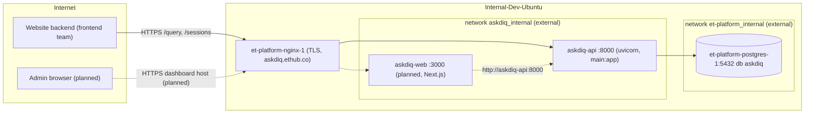

# Deployment and operations

How AskDIQ runs in production today, how a release is shipped, migrated,
verified and rolled back, how to watch it, and what went wrong before.
Audience: the ops person deploying the stack, and engineers on call.

Contents

- [1. What runs where](#1-what-runs-where)
- [2. Code in production vs code in the repo](#2-code-in-production-vs-code-in-the-repo)
- [3. Images and containers](#3-images-and-containers)
- [4. Golden rules](#4-golden-rules)
- [5. Release procedure (backend only, today)](#5-release-procedure-backend-only-today)
- [6. Planned full-stack deploy (dashboard container)](#6-planned-full-stack-deploy-dashboard-container)
- [7. Migrations](#7-migrations)
- [8. Backfills, ingestion and maintenance scripts](#8-backfills-ingestion-and-maintenance-scripts)
- [9. Backups and rollback](#9-backups-and-rollback)
- [10. Monitoring and health](#10-monitoring-and-health)
- [11. Scaling, workers and pool sizing](#11-scaling-workers-and-pool-sizing)
- [12. Incident history and lessons learned](#12-incident-history-and-lessons-learned)
- [13. Ops troubleshooting](#13-ops-troubleshooting)

---

## 1. What runs where

| Item | Value |
|---|---|
| Public API host | `askdiq.ethub.co` (TLS terminated by the shared et-platform nginx) |
| Server | `Internal-Dev-Ubuntu`, login user `WebAdmin` |
| Compose directory | `/opt/askdiq` (server file `/opt/askdiq/docker-compose.prod.yml` is authoritative) |
| API container | `askdiq-api`, image `askdiq-api:latest`, built from `backend/Dockerfile.prod`, listens on `8000` inside the container |
| Backend env | `/opt/askdiq/backend/.env` only (never shipped, never copied from a dev machine) |
| Database | container `et-platform-postgres-1`, port `5432`, database `askdiq` (Postgres + `pgvector`) |
| Reverse proxy | container `et-platform-nginx-1` (shared by other apps on the box) |
| Docker networks | both **external**: `askdiq_internal` (shared with `et-platform-nginx-1`) and `et-platform_internal` (where the DB lives). `askdiq-api` must be on **both**. |
| Host port | `127.0.0.1:5500` is AskDIQ's only known-free loopback port. Ports `3001-3600`, `5000-5600` and `5501` belong to other apps: never bind them, never change other apps' ports or networks. |
| Alembic head in prod | `d6e7f8a9b0c1` (see [Migrations](#7-migrations)) |



`askdiq-api` sits on both networks; nginx reaches it by container name over
`askdiq_internal`, and it reaches the DB over `et-platform_internal`. Inside a
container `localhost` is the container itself, so `DATABASE_URL` must use the
host `et-platform-postgres-1`.

## 2. Code in production vs code in the repo

| Code line | Contents | Alembic head | Where it runs |
|---|---|---|---|
| `main` + **`hotfix/query-filters-ip-ingest`** | Pre-revamp backend: API-key `/query`, sessions, governance, evaluation; plus the hotfix (filter allow-list, `no_sources`, forwarded `ip_address`, KB markdown in the image) | `d6e7f8a9b0c1` | **Production now** |
| `preview/view` | Integration branch: everything in `main` plus the admin-console revamp (PR stack #16-#38: SSO/RBAC, jobs, shared state, branding, feedback triage, insights, new dashboard) and owner fix branches | `254857d10a20` | Local / preview only |
| `chore/prod-deploy-fullstack` | `preview/view` + entrypoint automation, dashboard image and deploy kit | `254857d10a20` | Not deployed |

**In progress (branch `hotfix/query-filters-ip-ingest`) - live in prod, not
yet in `preview/view`.** The hotfix branches from `main` (`1a88798`), not from
`preview/view`. It must be merged forward into `preview/view` before the
next prod deploy, or the deploy silently reverts it.

Important for the next deploy: on `preview/view` every `/query` and
`/sessions` call needs an SSO session (`X-Session`), not just `X-API-Key`.
The website frontend team's server-to-server integration (API key +
`X-Client-Id`, see [Website integration](10-website-integration.md)) works only
on the `main` + hotfix line. Deploying `preview/view` as-is would break the
public widget. Resolve this (a public, API-key-only chat route or equivalent)
before shipping the revamp to `askdiq.ethub.co`.

## 3. Images and containers

| File | Purpose |
|---|---|
| `backend/Dockerfile` | Local/dev image used by `docker-compose.yml` |
| `backend/Dockerfile.prod` | Production image `askdiq-api:latest`: `python:3.14-slim`, `gcc libpq-dev curl`, non-root `appuser` (uid 1000), `HEALTHCHECK curl -f http://localhost:8000/health`, `CMD uvicorn main:app --host 0.0.0.0 --port 8000 --workers ${WEB_CONCURRENCY:-1}` (on `preview/view`; prod's `main` image runs a single worker without the variable) |
| `backend/.dockerignore` | Drops `*.md`, `.env`, tests, `scripts/_*.py`, `data/archive/`. The hotfix and deploy branches re-include `data/real_docs/*.md` (the knowledge base) |
| `frontend/Dockerfile` | Local/dev Next.js image used by `infra/docker-compose.yml` |
| `frontend/Dockerfile.prod` | **In progress (branch `chore/prod-deploy-fullstack`)**: production dashboard image `askdiq-web:latest` |
| `infra/docker-compose.yml` | Local full stack: `postgres` (`pgvector/pgvector:pg18`, host port `5433`), `backend` (`8000`), `frontend` (`3000`) |
| `infra/scale-out/docker-compose.yml` (was the root `docker-compose.prod.yml`) | **Reference only, does not match the server.** Describes two replicas `api-1`/`api-2` (`127.0.0.1:5500`, `127.0.0.1:5501`), a `worker` service, and one external network named by the placeholder `NETWORK_NAME`. Prod actually runs a single `askdiq-api` on two networks. Never ship or copy it to the server (see incident 12.1). |
| `infra/scale-out/askdiq-api.conf` | **Reference only.** nginx site for `askdiq.ethub.co`: `upstream askdiq_api` (`least_conn`, `askdiq-api-1`/`askdiq-api-2`), security headers at server level, SSE location (`/(stream|events)$`, unbuffered, 1 h timeouts), `client_max_body_size 15m`, `proxy_next_upstream error timeout http_502 http_503`. The live conf is owned by the et-platform nginx owner; find it with `docker inspect et-platform-nginx-1 --format '{{range .Mounts}}{{.Destination}}{{println}}{{end}}'`. |

## 4. Golden rules

1. Ship **only committed source**. Today: `git archive` of `backend/` only. With
   the deploy kit: `backend/`, `frontend/` and a `deploy-kit/` docs folder that
   is never extracted into `/opt/askdiq`.
2. **Never ship** `docker-compose*.yml`, `infra/scale-out/askdiq-api.conf` or any `.env`. The
   server's compose file, nginx conf and env files are edited in place, one
   line at a time, after a backup.
3. **Read state before changing it**: `docker ps -a`, `docker inspect
   askdiq-api` (networks), `alembic current`. Change one thing at a time and
   verify after each change.
4. Back up `/opt/askdiq/backend/.env` and take a `pg_dump` before any
   migration.
5. Never touch other apps' containers, networks or ports on the box. Never kill
   processes you did not start.
6. The release must pass the local CI mirror first (see
   [Development](09-development.md#local-ci-mirror)).

## 5. Release procedure (backend only, today)

This is the procedure for the current single-container backend. The deploy
kit in section 6 supersedes it once merged.

1. **Build the package locally** (committed code only):
   `git -C C:\Projects\askdiq archive --format=tar.gz -o askdiq-backend-<sha>.tgz <release-ref> backend`
   Use `-c core.autocrlf=false -c core.eol=lf` so shell scripts keep LF
   endings.
2. **Copy**: `scp askdiq-backend-<sha>.tgz WebAdmin@Internal-Dev-Ubuntu:~/`
3. **Pre-flight on the server**:
   ```bash
   cd /opt/askdiq
   docker ps -a --filter name=askdiq
   docker inspect askdiq-api --format '{{range $k,$v := .NetworkSettings.Networks}}{{$k}} {{end}}'
   #   expect: askdiq_internal et-platform_internal
   docker exec askdiq-api python -m alembic current
   cp -a backend/.env ~/askdiq.env.bak.$(date +%F-%H%M)
   docker tag askdiq-api:latest askdiq-api:rollback-$(date +%Y%m%d-%H%M%S)
   ```
   Take a DB dump (section 9).
4. **Extract over `backend/` without touching `.env`** (extract to a staging
   directory, then `rsync -a --delete --exclude='/.env' --exclude='/.env.*'`).
   `--delete` matters: a stale migration file left behind would give Alembic
   two heads.
5. **Build and recreate**:
   `docker compose -f docker-compose.prod.yml build askdiq-api && docker compose -f docker-compose.prod.yml up -d --force-recreate askdiq-api`
6. **Migrate** (the `main`/hotfix image does not migrate on start):
   `docker exec askdiq-api python -m alembic upgrade head`
7. **Ingest** the knowledge base if `backend/data/real_docs/*.md` changed:
   `docker exec askdiq-api python scripts/ingest_real_docs.py` (idempotent;
   unchanged documents are skipped by content hash).
8. **Verify** (section 10): `docker ps` shows `Up (healthy)`, `curl -fsS
   https://askdiq.ethub.co/health` returns `"database": "healthy"`, the
   container is still on both networks, and a test `/query` returns an answer
   with sources.

## 6. Planned full-stack deploy (dashboard container)

**In progress (branch `chore/prod-deploy-fullstack`).** The authoritative
procedure is `docs/deployment/runbook.md` on that branch
(`git show chore/prod-deploy-fullstack:docs/deployment/runbook.md`). Summary of what the
branch adds:

| File | What it does |
|---|---|
| `backend/docker-entrypoint.sh` | `ENTRYPOINT` of the prod image. For a command containing `uvicorn` it runs `scripts/prestart.py` first and refuses to start the API if it fails; any other command (`python -m app.jobs.worker`, `alembic ...`, a shell) is `exec`'d directly, so the worker never migrates. |
| `backend/scripts/prestart.py` | Waits for Postgres (`DB_WAIT_RETRIES=30`, `DB_WAIT_INTERVAL_SECONDS=2`, `DB_CONNECT_TIMEOUT_SECONDS=20`); runs `alembic upgrade head` under advisory lock `0x41534B4449510001` (fatal on failure, exit 3; DB unreachable exit 2; `MIGRATION_LOCK_TIMEOUT_SECONDS=600`); then KB ingestion (`scripts/ingest_real_docs.py`) under a try-lock (`0x...0002`, skipped if another replica holds it, non-fatal, `INGESTION_TIMEOUT_SECONDS=900`); optional usage backfill (`0x...0003`, `BACKFILL_TIMEOUT_SECONDS=1800`). Toggles: `RUN_MIGRATIONS` (default true), `RUN_INGESTION` (true), `RUN_USAGE_BACKFILL` (false). `DATABASE_URL` is never logged. |
| `backend/Dockerfile.prod` | Adds the entrypoint, `RUN_*` defaults, a build-time check that `data/real_docs/deploy-iq-platform.md` exists, CRLF stripping of the entrypoint, and `start-period=120s` on the healthcheck |
| `frontend/Dockerfile.prod`, `frontend/.dockerignore` | Production Next.js image `askdiq-web:latest`; all settings read at run time from `/opt/askdiq/frontend/.env` |
| `infra/build_kit.ps1` | Builds `askdiq-deploy-<sha>.tgz` from git with LF endings: `backend/`, `frontend/`, `deploy-kit/`. Rejects (and deletes) the kit if it contains `node_modules`, `.next`, any non-example `.env`, a compose file or `.conf` outside `deploy-kit/`, or misses a required file or the KB markdown. Prints `KIT OK`. |
| `infra/docker-compose.prod.example.yml` | Reference compose: `askdiq-api` (both networks, `start_period: 180s`), new `askdiq-web` (only `askdiq_internal`, **no host port**, healthcheck fetches `/login`), optional `askdiq-worker` (profile `worker`, set `JOBS_WORKER_ENABLED=false` on the API when used). Add only the missing block to the server file; never copy it over. |
| `infra/frontend.env.prod.example` | Template for `/opt/askdiq/frontend/.env`: `API_BASE_URL=http://askdiq-api:8000`, `API_KEY` (= backend `API_KEY_NAME`), `APP_BASE_URL`, `SESSION_COOKIE_NAME=askdiq_session`, `SESSION_COOKIE_SECURE=true`, `ACCESS_CONTACT_EMAIL`, `AUTH_DEV_MOCK=false` |
| `infra/nginx/askdiq-admin.conf.example` | Server block for a dashboard subdomain (example `askdiq-admin.ethub.co`) proxying to `askdiq-web:3000` via Docker DNS (`resolver 127.0.0.11`, so reloads never fail while the container is down). **Required** `proxy_redirect` rewriting `http://localhost:3000/...` (the Next.js 14 standalone middleware builds the signed-out redirect from its own listen address) to `https://$host`. Unbuffered SSE location for `/api/proxy/admin/governance/stream`. No CSP at nginx (Next sets a nonce CSP itself). |
| `docs/deployment/docker-and-auth-contract.md` | Notes that the prod image migrates and ingests in its entrypoint |

RUNBOOK steps: 0 decisions (dashboard subdomain, nginx block applied by the
nginx owner, Entra redirect URI
`https://<dashboard-domain>/api/auth/callback/microsoft-entra-id` or
`/auth/callback`) - 1 build kit - 2 `scp` - 3 read state, back up (compose,
both `.env`, source tarball, `alembic current`, rollback image tags, `pg_dump`)
- 4 extract to a staging dir and `rsync --delete` excluding `.env` - 5
configure (frontend `.env`; check backend `APP_BASE_URL`,
`ENTRA_REDIRECT_URI`, `SESSION_COOKIE_SECURE=true`, `TRUST_PROXY_HEADERS=true`,
`ENV=production`, `AUTH_DEV_MOCK=false`; add the `askdiq-web` block) - 6 build
and `up -d --force-recreate`, watch `prestart` logs - 7 verify (healthy,
`alembic current == heads`, `/health`, nginx reaches `askdiq-web:3000`, login
redirect host, `askdiq_session` cookie flags, live SSE feed, IP attribution) -
8 rollback - 9 clean up after a week.

Why a subdomain: dashboard and API both use top-level `/auth/*`, `/admin/*`,
`/documents` and `/branding/assets/*`, so they cannot share `askdiq.ethub.co`
without a Next `basePath` rebuild.

## 7. Migrations

Full chain and table details: [Database](05-database.md#migration-history).

- Prod is at **`d6e7f8a9b0c1`** (`add_evaluation_records_table`, the last
  revision on `main`).
- `preview/view` head is **`254857d10a20`** (`add_document_canonical_markdown`).
- Pending for prod when the revamp ships, in order:

| # | Revision | What it adds |
|---|---|---|
| 1 | `e7f8a9b0c1d2` | `jobs` table (Postgres job queue) |
| 2 | `f8a9b0c1d2e3` | Shared state: UNLOGGED `rate_limit_buckets`, and `oidc_states` (single-use OIDC state) |
| 3 | `a9b0c1d2e3f4` | SSO/RBAC: alters `users` (status, version, `entra_oid`), adds `access_requests` and `auth_sessions` |
| 4 | `4c1e9a7d2b65` | Insights tables (taxonomy, turn labels, rollups) |
| 5 | `bd75f2033c21` | `chat_messages` session turn stats |
| 6 | `b0c1d2e3f4a5` | Brand settings and brand assets |
| 7 | `5712ebd9d3c9` | Feedback triage fields and promoted (golden) cases |
| 8 | `72125f44984d` | Governance keyset indexes |
| 9 | `254857d10a20` | Document canonical markdown |
| 10 | `b2d6e08d82b3` | **In progress (branch `perf/dashboard-load-speed`)**: partial index `ix_chat_messages_user_created_desc` (down_revision `254857d10a20`) |

How to run:

- Today: `docker exec askdiq-api python -m alembic upgrade head`, after a
  `pg_dump`.
- With the deploy branch: automatic in the entrypoint, under an advisory lock;
  a failure stops the container from serving (it restarts and fails loudly).
- Check: `docker exec askdiq-api python -m alembic current` must equal
  `python -m alembic heads`, and `heads` must print exactly one head.
- Downgrade: run `alembic downgrade <prev>` with the **new** image (the old
  image does not know the new revisions), then swap images. Read the
  `downgrade()` of each revision first: dropping a column or table loses data
  written since the deploy. `audit_log` is append-only (trigger from
  `d4e5f6a7b8c9`), so anything that rewrites it fails by design.
- Note: the `main`/hotfix app also calls `init_db()` on start-up, which creates
  the `pgvector` extension and any missing tables from the models. That can
  mask a missing migration for new tables but never adds columns or indexes
  to existing ones, so always run Alembic.

## 8. Backfills, ingestion and maintenance scripts

All run from `backend/` (`docker exec askdiq-api python scripts/<name>.py` in
prod). Dry-run first wherever offered.

| Script | Effect | Safe in prod |
|---|---|---|
| `ingest_real_docs.py` | Incremental ingestion of `data/real_docs/*.md` via the shared `ingest_text()` (hashing, PII redaction, canonical names, transaction locks). Unchanged docs skipped. | Yes; rerun after KB changes |
| `backfill_usage_accounting.py` | Fills missing `outcome` and estimated `cost_usd` (`is_actual=false`) on legacy assistant messages. Dry run by default, `--apply` to write. Idempotent. | Yes, once (or via `RUN_USAGE_BACKFILL=true` for one deploy with the deploy branch) |
| `backfill_evaluation_records.py` | Rebuilds `evaluation_records` from historical `chat_messages` | Yes, after `d6e7f8a9b0c1`; check for duplicates first |
| `backfill_turn_insights.py` | Enqueues `insights.backfill` jobs (no inline LLM calls); worker labels under the daily token budget. `--limit`, `--since`, `--dry-run` | Yes, after the insights migrations and with a job worker running |
| `reconcile_document_names.py` | Reports legacy document names and case-variant collisions; `--apply` renames safe ones | Dry run yes; `--apply` with a backup |
| `rescan_pii.py` | Read-only scan of stored chunks for unredacted PII; reports documents to re-upload | Yes |
| `inventory_kb_docs.py` | Read-only KB inventory (files vs manifest vs DB), writes `reports/kb_inventory_report.json` | Yes |
| `verify_sso_config.py` | Prints PASS/FAIL per SSO setting, never values | Yes (revamp only) |
| `check_tpm.py` | Reads Azure OpenAI TPM/RPM rate-limit headers for the chat and embedding deployments | Yes (makes real API calls) |
| `run_admin_load_test.py`, `run_concurrency_test.py`, `run_evaluation.py` | Load, concurrency and evaluation runs (real LLM calls) | Only in a planned window |
| `seed_*.py`, `smoke_*.py` | Demo/test data and smoke journeys | **No** (dev/preview only) |
| `seed_realistic_activity.py` | **In progress (branch `feat/realistic-demo-data`)**: realistic demo activity for every dashboard; rows tagged `seed-` / `.example` / `seed-synthetic`; dry run by default, `--apply`, `--purge --apply`. It has **no environment guard**: never run it against the prod DB. Seeded `audit_log` rows cannot be purged (append-only). | **No** |

## 9. Backups and rollback

Backups before every deploy (commands from the RUNBOOK):

```bash
TS=$(date +%Y%m%d-%H%M%S); BK=~/askdiq-backups/$TS; mkdir -p "$BK"
cp -a /opt/askdiq/docker-compose.prod.yml "$BK/"
cp -a /opt/askdiq/backend/.env "$BK/backend.env"; chmod 600 "$BK/backend.env"
docker exec askdiq-api python -m alembic current | tee "$BK/alembic-before.txt"
docker tag askdiq-api:latest askdiq-api:rollback-$TS
# DB user name only is parsed from DATABASE_URL; the password is never printed
PGU=$(grep -E '^DATABASE_URL=' /opt/askdiq/backend/.env | sed -E 's#^DATABASE_URL=["'"'"']?[a-z+0-9]+://([^:@/]+).*#\1#')
docker exec et-platform-postgres-1 pg_dump -U "$PGU" -d askdiq -Fc > ~/askdiq-db-$TS.dump
```

Older ad-hoc env backups exist as `~/askdiq.env.bak.<date>` (for example
`~/askdiq.env.bak.2026-10-16-0441`).

| Situation | Rollback |
|---|---|
| No new migrations | `docker tag askdiq-api:rollback-$TS askdiq-api:latest` then `docker compose -f docker-compose.prod.yml up -d --no-build --force-recreate askdiq-api` |
| New migrations applied | Stop the API; with the **new** image run `docker compose -f docker-compose.prod.yml run --rm --no-deps askdiq-api python -m alembic downgrade <rev from alembic-before.txt>`; then swap to the rollback image as above |
| Downgrade unsafe or failing | Stop the API (and web); `pg_restore -U "$PGU" -d askdiq --clean --if-exists --no-owner --single-transaction < ~/askdiq-db-$TS.dump`; start the rollback image. Data written after the dump is lost. |
| `.env` broken | `cp -a "$BK/backend.env" /opt/askdiq/backend/.env` and recreate |
| Dashboard only (planned) | `docker compose ... stop askdiq-web`, retag `askdiq-web:rollback-$TS`, `up -d --no-build --force-recreate askdiq-web` |

Keep backups, the dump and the rollback image for at least a week.

Unverified: whether the server has a scheduled (cron) `pg_dump` of the
`askdiq` database independent of deploys. Ask the et-platform DB owner.

## 10. Monitoring and health

`GET /health` (no auth, `backend/app/api/routes/health.py`):

| Field | Values |
|---|---|
| `status` | `ok`, or `degraded` with HTTP **503** when the DB is unreachable |
| `database` | `healthy` / `unreachable` (runs `SELECT 1`) |
| `reranker` | `ready` (cross-encoder loaded), `lazy_load`, `not_loaded` |
| `timestamp` | UTC ISO-8601 |
| `pool` | **In progress (branch `fix/chat-page-fetch-timeouts`, uncommitted)**: `{size, max_overflow, checked_out, idle}` for this process. `checked_out > 0` on an idle server means a connection leak. |

Checks an operator should use:

| What | How |
|---|---|
| Container state | `docker ps --filter name=askdiq --format 'table {{.Names}}\t{{.Status}}\t{{.Ports}}'` (expect `Up (healthy)`) |
| Networks | `docker inspect askdiq-api --format '{{range $k,$v := .NetworkSettings.Networks}}{{$k}} {{end}}'` |
| Logs | `docker logs --since 30m askdiq-api`. Structured logs (`backend/app/core/logging_config.py`, `LOG_LEVEL`); look for `rate_limit_exceeded`, `retrieval_filters_ignored`, `production_startup_warning`, `prestart` (deploy branch) |
| Migration state | `docker exec askdiq-api python -m alembic current` |
| Through nginx | `curl -fsS https://askdiq.ethub.co/health` |
| Pipeline metrics | `GET /metrics` routes (API key) and, on the revamp, Admin > Governance > Monitoring (latency percentiles, quota series, live SSE feed `/admin/governance/stream`) and Admin > Usage |
| Audit trail | `audit_log` table / `GET /governance/audit-log`; every query, ingest, rate-limit rejection and (revamp) login is recorded |
| Azure quotas | `python scripts/check_tpm.py` |

Start-up warnings to watch: `production_startup_warning: trust_proxy_headers is
False while env=production` (IP attribution and per-IP limits will see the
nginx address). On the revamp a startup guard refuses `AUTH_DEV_MOCK=true`
outside development.

## 11. Scaling, workers and pool sizing

- Prod today: one container, `WEB_CONCURRENCY` uvicorn workers (1 by default in
  the `main` image). The `main`/hotfix rate limiter is in-process memory, so
  each worker counts separately; with more than one worker the effective
  limit multiplies. On `preview/view` limits go through the Postgres shared
  state backend and are global.
- Jobs (revamp): the API runs jobs in-process when `JOBS_WORKER_ENABLED=true`
  (default). For a dedicated worker run `python -m app.jobs.worker` (compose
  profile `worker`) and set `JOBS_WORKER_ENABLED=false` on the API.
- Pool sizing rule (`docs/deployment/docker-and-auth-contract.md`):
  `replicas x workers x (DB_POOL_SIZE + DB_MAX_OVERFLOW) <= max_connections - 20`,
  plus the job worker's pool and one `LISTEN` connection per process. Check
  `SHOW max_connections;` on `et-platform-postgres-1`; the DB is shared with
  other et-platform apps.
- Each uvicorn worker loads its own ONNX cross-encoder model;
  budget RAM per worker. The model downloads from Hugging Face on first load,
  so the container needs outbound access once (or a warmed cache).

## 12. Incident history and lessons learned

### 12.1 2026-10-16: deploy outage (crash loop, 502)

| | |
|---|---|
| Impact | `askdiq.ethub.co` returned 502; `askdiq-api` in a restart loop |
| Cause 1 | The deploy tarball included the repo's `docker-compose.prod.yml` (now `infra/scale-out/docker-compose.yml`) (placeholder network `NETWORK_NAME`, a single network, replica layout) which replaced the server file, so the container lost `et-platform_internal` and could not reach the DB |
| Cause 2 | A dev-derived `.env` was uploaded; its `DATABASE_URL` pointed at `localhost`, which inside the container is the container itself |
| Fix | Restored the `DATABASE_URL` line from `~/askdiq.env.bak.2026-10-16-0441`; re-attached `et-platform_internal`; recreated the container; verified `/health` (`database: healthy`) and `docker ps` |

### 12.2 Swagger `additionalProp1` filter bug (empty answers)

| | |
|---|---|
| Symptom | Valid questions returned the off-topic fallback with no sources |
| Cause | Swagger UI pre-fills `"filters": {"additionalProp1": {}}` for a free-form `dict`. The retriever turned every key into `chunk_metadata[key] == value`, so the placeholder matched no chunk; the empty result was reported as `off_topic`. |
| Fix (hotfix, live) | `usable_filters()` in `backend/app/retrieval/vector_store.py` keeps only keys in `RETRIEVAL_FILTER_KEYS` (`source_type`, `corpus`, `ingestion_source`) with non-empty scalar values and logs `retrieval_filters_ignored`; the OpenAPI example omits `filters`; an empty retrieval is flagged `no_sources` (distinct from `off_topic`). Tests: `backend/tests/test_query_hardening.py`. |

### 12.3 Missing migrations and missing knowledge base in prod

| | |
|---|---|
| Symptom | Prod ingestion failed with `Missing source document`; features depending on newer tables failed after deploys |
| Cause | `backend/.dockerignore` excluded `*.md`, so `data/real_docs/*.md` never reached the image; migrations were a manual step that was skipped |
| Fix | Hotfix re-includes `!data/real_docs/*.md`; the deploy branch makes migrations and ingestion part of the entrypoint (fatal on migration failure) and fails the image build if the KB is missing |
| Related | On the revamp, sign-in fails with `idp_unavailable` when the sign-in tables (`oidc_states` from `f8a9b0c1d2e3`, `users`/`auth_sessions` from `a9b0c1d2e3f4`) are missing; see [Development troubleshooting](09-development.md#troubleshooting) |

### Lessons learned

1. Ship only `backend/` (and `frontend/` with the kit), built from git. The kit
   builder now rejects compose, nginx and `.env` files.
2. The server compose file, nginx conf and `.env` are server-owned. Diff and
   add lines; never replace.
3. Read state, back up, change one thing, verify. Keep `~/askdiq.env.bak.*`.
4. Migrations must run as part of the start-up, under a lock, and a failed
   migration must stop the app instead of serving a half-migrated schema.
5. Never accept free-form `dict` input that changes query semantics without an
   allow-list; Swagger examples are real inputs.
6. Distinguish "nothing retrieved" from "not relevant" in flags so empty KBs and
   bad filters are visible.
7. Keep hotfixes flowing forward into `preview/view` immediately.

## 13. Ops troubleshooting

| Symptom | Likely cause | Action |
|---|---|---|
| 502 from `askdiq.ethub.co` | Container down or crash-looping; nginx cannot resolve `askdiq-api` | `docker ps -a`, `docker logs askdiq-api`; check both networks attached |
| `/health` 503, `database: unreachable` | Wrong `DATABASE_URL` host (`localhost`), container not on `et-platform_internal`, DB down | Fix the `.env` line from backup; `docker network connect et-platform_internal askdiq-api`; recreate |
| Container restarts with `prestart FAILED` (deploy branch) | Migration failed or DB unreachable (exit 3 / 2) | Read the log; fix or roll back (section 9) |
| `prestart ingestion failed` | KB missing or embedding API error; non-fatal | `docker exec askdiq-api python scripts/ingest_real_docs.py` after fixing |
| Answers all "couldn't find relevant information" with `no_sources` | Empty `chunks` table or filter matching nothing | Run ingestion; check caller is not sending `filters` |
| Every visitor shows the same IP (172.x or the website server) | `TRUST_PROXY_HEADERS=false`, or the caller is not forwarding `ip_address` | Set `TRUST_PROXY_HEADERS=true` behind nginx; website backend must send `ip_address` (`ALLOW_CLIENT_IP_OVERRIDE` defaults to true in code on the hotfix branch) |
| Many 429s | Per-client or per-IP limits (10 and 30 per minute); visitors without a valid `X-Client-Id` share one bucket | See [Website integration](10-website-integration.md#6-rate-limits) |
| Two Alembic heads | Stale migration file left on the server | Re-sync with `rsync --delete`; `alembic heads` must show one |
| Next.js `HeadersTimeoutError` (dashboard) | Backend frozen by pool exhaustion | See [Development troubleshooting](09-development.md#troubleshooting); **In progress (branch `fix/chat-page-fetch-timeouts`)** |
| Dashboard redirects to `http://localhost:3000/login` (planned) | nginx block lacks `proxy_redirect` | Apply the block from `infra/nginx/askdiq-admin.conf.example` |
| Dashboard POST returns 403 "Cross-site request rejected." (planned) | `APP_BASE_URL` does not equal the dashboard origin | Fix `APP_BASE_URL` in the backend `.env` |
