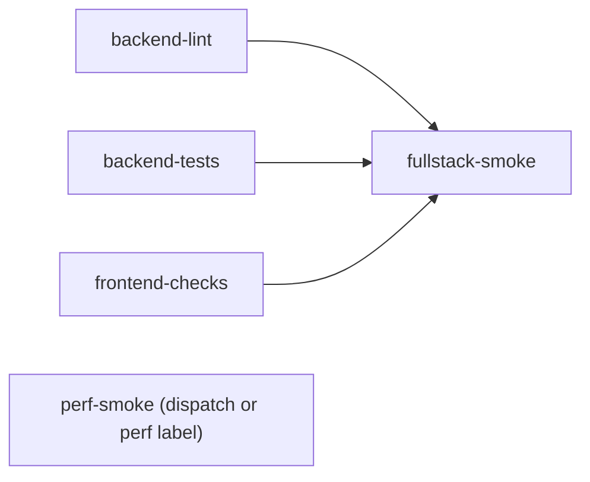

# Development

Scope: everything an engineer needs to work on AskDIQ locally: setup, running the backend, frontend, job worker
and mock IdP, seeding data, tests, lint and security scans, the CI pipeline and its local mirror, the branch and
PR workflow, and troubleshooting of known failure modes. Production layout and runbooks are in
[Deployment and operations](08-deployment-operations.md); every env var is in [Configuration](06-configuration.md).

Contents

- [Prerequisites](#prerequisites)
- [Local setup](#local-setup)
- [Running the stack](#running-the-stack)
- [Seeding data](#seeding-data)
- [Tests](#tests)
- [Lint and security scans](#lint-and-security-scans)
- [Continuous integration](#continuous-integration)
- [Local CI mirror](#local-ci-mirror)
- [Branch and PR workflow](#branch-and-pr-workflow)
- [Troubleshooting](#troubleshooting)

## Prerequisites

| Tool | Version | Source of truth |
|---|---|---|
| Python | 3.14 | `.github/workflows/ci.yml` `PYTHON_VERSION`; `pyproject.toml` `[tool.pylint.main] py-version = "3.14"` (`requires-python >=3.11`, Ruff `target-version = "py311"`) |
| Node.js | 20 | `ci.yml` `NODE_VERSION` |
| PostgreSQL + pgvector | pg18 locally (`pgvector/pgvector:pg18`), pg16 in CI (`pgvector/pgvector:pg16`) | `docker-compose.yml`, `ci.yml` |
| uv | optional | Faster installs; `pip` works. No `uv.lock` in the repo. |
| Docker | optional | Local Postgres, or the full compose stack |

No Redis (shared state, rate limits and the event bus use Postgres) and no Playwright run in CI
(`@playwright/test` is listed in `frontend/package.json` devDependencies but no Playwright suite or CI step
exists; journeys run in vitest/jsdom).

## Local setup

### Database

Run Postgres with pgvector from the local compose file (host port **5433**, database `ragdb`, user `postgres`),
from the repository root:

```powershell
docker compose -f infra/docker-compose.yml up -d postgres
```

The `vector` extension is created by the migrations; on a hand-made database run
`CREATE EXTENSION IF NOT EXISTS vector;` as a superuser first (see [Troubleshooting](#troubleshooting)).

### Backend

The venv lives at `backend\venv` in practice (`.vscode/settings.json`, `ci_local.ps1` and every worktree use
`C:\Projects\askdiq\backend\venv`). This differs from the `.venv/` convention in `C:\Projects\CLAUDE.md`; the
existing convention wins (Ruff and Pylint already exclude both `venv` and `.venv`). Worktrees under
`C:\Projects\askdiq-wt\*` reuse the main checkout's venv rather than creating their own.

```powershell
cd backend
python -m venv venv                          # or: uv venv venv
venv\Scripts\python.exe -m pip install -r requirements.txt
Copy-Item .env.example .env                  # then fill in real values
venv\Scripts\python.exe -m alembic upgrade head
venv\Scripts\python.exe scripts\ingest_real_docs.py
```

- Fill `DATABASE_URL` (for the compose Postgres: `postgresql+asyncpg://postgres:<password>@localhost:5433/ragdb`),
  `AZURE_OPENAI_*`, `EMBEDDING_MODEL`, `API_KEY_NAME`, `SESSION_SECRET`, and either `ENTRA_*` or the mock IdP
  settings below.
- `.env` and `.env.local` are git-ignored. Never commit, paste, print or read them (also not into chats or
  tools); only the `*.example` files are shared.

### Frontend

```powershell
cd frontend
npm ci --legacy-peer-deps                    # .npmrc also sets legacy-peer-deps=true
Copy-Item .env.local.example .env.local      # API_BASE_URL, API_KEY (= backend API_KEY_NAME), APP_BASE_URL
```

`API_BASE_URL` and `API_KEY` are server-only (no `NEXT_PUBLIC_`): the browser only calls same-origin
`/api/proxy/*`.

## Running the stack

| Process | Command (from) | Port |
|---|---|---|
| Backend API | `venv\Scripts\python.exe -m uvicorn main:app --reload --port 8000 --timeout-graceful-shutdown 5` (`backend/`) | 8000 |
| Frontend | `npm run dev` (`frontend/`; `next dev --turbo -p 3000`; `dev:webpack` without turbo) | 3000 |
| Frontend (prod build) | `npm run serve` (`next build && next start -p 3000`) | 3000 |
| Job worker | In-process by default (`JOBS_WORKER_ENABLED=true`, started from the FastAPI lifespan via `app/jobs/runtime.py`); standalone: `venv\Scripts\python.exe -m app.jobs.worker` with `JOBS_WORKER_ENABLED=false` on the API | n/a |
| Full stack in Docker | `docker compose -f infra/docker-compose.yml up --build` (repo root) | 5433, 8000, 3000 |

Health check: `GET http://127.0.0.1:8000/health`. API docs: `/docs` and `/redoc` are served unless `ENV=production` (where `ENABLE_API_DOCS=true` turns them on).

### Mock IdP (sign in without Entra)

| Setting | File | Value |
|---|---|---|
| `AUTH_DEV_MOCK` | `backend/.env` | `true` (settings validation refuses it unless `ENV=development`) |
| `ENV` | `backend/.env` | `development` |
| `SUPERADMIN_EMAILS` | `backend/.env` | comma-separated; these emails become active superadmins on first sign-in |
| `AUTH_DEV_MOCK` | `frontend/.env.local` | `true` (enables the `/mock-idp/*` forwarder; otherwise 404) |
| `APP_BASE_URL` | both | `http://localhost:3000` (mock authority defaults to `APP_BASE_URL/mock-idp`) |

Open `http://localhost:3000`, click **Sign in with Microsoft**, pick an email. A `SUPERADMIN_EMAILS` address
lands as Superadmin; any other email becomes a pending user (Access Required) that a superadmin approves in
User Management.

For real Entra SSO, set `ENTRA_TENANT_ID`, `ENTRA_CLIENT_ID`, `ENTRA_CLIENT_SECRET` and check the setup with
`venv\Scripts\python.exe scripts\verify_sso_config.py`.

## Seeding data

| Script | Effect |
|---|---|
| `scripts/ingest_real_docs.py` | Ingests the KB corpus `data/real_docs/*.md` (incremental, safe to rerun). |
| `scripts/seed_usage_data.py` | Deterministic usage dataset (mixed IPs, sessions, outcomes, audit rows). |
| `scripts/seed_comprehensive_deployiq_data.py` | 1,000+ synthetic rows across all tables; keeps documents and chunks. |
| `scripts/seed_ingest.py` | Ingests via the live `/ingest` API (`--api-url`, `--token`). |
| `scripts/backfill_turn_insights.py`, `backfill_evaluation_records.py`, `backfill_usage_accounting.py` | Backfills for insights labels, evaluation records, usage accounting (`--apply`). |
| `scripts/seed_realistic_activity.py` | **In progress (branch `feat/realistic-demo-data`)**: realistic visitors, sessions, answers citing real chunks, cost, latency, feedback, eval records, insights labels, then the real insights rollup. Dry run by default; `--apply`, `--scale 0.1`, `--seed 7`, `--purge --apply`. Seeded rows are tagged (`seed-` request ids, `.example` emails, model `seed-synthetic`); seeded `audit_log` rows stay after purge (append-only trigger). |

Seeders write to whatever `DATABASE_URL` points at; never point them at production.

## Tests

### Backend (pytest)

```powershell
cd backend
venv\Scripts\python.exe -m pytest -q -m perf                       # timing gates, no coverage
venv\Scripts\python.exe -m pytest -q -m "not perf" --cov=app --cov-fail-under=78
```

| Item | Detail |
|---|---|
| Config | `pytest.ini`: `pythonpath = .`, `asyncio_mode = auto`, `testpaths = tests` |
| Marker `perf` | Timing/latency gates (`test_concurrency_50.py`, `test_insights_integration.py`, `test_shared_state.py`). CI runs them first, on a freshly migrated DB, without coverage tracing. |
| Marker `real_auth` | Real SSO session resolution instead of the signed-in superadmin override (`test_route_guards.py`, `test_auth_rbac.py`, `test_auth_routes.py`, ...). |
| Marker `db` | Registered in `conftest.py`: needs the DB without using the `db_session` / `client` fixtures. |
| Database | DB tests need a migrated Postgres with pgvector. URL: `TEST_DATABASE_URL`, else `DATABASE_URL`; `TEST_DB_SUFFIX` appends `_<suffix>` to the database name. A missing DB **fails** the run; `ALLOW_DB_SKIP=1` (local only) turns that into skips. CI never sets it. |
| Defaults | `conftest.py` sets `STATE_BACKEND=memory`, `AUTH_DEV_MOCK=true` and a test `SESSION_SECRET` if unset. |
| Coverage | `COV_FAIL_UNDER: "78"` in `ci.yml` (ratchet; target 80). |
| Route guards | `tests/test_route_guards.py` walks `app.routes`; a new route without a guard dependency (and not in `PUBLIC_PATHS`/`PUBLIC_PREFIXES`) fails the build. Update it for every new route. |

Use test-only env values (the set in `ci.yml` `env:`) rather than a real `.env` when running tests in a shell.

### Frontend (vitest)

```powershell
cd frontend
npm test                 # vitest run (jsdom, tests/setup.ts)
npx vitest run tests/journeys          # journeys only
```

`tests/components/` and `tests/lib/` are unit and component tests; `tests/journeys/` are multi-step user
journeys rendered in jsdom with router/auth harnesses from `tests/helpers/`. `tests/lib/theme-tokens.test.ts`
has a snapshot; update it only for intended token changes.

### Smoke and load

| Script | Use |
|---|---|
| `scripts/smoke_e2e.py --frontend-url ... --backend-url ...` | Full-stack smoke (CI `fullstack-smoke`). |
| `scripts/smoke_journeys.py --base-url ...` | Sign-in journeys through the frontend. |
| `scripts/run_admin_load_test.py [--smoke]` | Admin HTTP load test with budgets (CI `perf-smoke`). |
| `scripts/run_concurrency_test.py --users N` | Concurrent `/query` users against the real pipeline (needs Azure). |
| `scripts/run_evaluation.py` | Live RAG evaluation (needs DB and Azure). |

## Lint and security scans

Backend (from `backend/`, all via the venv):

| Command | Config / gate |
|---|---|
| `venv\Scripts\ruff.exe check .` | `pyproject.toml` `[tool.ruff.lint]`: E, W, F, I, UP, B, N, PL, SIM, S, ASYNC, C4, T20, RUF, ARG, RET, FAST. Ignored: E501, B008, PLR0913, FAST001/002 (project convention), PLR0911/0912/0915/0917 (deferred), a few RUF/C4 rules. Per-file: routes ARG001; scripts E402/T201/PLR2004/S311/PLC0415; tests S101/PLR2004/ARG001/ARG002/PLC0415; alembic versions F401/F403/E501/N999. |
| `venv\Scripts\ruff.exe format --check .` | Line length 88, double quotes. |
| `venv\Scripts\pylint.exe app` | `fail-under = 9.34` (ratchet: only raise); docstring checks disabled. |
| `venv\Scripts\bandit.exe -r app -ll` | Medium+ severity findings fail. |
| `venv\Scripts\pip-audit.exe -r requirements.txt --ignore-vuln <id> ...` | Allow-list `.github/audit/pip-audit-ignore.txt`: one id per line, comment must contain `expires YYYY-MM-DD`; a missing or past expiry fails CI. |

Frontend (from `frontend/`):

| Command | Gate |
|---|---|
| `npm run lint` | `next lint` (`.eslintrc.json`) |
| `npm run typecheck` | `tsc --noEmit` |
| `npm run build` | `next build` |
| `npm run audit:gate` | `scripts/audit-gate.mjs`: `npm audit --omit=dev`; high/critical advisories must be in `.github/audit/npm-audit-allowlist.json` with a future `expires`. |

## Continuous integration

`.github/workflows/ci.yml` runs on every `pull_request` (no branch filter, so stacked PRs get CI), on push to
`main`, and on manual dispatch. `concurrency` cancels superseded runs per ref. Permissions: `contents: read`.
Workflow env holds test-only values (`DATABASE_URL`/`TEST_DATABASE_URL` `postgresql+asyncpg://ci:ci@127.0.0.1:5432/ci`,
dummy Azure, `AUTH_DEV_MOCK=true`, `ENV=development`, `SUPERADMIN_EMAILS=ci-admin@example.com`,
`PYTHON_VERSION=3.14`, `NODE_VERSION=20`, `COV_FAIL_UNDER=78`).



| Job | Steps |
|---|---|
| `backend-lint` | checkout; setup-python 3.14 (pip cache); install requirements; `ruff check .`; `ruff format --check .`; `pylint app`; `bandit -r app -ll`; pip-audit with the expiring allow-list. |
| `backend-tests` | Service `pgvector/pgvector:pg16`; install; `alembic upgrade head`; assert exactly one `alembic heads` line with `(head)`; `alembic downgrade -1 && alembic upgrade head`; `pytest -q -m perf`; `pytest -q -m "not perf" --cov=app --cov-report=xml --cov-fail-under=78`; upload `backend-coverage`. |
| `frontend-checks` | setup-node 20 (npm cache); `npm ci --legacy-peer-deps`; `npm run lint`; `npm run typecheck`; `npm test`; `npm run build`; `npm run audit:gate`. |
| `fullstack-smoke` | Needs the three jobs above. pg16 service; install both; `alembic upgrade head`; start uvicorn on 8000; `npm run build` + `next start -p 3000` (`API_BASE_URL=http://127.0.0.1:8000`, `API_KEY=$API_KEY_NAME`); wait for `/health` and `/`; `python scripts/smoke_e2e.py`; upload logs on failure. |
| `perf-smoke` | Only on `workflow_dispatch` or PRs labelled `perf`. Skips if `run_admin_load_test.py` lacks `--smoke`; else migrate, start uvicorn, `run_admin_load_test.py --smoke`; upload log on failure. |

## Local CI mirror

`ci_local.ps1` mirrors `backend-lint`, `backend-tests`, `frontend-checks` and `fullstack-smoke` on Windows. It must
print `RESULT: PASS` before any push (the owner does not want CI-failure emails).

The script currently lives **outside the repository**, in the coordinator's Claude scratchpad
(`...\scratchpad\ci_local.ps1`, with a helper `ci_db.py` next to it). Recommended follow-up: commit both (for
example under `scripts/ci/`) so every engineer runs the same gate. Not done in this docs change.

```powershell
powershell -ExecutionPolicy Bypass -File <dir>\ci_local.ps1 -Worktree C:\Projects\askdiq-wt\<worktree>
# optional: -SkipBackend  -SkipFrontend  -SkipSmoke
```

What it does:

| Stage | Behaviour |
|---|---|
| Credentials | Reads the **user-level** env var `ASKDIQ_TEST_DB_ADMIN_URL` (a Postgres URL with rights to create databases; never printed). Falls back to the process env, then (owner-approved) to `DATABASE_URL` from the main checkout's `backend\.env` without printing it. |
| Env | Sets the same test-only values as `ci.yml` (dummy Azure, `AUTH_DEV_MOCK=true`, `ENV=development`, ...); `ALLOW_DB_SKIP` and `TEST_DB_SUFFIX` are blanked so DB tests cannot skip. Reads `COV_FAIL_UNDER` from the worktree's `ci.yml` (default 78). |
| Throwaway DB | Creates `askdiq_ci_<worktree name>` via `ci_db.py create`, points `DATABASE_URL` and `TEST_DATABASE_URL` at it, and drops it at the end. Only `ci_*` databases are created or dropped. |
| backend-lint | `ruff check`, `ruff format --check`, `pylint app`, `bandit -r app -ll -q`, pip-audit with the same expiry rules. Installs `pylint==4.1.3` into the venv if missing. |
| backend-tests | `alembic upgrade head`, single-head check, `downgrade -1` / `upgrade head`, then `pytest -m perf` and `pytest -m "not perf"` with coverage when the branch's `ci.yml` splits perf (else one coverage run). |
| frontend-checks | `npm ci --legacy-peer-deps` if `node_modules` is missing or older than `package-lock.json`; lint, typecheck, test, build, and `audit:gate` if the script exists. |
| fullstack-smoke | Only if everything passed: starts uvicorn and `next start` on per-worktree ports (`18000+h` / `13000+h`), waits for health, runs `smoke_e2e.py`, then stops only the processes it started. Logs go to `smoke_*_<name>.log` beside the script. |

| Exit code / output | Meaning |
|---|---|
| `0`, `RESULT: PASS - safe to push` | Every mirrored step passed. |
| `1`, `RESULT: FAIL - DO NOT PUSH` | At least one step failed (summary table lists which). |
| `3` | No test DB credentials (`ASKDIQ_TEST_DB_ADMIN_URL` unset and no fallback): DB tests cannot run like CI. Do not push. |

## Branch and PR workflow

| Rule | Detail |
|---|---|
| Never push or merge to `main` | The owner merges. Hotfixes go on a `main`-based branch (e.g. `hotfix/query-filters-ip-ingest`) and must then be merged forward into the stacked branches and `preview/view`. |
| Stacked PRs | Each PR's base is the previous PR's branch, not `main`; left unmerged until the owner merges. CI runs on every PR regardless of base. |
| `preview/view` | Local integration branch combining the in-flight branches for review; docs branches are based on it. |
| Worktrees | One worktree per branch under `C:\Projects\askdiq-wt\<name>`; the main checkout is `C:\Projects\askdiq`. Do not modify another task's worktree. |
| Never `git stash` | The stash is shared across all worktrees of the repository; stashing in one can lose or misapply another's work. Commit to a WIP branch instead. |
| Alembic revision ids | Random: `uuid.uuid4().hex[:12]` (e.g. `b2d6e08d82b3`), never hand-made sequences. Before committing, confirm the id is unused on every remote branch, e.g. `git fetch origin` then `git grep -l <id> $(git for-each-ref --format='%(refname)' refs/remotes/origin) -- backend/alembic/versions`. Set `down_revision` to the current head; CI fails on more than one head. |
| Commits | Conventional Commits (`feat(scope): ...`, `fix(...)`, `perf(...)`, `docs(...)`, `build(...)`, `test: ...`, `chore: ...`). |
| PR description | Fill `.github/pull_request_template.md`: summary, plan task ids, type, light/dark screenshots for UI, migration checks, OWASP rows, budgets, assumptions, test evidence, rollback, checklist. |
| New routes | Guard dependency + update `backend/tests/test_route_guards.py`; add 401/403/422/injection tests; document in [API reference](04-api-reference.md). |
| Before pushing | `ci_local.ps1` prints `RESULT: PASS`. GitHub access is via the REST API with the Windows Credential Manager token. |

## Troubleshooting

| Symptom | Cause | Fix |
|---|---|---|
| Next.js logs `HeadersTimeoutError` / `UND_ERR_HEADERS_TIMEOUT`, "fetch failed" or "failed to pipe response"; pages and chat hang for ~300 s | Backend frozen by **DB pool exhaustion**, not a frontend bug. Known causes: (1) requests holding their `get_db` connection while waiting on `gather_scoped` fan-out sessions (dashboard, feedback analytics, monitoring, conversation stats), so concurrent dashboards deadlock the pool until `pool_timeout`; (2) `GET /branding` single-flight load running on the caller's session, leaking the connection when the caller disconnects ("garbage collector is trying to clean up non-checked-in connection" in the log); (3) the governance SSE producer snapshot with no time bound; (4) frontend polling and revalidation re-requesting failing keys; (5) Next's data-cache background refresh of branding keeping every render open. | Restart the backend to recover. **In progress (branch `fix/chat-page-fetch-timeouts`, uncommitted)**: `release_connection(db)` before fan-out; process-wide `fanout_slots()` semaphore (`pool_size + max_overflow - AGG_POOL_RESERVE`, default reserve 5); branding load opens its own session, bounded by `BRANDING_LOAD_TIMEOUT_SECONDS=5`; SSE snapshot bounded by `GOVERNANCE_STREAM_SNAPSHOT_TIMEOUT_SECONDS=60`; `DB_POOL_TIMEOUT_SECONDS=120`; `/health` reports `pool` (`checked_out > 0` on an idle server means a leak). Frontend: proxy bounds the wait for headers (`BACKEND_TIMEOUT_MS=60000`, `BACKEND_WRITE_TIMEOUT_MS=180000`, answers 504) and retries idempotent calls on 502/503/504 or connection errors (`BACKEND_RETRIES=2`, jittered backoff); `query-cache.ts` backs off failing keys (1 s doubling to 60 s); branding cached in-process instead of ISR; new `app/global-error.tsx`; regression test `backend/tests/test_connection_release.py`. |
| Microsoft sign-in error `AADSTS50011` (redirect URI mismatch) | The redirect URI sent to Entra is `ENTRA_REDIRECT_URI` (alias `OIDC_REDIRECT_URI`), default `APP_BASE_URL + /auth/callback`; it must equal a URI registered on the app registration exactly (scheme, host, port, path, no trailing slash). | Register the exact URI, or set `ENTRA_REDIRECT_URI` to the registered one. Supported callback paths: `/auth/callback`, `/auth/callback/<provider>`, `/api/auth/callback/<provider>`. Locally use port 3000 (`APP_BASE_URL=http://localhost:3000`), not the backend port. |
| `/login?error=idp_unavailable` | `frontend/app/auth/login/route.ts` maps it from: a non-2xx from `GET /auth/sso/login` other than 400/401/403/429 (e.g. 500 when the sign-in tables are missing, or 502 when the backend's OIDC client fails, such as unreachable Entra discovery), a body that is not JSON, or no `authorize_url` / no `state` in it. A backend that cannot be reached at all gives `backend_unavailable` instead. | Check the backend log. Run `alembic upgrade head`: `oidc_states` comes from `f8a9b0c1d2e3`, `users`/`auth_sessions` from `a9b0c1d2e3f4`. Check `ENTRA_*` / `AUTH_DEV_MOCK` settings with `scripts/verify_sso_config.py`. |
| `address already in use` on 8000 / 3000 / 5433 | Another checkout's servers (other worktrees), or a local Postgres on 5433. | Stop your own other servers (never kill processes you did not start); or run on other ports (`uvicorn --port 8001`, `next dev -p 3001`) and set `API_BASE_URL` / `APP_BASE_URL` accordingly. Check with `Get-NetTCPConnection -LocalPort 8000`. |
| `type "vector" does not exist` / `extension "vector" is not available` | Postgres image without pgvector, or the extension not created and the migration user is not allowed to create it. | Use `pgvector/pgvector` images; run `CREATE EXTENSION IF NOT EXISTS vector;` as a superuser on the database. |
| CI "Expected exactly 1 alembic head"; `alembic upgrade head` says "Multiple head revisions" | Two branches added migrations with the same `down_revision`. | Rebase your migration's `down_revision` onto the current head (do not add a merge revision unless the owner asks); recheck `alembic heads`. |
| Flaky `test_concurrency_50` or `test_http_efficiency` locally | Timing-sensitive tests (latency budgets, event-loop blocking, pool behaviour) on a heavily loaded machine or with coverage tracing. | Run them alone: `pytest -q -m perf` and `pytest -q tests/test_http_efficiency.py`; close other heavy processes. CI runs perf gates without coverage. Do not loosen budgets to make them pass. |
| DB tests fail with connection errors | No reachable test DB. | Start Postgres and set `TEST_DATABASE_URL`, or set `ALLOW_DB_SKIP=1` locally (never in CI). |
| Windows: commands fail in the wrong shell | The tooling mixes PowerShell (`ci_local.ps1`, `venv\Scripts\...`) and Git Bash (POSIX scripts, `VAR=value cmd`). | PowerShell: `$env:VAR='x'; cmd`, `;` not `&&` (PowerShell 5.1). Git Bash: forward slashes, `/c/Projects/...`. |
| Windows: `LF will be replaced by CRLF` warnings, broken shell scripts in containers | `core.autocrlf` converts line endings in the working copy. | Leave the warnings; commits normalize. Files that run in Linux (`docker-entrypoint.sh`) must be LF; the deploy kit (`infra/build_kit.ps1`, **In progress (branch `chore/prod-deploy-fullstack`)**) builds archives with LF endings via `git archive`. |
