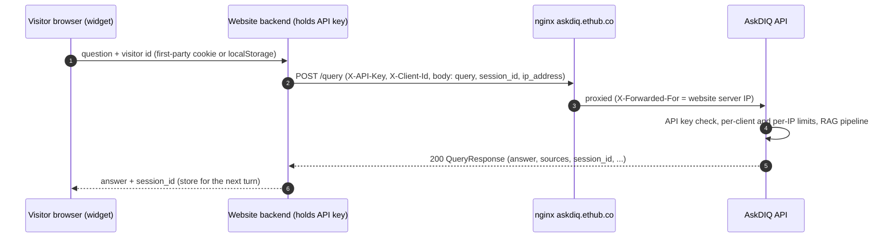

# Website integration guide (public chat widget)

The contract the website frontend team uses to put AskDIQ on the public
website: how to call `POST /query` and the session/feedback routes from
your server, what to send, what comes back, the rate limits, and how to
handle errors. It describes the API **as deployed on `askdiq.ethub.co`
today** (`main` + branch `hotfix/query-filters-ip-ingest`). The admin-console
revamp (`preview/view`) keeps the same contract on the same paths; the
differences are listed in [section 10](#10-upcoming-changes).

Contents

- [1. Integration shape](#1-integration-shape)
- [2. Authentication and visitor identity](#2-authentication-and-visitor-identity)
- [3. POST /query](#3-post-query)
- [4. Sessions](#4-sessions)
- [5. Feedback](#5-feedback)
- [6. Rate limits](#6-rate-limits)
- [7. Errors and retries](#7-errors-and-retries)
- [8. Examples](#8-examples)
- [9. Checklist](#9-checklist)
- [10. Upcoming changes](#10-upcoming-changes)

---

## 1. Integration shape

The browser widget never calls AskDIQ directly. Your website backend holds
the API key, calls AskDIQ server-to-server, and forwards each visitor's IP.



## 2. Authentication and visitor identity

| Header | Required | Rules |
|---|---|---|
| `X-API-Key` | Yes | Shared service key (`API_KEY_NAME` on the server). **Server-side only**: never ship it to the browser, never put it in widget JavaScript, logs or URLs. Missing or wrong: **401** `{"detail": "Access Denied!"}`. |
| `X-Client-Id` | Yes (in practice) | One stable id per visitor (per browser). Must match a UUID, or `^[A-Za-z0-9_\-.@]{1,64}$`. Recommended: a random UUID v4 generated once and stored in a first-party cookie/localStorage. A missing or invalid value is silently replaced by the shared actor `default@local`, so **every such visitor shares one identity, one chat history and one rate-limit bucket**. |
| `Content-Type` | Yes | `application/json` |

`X-Client-Id` partitions chat sessions and rate limits; it is not a
security boundary (`backend/app/governance/auth.py`). Do not put emails or
other personal data in it. From the revamp onwards an email-shaped id
(anything containing `@`) is treated like a missing id (`default@local`), so a
visitor id can never name a dashboard user's sessions.

Do **not** send `X-Session`, `X-Requested-With` or `X-AskDIQ-Proxy`: those are
the dashboard's own headers. On the revamp a request carrying `X-Session` or
`X-AskDIQ-Proxy` is treated as a dashboard request and needs a valid session
(401 otherwise).

### End-user IP (`ip_address`)

Because your server is the caller, AskDIQ would otherwise see your server's
address for every visitor. Send the visitor's real IP in the JSON body:

- Field `ip_address` on `POST /query`, `POST /sessions` and
  `POST /sessions/{id}/messages/{message_id}/feedback`.
- Honoured when the server setting `ALLOW_CLIENT_IP_OVERRIDE` is true (code
  default `true` on the hotfix branch; `backend/app/core/request_meta.py`
  `resolve_client_ip`).
- Only syntactically valid IPv4/IPv6 values are used; for a comma list
  (X-Forwarded-For style) the first entry is used. Anything invalid falls back
  to the detected client IP (your server, or the first `X-Forwarded-For` hop
  when the API trusts proxy headers).
- The IP is stored with the visitor's session and messages (audit, audience
  analytics), drives the per-IP rate limit, and is echoed back as
  `ip_address` in the response.
- Take it from your own edge (for example the left-most trusted
  `X-Forwarded-For` entry your load balancer sets), never from a
  client-supplied field.

## 3. POST /query

`POST https://askdiq.ethub.co/query`

### Request body (`QueryRequest`, `backend/app/schemas/query.py`)

| Field | Type | Required | Notes |
|---|---|---|---|
| `query` | string | Yes | 1-2000 characters (also guarded by `MAX_QUERY_LENGTH=2000`) |
| `session_id` | string (UUID) or null | No | The `session_id` from the previous response. Omit/null on the first turn. |
| `ip_address` | string or null | Recommended | Visitor IP (section 2) |
| `filters` | object or null | **Do not send** | Internal. Only keys `source_type`, `corpus`, `ingestion_source` with scalar values are applied; everything else is ignored and logged. Sending filters can only narrow the answer. |

### Session behaviour

- `session_id` valid, owned by this `X-Client-Id` and not expired: the turn is
  added to it and the last turns are used as conversation context
  (follow-ups such as "and how much does it cost?").
- `session_id` unknown, expired or belonging to another client id: a new
  session starts silently (no error). Always store the `session_id` returned.
- No `session_id`: the most recent non-expired session of this client id
  **created from the same IP** is resumed, else a new one starts.
- Sessions expire after `SESSION_TIMEOUT_MINUTES` (default **60**) of
  inactivity.

### Response body (`QueryResponse`)

| Field | Type | Meaning |
|---|---|---|
| `answer` | string | Markdown-ish plain text answer (render as text or safe Markdown; never as raw HTML) |
| `sources` | array | Cited chunks: `chunk_id`, `document_id`, `content`, `score`, `metadata` (source name, headings). Empty for fallbacks. |
| `grounded` | bool | Answer passed the groundedness check |
| `confidence` | float | Groundedness/retrieval confidence 0-1 |
| `guardrail_flags` | string[] | e.g. `off_topic`, `no_sources`, `unsafe_input_detected`, `spam_detected`, `unclear_input`, `query_too_long`, `empty_query`, groundedness flags |
| `outcome` | string | `answered`, `conversational`, `blocked`, `ungrounded`, `llm_failed`, `empty_llm_output` |
| `session_id`, `session_title` | string | Session to send on the next turn |
| `user_message_id`, `assistant_message_id` | string | Ids for feedback (section 5) |
| `request_id` | string | Quote this in support requests |
| `latency_ms` | float | Server time |
| `ip_address` | string | IP the request was attributed to |
| `follow_up_detected`, `history_turns_sent` | bool, int | Whether prior turns were used (max 6 messages) |
| `prompt_tokens`, `completion_tokens`, `total_tokens`, `reasoning_tokens`, `embedding_tokens`, `guardrail_tokens`, `cost_usd`, `token_details` | numbers/object | Usage accounting; can be ignored by the widget |

A blocked, off-topic or failed generation still returns **200** with a
helpful fallback `answer` (for example "That's a bit outside what I can help
with here... our specialists are happy to help"). Show the
`answer`; use `outcome`/`guardrail_flags` only for analytics.

## 4. Sessions

All routes need the same `X-API-Key` and `X-Client-Id`; a visitor only sees
its own sessions.

| Method | Path | Body / result |
|---|---|---|
| `GET` | `/sessions` | List of `ChatSessionSummary`: `id`, `title`, `created_at`, `last_activity_at`, `expires_at`, `is_expired`, `message_count` |
| `POST` | `/sessions` | `{"title"?: string<=256, "ip_address"?: string}` -> **201** summary. Optional; `/query` creates sessions itself. |
| `GET` | `/sessions/{session_id}` | `ChatSessionDetail`: summary + `messages[]` (`id`, `role`, `content`, `created_at`, `grounded`, `guardrail_flags`, `feedback_rating`, token fields) - use it to restore the widget after a page reload |
| `PATCH` | `/sessions/{session_id}` | `{"title": string 1-256}` -> summary |
| `DELETE` | `/sessions/{session_id}` | **204** |
| `DELETE` | `/sessions/{session_id}/messages/{message_id}` | **204**, deletes one exchange |

## 5. Feedback

`POST /sessions/{session_id}/messages/{assistant_message_id}/feedback`

| Field | Type | Rules |
|---|---|---|
| `rating` | int | 1-5 (thumbs up/down: send 5 / 1) |
| `comment` | string or null | Max 1000 chars; control characters stripped |
| `ip_address` | string or null | Visitor IP |

Response: `{message_id, session_id, rating, comment, created_at}`. Sending
again for the same message updates the rating. Limit: 30 per minute per
client id and per IP.

## 6. Rate limits

Sliding 60-second windows (`backend/app/core/rate_limit.py`):

| Limit | Key | Default | Setting |
|---|---|---|---|
| `/query` per visitor | `X-Client-Id` (or `default@local`) | **10 per minute** | `RATE_LIMIT_PER_MINUTE` |
| `/query` per IP | end-user IP (`ip_address`, else detected IP) | **30 per minute** | `RATE_LIMIT_PER_MINUTE_PER_IP` |
| Feedback | client id and IP | 30 per minute each | code default |

Consequences:

- Without a valid `X-Client-Id`, all visitors share 10 questions per minute.
- Without `ip_address`, all visitors share the website server's IP and 30
  questions per minute in total.
- In the current production build the counters are in process memory, so
  they reset on a restart and are counted per uvicorn worker.
- Load-test client ids can be exempted server-side via
  `RATE_LIMIT_EXEMPT_ACTORS` (ask the AskDIQ team; never in normal traffic).

## 7. Errors and retries

Error bodies on the production build are FastAPI's default
`{"detail": "<message>"}` (validation errors: `{"detail": [ ... ]}`).

| Status | When | What to do |
|---|---|---|
| 401 | Missing/wrong `X-API-Key` | Configuration error; do not retry; alert |
| 404 | Session or message not found / not yours (session routes, feedback) | Drop the stored `session_id`, start fresh |
| 422 | Body invalid (empty `query`, > 2000 chars, rating outside 1-5) | Fix the request; show "please shorten your question" for length |
| **429** | Rate limit hit | See below |
| 500 / 502 / 503 / 504 | Server, nginx or upstream (Azure OpenAI) problem | Retry once after 2-5 s for idempotent reads; for `/query` show "please try again" rather than auto-retrying more than once |

### Handling 429

Response:

```http
HTTP/1.1 429 Too Many Requests
Retry-After: 37
Content-Type: application/json

{"detail": "Rate limit exceeded (per user): max 10 questions per minute. Try again in 37s."}
```

- Read `Retry-After` (seconds). Do not retry before it elapses; never retry in
  a tight loop (each rejected call is audited as `rate_limited`).
- Show the visitor a friendly message ("You're asking quickly; please wait N
  seconds") and disable the send button for `Retry-After` seconds.
- The `detail` text says which limit hit (`per user` or `per IP`); log it.
- If 429s with `per IP` appear for many visitors at once, you are probably not
  sending `ip_address`.

Timeouts: a normal answer takes a few seconds (embedding, rerank, one LLM call,
groundedness check) and at most one extra LLM attempt is made. Use a client
timeout of about 60 s on `/query` (guidance; not a server contract).

## 8. Examples

### curl

```bash
curl -sS https://askdiq.ethub.co/query \
  -H "Content-Type: application/json" \
  -H "X-API-Key: $ASKDIQ_API_KEY" \
  -H "X-Client-Id: 3f6c2a9e-8d41-4c7b-9a55-0f1e2d3c4b5a" \
  -d '{"query": "What is the Trust Center?", "session_id": null, "ip_address": "203.0.113.10"}'
```

### Server-side TypeScript (Next.js route handler / Node 18+)

```ts
// app/api/askdiq/route.ts on the WEBSITE (server only; never in browser code)
const ASKDIQ_URL = process.env.ASKDIQ_URL ?? "https://askdiq.ethub.co";
const ASKDIQ_API_KEY = process.env.ASKDIQ_API_KEY!; // server env, never NEXT_PUBLIC_

export async function POST(req: Request) {
  const { query, sessionId, clientId } = await req.json();
  const visitorIp = (req.headers.get("x-forwarded-for") ?? "").split(",")[0].trim();

  const res = await fetch(`${ASKDIQ_URL}/query`, {
    method: "POST",
    headers: {
      "Content-Type": "application/json",
      "X-API-Key": ASKDIQ_API_KEY,
      "X-Client-Id": clientId, // stable UUID per visitor
    },
    body: JSON.stringify({ query, session_id: sessionId ?? null, ip_address: visitorIp || null }),
    signal: AbortSignal.timeout(60_000),
  });

  if (res.status === 429) {
    const retryAfter = Number(res.headers.get("Retry-After") ?? "30");
    return Response.json({ error: "rate_limited", retryAfter }, { status: 429 });
  }
  if (!res.ok) return Response.json({ error: "unavailable" }, { status: 502 });

  const data = await res.json();
  return Response.json({
    answer: data.answer,
    sources: data.sources.map((s: { metadata: Record<string, unknown> }) => s.metadata),
    sessionId: data.session_id,
    messageId: data.assistant_message_id,
  });
}
```

### Example response (trimmed)

```json
{
  "answer": "The Trust Center is ...",
  "sources": [{"chunk_id": "...", "document_id": "...", "content": "...", "score": 0.71, "metadata": {"source": "trust-center.md"}}],
  "grounded": true,
  "confidence": 0.82,
  "request_id": "...",
  "latency_ms": 4210.5,
  "guardrail_flags": [],
  "session_id": "6f1d...",
  "session_title": "What is the Trust Center?",
  "user_message_id": "...",
  "assistant_message_id": "...",
  "ip_address": "203.0.113.10",
  "follow_up_detected": false,
  "history_turns_sent": 0,
  "outcome": "answered"
}
```

## 9. Checklist

- [ ] API key only in server environment variables; widget talks to your
      backend only (browser calls would also depend on `CORS_ALLOWED_ORIGINS`,
      and would expose the key).
- [ ] One stable UUID `X-Client-Id` per visitor.
- [ ] `ip_address` forwarded on `/query`, `/sessions` and feedback.
- [ ] `session_id` stored per visitor and sent on every turn.
- [ ] No `filters` field.
- [ ] 429 handled with `Retry-After`; no retry loops.
- [ ] `answer` rendered as text/safe Markdown, never raw HTML.

## 10. Upcoming changes

- **Admin-console revamp (`preview/view`)**: same paths, headers and bodies.
  `/query`, `/sessions*` and feedback accept either a dashboard SSO session or
  this contract (`X-API-Key` compared in constant time + `X-Client-Id`, no
  session; `require_chat_actor` in `backend/app/auth/deps.py`). If the server's
  `API_KEY_NAME` is empty, every call gets 401. Differences you may notice:
  - Errors are `application/problem+json`; the `detail` field is still there
    with the same texts (`Access Denied!`, rate-limit messages).
  - Extra 429 when the assistant is at capacity
    (`The assistant is at capacity. Please retry shortly.`, `Retry-After`).
    Handle it like any 429.
  - Rate-limit counters are shared by all workers (Postgres), not per process.
  - Email-shaped `X-Client-Id` values map to `default@local` (section 2).
  - Feedback also accepts optional `reason_tags` and `corrected_answer`.
  - Only the chat routes accept the key alone; every admin route needs a
    dashboard session.
- The Swagger example for `/query` shows only `query`, `session_id` (`""`
  means "no session") and `ip_address` (the old generic `filters` example
  emptied answers).
