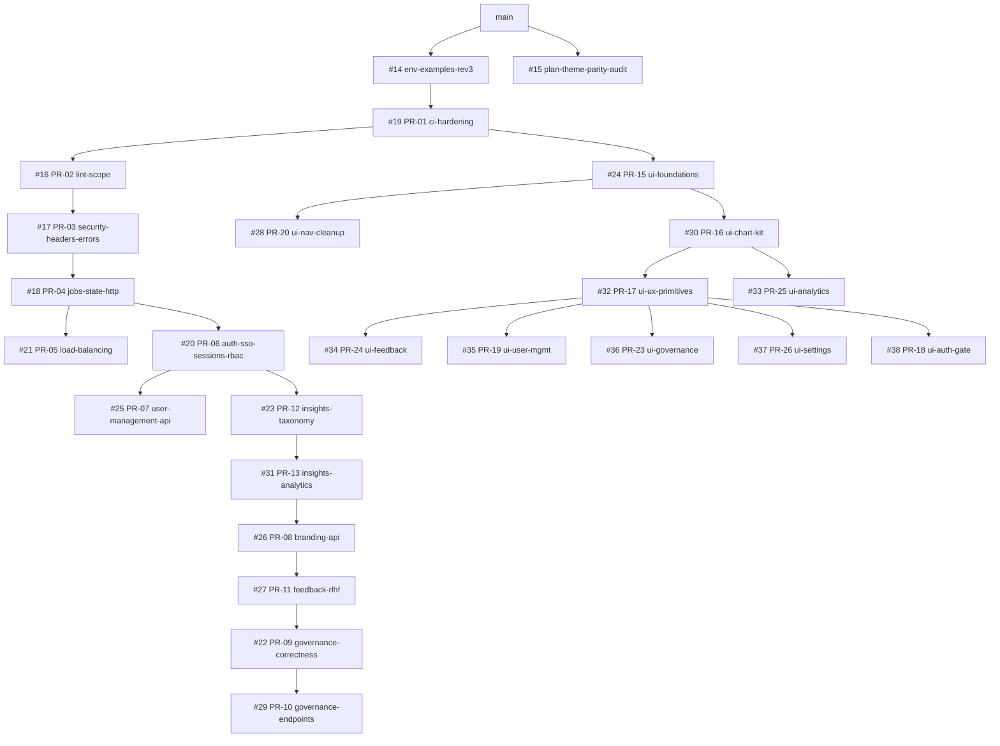

# In-flight work: branches and the open PR stack

Scope: everything that is written but **not yet on `preview/view`** (the base of this doc set, `9115c45`),
plus the open GitHub PR stack #14-#38 that `preview/view` is built from. Part 1 describes the seven
in-flight branches from their actual diffs; Part 2 maps every open PR to the plan
(`planchanges4.md`, PR-01..PR-33 and phase F8). State as of 2026-10-16. Code is the truth; where the plan
says something else, the difference is noted.

Contents

- [Branch model](#branch-model)
- [Part 1: in-flight branches](#part-1-in-flight-branches)
  - [Summary](#summary)
  - [fix/chat-page-fetch-timeouts (PR-27, uncommitted)](#fixchat-page-fetch-timeouts-pr-27-uncommitted)
  - [perf/dashboard-load-speed (PR-28)](#perfdashboard-load-speed-pr-28)
  - [feat/realistic-demo-data (PR-29)](#featrealistic-demo-data-pr-29)
  - [feat/askdiq-chat-widget (PR-30)](#feataskdiq-chat-widget-pr-30)
  - [fix/shell-nav-logout-theme-dates (PR-31)](#fixshell-nav-logout-theme-dates-pr-31)
  - [chore/prod-deploy-fullstack](#choreprod-deploy-fullstack)
  - [hotfix/query-filters-ip-ingest (HF-01, live in prod)](#hotfixquery-filters-ip-ingest-hf-01-live-in-prod)
  - [Overlaps and conflict risks](#overlaps-and-conflict-risks)
  - [Suggested merge order](#suggested-merge-order)
- [Part 2: open GitHub PR stack #14-#38](#part-2-open-github-pr-stack-14-38)
  - [Stack graph](#stack-graph)
  - [PR table](#pr-table)
  - [Is the stack in preview/view?](#is-the-stack-in-previewview)
  - [Plan PRs without a GitHub PR](#plan-prs-without-a-github-pr)
  - [Dependabot and closed PRs](#dependabot-and-closed-prs)

---

## Branch model

| Ref | What it is |
|---|---|
| `main` (`1a88798`, = `origin/main`) | Last merged state. Never pushed to by agents. |
| Production | `main` + `hotfix/query-filters-ip-ingest`; alembic head `d6e7f8a9b0c1`. |
| `preview/all` (`c1295ba`, local only) | `main` + every PR-stack branch (#14-#38 heads, plus local PR-21/PR-22) merged. |
| `preview/view` (`9115c45`, local only) | `preview/all` + the four owner fix branches (`fix/owner-dashboard-data-endpoints`, `fix/owner-theme-tables-motion`, `fix/owner-documents-inventory`, `fix/owner-click-audit-analytics`). Alembic head `254857d10a20`. |
| F8 branches | Branched from `preview/view` at `9115c45` (not from `main`, see note below). |
| HF-01 | Branched from `main` at `1a88798`; **not** in `preview/view`. |

Plan difference: `planchanges4.md` F8 says each F8 PR branches "from a fresh `main`". In reality all five
F8 branches and the deploy branch start at `preview/view` (`git merge-base preview/view <branch>` =
`9115c45`), so they cannot be merged to `main` before the #14-#38 stack lands.

Migration drift: `preview/view` adds 9 migrations not on `main` (`a9b0c1d2e3f4`, `e7f8a9b0c1d2`,
`f8a9b0c1d2e3`, `4c1e9a7d2b65`, `bd75f2033c21`, `b0c1d2e3f4a5`, `5712ebd9d3c9`, `72125f44984d`,
`254857d10a20`) on top of prod's `d6e7f8a9b0c1`; `perf/dashboard-load-speed` adds a tenth
(`b2d6e08d82b3`). See [Database](05-database.md).

---

## Part 1: in-flight branches

### Summary

| Branch | Plan id | Worktree | State | Commits vs `preview/view` | Files | Live in prod |
|---|---|---|---|---|---|---|
| `fix/chat-page-fetch-timeouts` | PR-27 (F8.1) | `C:\Projects\askdiq-wt\fix-chat-timeouts` | **Uncommitted** (HEAD = `9115c45`) | 0 (24 modified + 5 untracked files) | 29 | No |
| `perf/dashboard-load-speed` | PR-28 (F8.2) | `C:\Projects\askdiq-wt\perf-dashboard` | Committed, clean tree | 2 (`3bf8142`, `2e6bd62`) | 19 | No |
| `feat/realistic-demo-data` | PR-29 (F8.3) | `C:\Projects\askdiq-wt\feat-seed-data` | Committed, clean tree | 3 (`e8e17c9`, `734bf26`, `bb7df73`) | 11 | No |
| `feat/askdiq-chat-widget` | PR-30 (F8.4) | `C:\Projects\askdiq-wt\feat-askdiq-widget` | Committed, clean tree | 2 (`8abae17`, `a965b12`) | 20 | No |
| `fix/shell-nav-logout-theme-dates` | PR-31 (F8.5) | `C:\Projects\askdiq-wt\fix-shell-ux` | Committed, clean tree | 5 (`5c5f093`..`8d77dac`) | 93 | No |
| `chore/prod-deploy-fullstack` | (not in register) | `C:\Projects\askdiq-wt\deploy-fullstack` | Committed, clean tree | 4 (`a0f25ae`..`323329e`) | 12 | No |
| `hotfix/query-filters-ip-ingest` | HF-01 (F8.7) | `C:\Projects\askdiq-wt\hotfix` | Committed, clean tree; base `main` | 3 (`a795af3`, `27d516c`, `f9d76ed`) | 13 | **Yes** |

None of these branches has a GitHub PR yet. Pushes wait for `ci_local.ps1` to print `RESULT: PASS`
([Development](09-development.md)).

### fix/chat-page-fetch-timeouts (PR-27, uncommitted)

**In progress (branch `fix/chat-page-fetch-timeouts`).** Worktree only; nothing committed. Problem
(newplan §17.1): `/chat` hung on undici's 300 s headers timeout when the backend froze, the browser
re-requested `GET /chat?_rsc=...` about once a second, and pooled DB connections leaked until the pool
was exhausted.

Backend: connection leak and freeze

| Change | File | Detail |
|---|---|---|
| `release_connection(session)` | `backend/app/core/database.py` | Commits the session's read transaction (if any) so its pooled connection returns before the request fans out to parallel sessions. A request holding one connection while waiting for more could deadlock the pool. |
| Called before fan-out | `admin.py` (`admin_dashboard` with a window), `admin_feedback.py` (`get_feedback_analytics`), `admin_governance.py` (`governance_monitoring`), `app/entities/conversations.py` (`conversation_stats`) | Each releases `db` before `gather_scoped` / `runner.gather`. |
| `pool_stats()` | `database.py`, `routes/health.py` | `/health` now returns `"pool": {size, max_overflow, checked_out, idle}`; the probe releases its own connection first, so `checked_out > 0` on an idle server means a leak. |
| `pool_timeout` | `database.py`, `config.py` | New `DB_POOL_TIMEOUT_SECONDS` (default `120`): bursts queue instead of failing. |
| Fan-out cap | `app/core/concurrency.py` | `fanout_slots()`: one process-wide semaphore of `DB_POOL_SIZE + DB_MAX_OVERFLOW - AGG_POOL_RESERVE` (min 1) slots, taken by every `gather_scoped` task. New `AGG_POOL_RESERVE` (default `5`) keeps connections free for sign-in, `/health` and plain reads. |
| Branding load | `app/branding/service.py`, `routes/branding.py` | `get_branding()` takes a session factory, opens its own session inside the single-flight load and is bounded by `BRANDING_LOAD_TIMEOUT_SECONDS` (default `5`). A cancelled caller can no longer close a session the shared load is still using. |
| SSE producer | `app/governance/stream.py` | `GovernanceStreamHub.tick()` wraps the snapshot in `asyncio.timeout(GOVERNANCE_STREAM_SNAPSHOT_TIMEOUT_SECONDS)` (default `60`); on timeout it logs `governance_stream_snapshot_timeout` and the next tick retries, so the producer never hangs. |
| Env docs | `backend/.env.example` | The four new variables above. |

Frontend: bounded server fetches, retries, no loops

| Change | File | Detail |
|---|---|---|
| Timeouts and retries config | `frontend/lib/server/backend.ts` | `backendTimeoutMs(write)`: `BACKEND_TIMEOUT_MS` (default `60000`) for reads, `BACKEND_WRITE_TIMEOUT_MS` (default `180000`) for writes. `backendRetries()`: `BACKEND_RETRIES` (default `2`, max `5`, `0` disables). |
| Proxy | `frontend/app/api/proxy/[...path]/route.ts` | `fetchUpstream()` bounds the wait for **response headers** only (SSE bodies are never cut), propagates browser disconnects, and retries idempotent calls (GET/HEAD/OPTIONS and `POST /auth/logout`) after a connection error or 502/503/504 with jittered exponential backoff (250-500 ms, 500-1000 ms). A timeout is not retried and becomes `504` with `detail: "The backend did not respond within N seconds..."` and `Cache-Control: no-store`. |
| Other server routes | `app/auth/login/route.ts`, `app/auth/callback/route.ts`, `app/mock-idp/[...path]/route.ts` | `AbortSignal.timeout(backendTimeoutMs(...))` on each backend call. |
| Branding fetch | `frontend/lib/brand-server.ts`, `app/layout.tsx` | Drops Next's data cache (`next.revalidate`, and `export const revalidate = 300` in the root layout): Next 14 refreshed stale entries without the request's abort signal and held the page open. Replaced by an in-process cache: fresh is served as is, stale is served at once while one bounded single-flight refresh runs, cold waits at most `BRANDING_TIMEOUT_MS` (2500 ms), failure yields last good brand or `DEFAULT_BRAND`. |
| Polling loops | `frontend/lib/query-cache.ts` | Per-key failure backoff (1 s doubling to 60 s): `isStale()` returns false while backing off, so mounts, focus and stale checks stop re-requesting a failing key; explicit refetches still go through. |
| Root error boundary | `frontend/app/global-error.tsx` (new) | Renders its own `<html>/<body>` with no providers, router or brand hooks; "Try again" and a plain link to `/`; shows `error.digest` as a reference. |
| Env docs | `frontend/.env.local.example` | `BACKEND_TIMEOUT_MS`, `BACKEND_WRITE_TIMEOUT_MS`, `BACKEND_RETRIES`. |

Tests (new or changed): `backend/tests/test_connection_release.py` (10 tests: cancelled branding
caller, branding timeout fallback, bounded SSE snapshot, `release_connection` semantics, process-wide
fan-out cap, every connection returned after cancellation of `gather_scoped` / overview / stream /
branding, no pool deadlock when requests release before fan-out), `frontend/tests/lib/proxy.test.ts`,
`frontend/tests/lib/query-cache.test.ts`, `frontend/tests/lib/brand-server.test.ts`,
`frontend/tests/components/GlobalError.test.tsx`, `frontend/tests/journeys/chat-backend-timeout.test.tsx`
(proxy 504 shown as an error state; no route refresh, navigation or `/auth/me` polling loop),
`frontend/tests/components/BrandProvider.test.tsx`.

`frontend/tests/lib/__snapshots__/theme-tokens.test.ts.snap` shows as modified in this worktree (and in
the main checkout) but has no content diff ignoring line endings: a CRLF/LF artefact, not a token change.

Plan differences: the plan asks for one `serverFetch()` helper with `SERVER_FETCH_TIMEOUT_MS` (10 s), a
typed `UpstreamTimeoutError` and `tests/test_governance_overview_pool.py`. The code uses
`backendTimeoutMs()` with 60 s / 180 s defaults, a private `UpstreamTimeout` class in the proxy, and
`test_connection_release.py`. Unverified: whether a 50-concurrency pool test exactly as F8.1.3 describes
exists.

### perf/dashboard-load-speed (PR-28)

**In progress (branch `perf/dashboard-load-speed`).** Two commits.

`3bf8142` perf(backend), EXPLAIN-driven (numbers from the commit message, local dev DB ~32k
`chat_messages`, cold):

| Endpoint | Before -> after | Change |
|---|---|---|
| `GET /admin/usage/summary` | 6.8 s -> 0.9 s | `cached_tokens_sql()` (`app/dashboard/queries.py`) reads `token_details` (a `json` column) with native json operators instead of casting every row to `jsonb` twice; the six independent aggregates run in parallel via `ScopedRunner.gather`; the global summary lock becomes a per-key single flight. |
| `GET /admin/governance/logs` | 3.4 s -> 1.3 s | `app/governance/logs.py`: `flags_sql()` / `grounded_sql()` cast only `detail.guardrail_flags` / `detail.grounded` to `jsonb`, once per row inside the `LIMIT` subquery; `level_sql()` takes the precomputed columns. |
| `GET /admin/governance/traces/page` | 1.4 s -> 0.1 s | `app/governance/traces.py`: unfiltered `count()` skips the two `LEFT JOIN LATERAL ... LIMIT 1` joins (`_needs_laterals()`), which never change the count. |
| `/admin/usage/embedding`, `/admin/usage/reranker`, `/admin/usage/llm` | - | `_latency_stats()` aggregates counts and stage averages in SQL instead of loading 30 days of `latency_metrics` rows; `usage/llm` keeps per-exchange accounting but is cached in `aggregation_cache` for `USAGE_SUMMARY_CACHE_TTL_SECONDS` (15 s) with single flight. Cache keys include the `dashboard:read` permission scope. |
| `GET /admin/usage/queries` | 3.9 s -> 58 ms (EXPLAIN ANALYZE) | Migration `b2d6e08d82b3` (revises `254857d10a20`): partial index `ix_chat_messages_user_created_desc` on `chat_messages (created_at DESC NULLS LAST) WHERE role = 'user'`, built `CONCURRENTLY` inside `autocommit_block()` with `IF NOT EXISTS`; downgrade drops it concurrently. Mirrored in `ChatMessageRecord.__table_args__`. |

`2e6bd62` perf(frontend), first paint:

- `frontend/lib/server/session-me.ts` (new): `preloadMe()` calls `/auth/me` server-side with the
  session cookie, service key, `X-Forwarded-For` and `User-Agent`, `cache: "no-store"`, bounded by
  `ME_PRELOAD_TIMEOUT_MS` = 1500. Any miss returns `undefined` and the client fetch stays the fallback.
- `frontend/app/layout.tsx`: branding and `preloadMe()` run in parallel (`Promise.all`); the result
  goes to `<AuthProvider initialMe>` so the first HTML carries the sidebar, header and skeletons.
- `frontend/lib/use-usage-data.ts`: Usage & Cost summary moves onto the shared query cache
  (`USAGE_SUMMARY_STALE_MS` = 15000, matching the backend TTL). `DashboardKpis.tsx` hover prefetch writes
  the target page's own cache entry (`governanceKeys.monitoring` in `lib/governance-api.ts`).
- Governance ships only the default tab; Monitoring, Traces and Logs are `next/dynamic` and preloaded on
  idle (`admin/governance/page.tsx`, `MonitoringView.tsx`); `evaluation-live/page.tsx` splits the
  below-the-fold charts.
- `frontend/next.config.js`: `optimizePackageImports` gains `"motion"`.

Tests: `backend/tests/test_dashboard_load_perf.py`, `frontend/tests/lib/session-me.test.ts`,
`frontend/tests/lib/usage-summary-cache.test.tsx`.

Plan differences: plan test names `test_dashboard_perf_budget.py` / `test_aggregation_cache_isolation.py`
and `scripts/measure_dashboard_speed.py` do not exist on the branch. Unverified: p95 < 500 ms at 50
concurrent requests on 10k+ seeded rows.

### feat/realistic-demo-data (PR-29)

**In progress (branch `feat/realistic-demo-data`).** Three commits.

Seeder `backend/scripts/seed_realistic_activity.py` (+ corpus module `seed_realistic_corpus.py`):

| Flag | Default | Meaning |
|---|---|---|
| (none) | dry run | Reads the KB and taxonomy, generates everything, prints row counts, writes nothing. |
| `--apply` | off | Writes (`INSERT ... ON CONFLICT DO NOTHING`), then runs the real insights rollup. |
| `--purge` | off | With `--apply`, deletes seeded rows; without it, prints what would be purged. |
| `--seed` | `42` | RNG seed; deterministic output. |
| `--scale` | `1.0` | Volume multiplier (0.001-20); 1.0 is about 2k visitors, 5k sessions, 12k+ exchanges. |
| `--days` | `120` | History window (1-730). |
| `--eval-rate` | `ONLINE_EVAL_SAMPLE_RATE` | Online-eval sample rate (0-1). |

What it generates: visitors, multi-turn sessions with trend, weekday and diurnal patterns, answers citing
real KB chunk ids, guardrail paths decided by the real guardrail functions, token usage and cost via
`app.governance.costing`, per-stage latency, insert-only audit rows, feedback, online-eval records and
insights labels.

Tagging and purge: `request_id` prefix `seed-` on `chat_messages`, `latency_metrics`,
`evaluation_records` and `audit_log`; `"seed": true` in `token_details`; visitor emails on the reserved
`.example` TLD; test-IP rules with a `seed:` description; insights labels with model `seed-synthetic`.
`--purge` deletes seeded sessions (cascading to messages, feedback, evaluation records, labels), latency
rows and test-IP rules, then recomputes the rollup. Seeded `audit_log` rows are **kept** (the table is
append-only via `trg_audit_log_immutable`).

**No production guard.** The script connects to `settings.database_url` and never checks `ENV`, nor prints
the target host. The plan (F8.3.1) requires refusing `ENV=production` unless `--allow-production` is
passed and printing the DB host first. `backend/.dockerignore` only excludes `scripts/_*.py`, so the
script ships in the prod image and could be run inside `askdiq-api`. Treat this as a blocker before merge.

Live-path field fixes (`734bf26`), so dashboards are not empty on real traffic:

| Field | File | Fix |
|---|---|---|
| Online-eval `latency_ms` | `routes/query.py` | Passes `latency_ms=response.latency_ms` to the online eval (Evaluation (Live) fell back to hard-coded percentiles). |
| Query audit `message_id` | `app/core/sessions.py` | Query audit `detail` gains `message_id` (the activity feed linked nothing). |
| Ingest audit keys | `app/ingestion/service.py` | Ingest audit also writes `cost_usd`, `document_id`, `total_chunks` (ingestion cost showed 0). |
| Governance active users | `governance/timeseries.py`, `governance/overview.py` | Counts distinct `chat_sessions.created_ip` (assistant rows have no IP, so it was always 0). |
| Feedback coverage for `audience=users` | `routes/admin_feedback.py` | Audience filter on `ChatSession.created_ip` instead of `ChatMessageRecord.ip_address`. |

Tests: `test_seed_realistic_activity.py`, `test_seed_realistic_db.py`, `test_live_missing_fields.py`.

### feat/askdiq-chat-widget (PR-30)

**In progress (branch `feat/askdiq-chat-widget`).** Two commits. This is the dashboard's in-app chat for
signed-in users, not the public website widget ([Website integration](10-website-integration.md)).

`8abae17` refactor: `components/chat/ChatConversation.tsx` extracts the `/chat` message list, empty
state and composer so the page and the drawer render one conversation from the layout-level
`ChatProvider`. The assistant name comes from `brand.assistantName` (default "AskDIQ") in the chat
header, composer label and error fallback (was hard-coded "DeployIQ"). Answers get source chips
(`SourceChips.tsx`), local timestamps and Retry (`retryExchange()` in `lib/chat-context.tsx`).

`a965b12` feature:

| Piece | File | Behaviour |
|---|---|---|
| Launcher | `components/askdiq/AskDiqLauncher.tsx`, `AskDiqMascot.tsx` | Mounted in `app/(app)/layout.tsx` on every dashboard page, bottom-right. Idle float and teal pulse, hover tooltip, once-per-session greeting (dismissal in `localStorage` `askdiq.greeting.dismissed`; seen flag in `sessionStorage` `askdiq.greeting.seen`), typing and unread indicators, static under reduced motion. Hidden on `/chat`. |
| Shortcut | `lib/shortcuts.ts` | `Ctrl+/` / `Cmd+/` toggles the drawer (listed in the `?` sheet). |
| Drawer | `components/askdiq/AskDiqDrawer.tsx` | Lazy (`next/dynamic`, preloaded on hover/focus); slides in from the right, `100dvh`. From 640 px non-modal (dashboard stays usable, `Esc` minimises); below 640 px (`SMALL_SCREEN_QUERY`) full-width modal with focus trap. Recent chats, new chat, "Open full chat" carrying the session. |
| Mascot | `public/brand/askdiq-mascot.png` (1.27 MB original), `askdiq-mascot-256.webp` (15 KB) | Served through `next/image`. |

Tests: `frontend/tests/components/AskDiqWidget.test.tsx` (398 lines). Plan difference: plan names the
asset `askdiq-mascot.webp`; Unverified: the F8.4.3 checks (inert `<script>` / `javascript:` links, widget
outside the first-load chunk) are covered.

### fix/shell-nav-logout-theme-dates (PR-31)

**In progress (branch `fix/shell-nav-logout-theme-dates`).** Five commits, 93 files.

| Commit | Change |
|---|---|
| `5c5f093` flat nav | `components/Sidebar.tsx` drops the collapsible "Admin" group; one flat, permission-filtered list; the collapsed rail also offers Sign out. |
| `b37f6e2` logout | New Next route `frontend/app/auth/logout/route.ts` (`POST /auth/logout`): requires `X-Requested-With: askdiq` and a same-origin `Origin` (else 403), revokes the backend session with a 4 s bound (`LOGOUT_BACKEND_TIMEOUT_MS`, best effort), **always** clears the session cookie (Secure behind HTTPS), returns 204 with `Cache-Control: no-store`, `Clear-Site-Data: "cache"` and `X-Session-Revoked: 1/0`. Excluded from `middleware.ts`. Client logout is single-flight, aborts after 6 s and uses `location.replace("/login")`; a bfcache restore re-checks `/auth/me`. `smoke_e2e.py` replays the old session to prove revocation. |
| `edec848` theme | Light and dark only: `ThemeToggle.tsx`, `ProfileMenu.tsx`, `lib/theme-context.tsx`, `lib/theme-script.ts`. A missing, unknown or legacy `system` value is resolved once to the OS setting and persisted. |
| `712026b` dates | `components/ui/RelativeTime.tsx` (`<time>`, "3h ago", local date-time and timezone in the tooltip; naive server timestamps read as UTC) used on every record list. API additions: `/admin/usage/users` items gain `last_active` and `last_active_desc|asc` sorts; `/admin/conversations` accepts `created_at_desc|asc`; `/admin/users` honours first_seen / last_active / queries / sessions sorts; preference-export pairs carry `created_at`. |
| `8d77dac` active visitors | `backend/app/dashboard/active_visitors.py`: one definition. Active visitor = distinct identity with at least one user query in the window; identity = session actor unless empty or the default/anonymous actor, else the query's client IP (message IP, falling back to session IP); test IPs excluded via the audience filter. DAU/WAU/MAU (with previous window and delta) and active now (5 min) from one aggregate. Additive `active_visitors` block on `GET /admin/dashboard` and `GET /admin/visitors/stats`; used by governance overview and monitoring. UI: `ActiveVisitorsPanel.tsx`, `InfoTip.tsx`; usage "Users" card relabelled "Unique client IPs". No migration, no new route. |

Tests include `backend/tests/test_active_visitors.py`, `frontend/tests/lib/auth-routes.test.ts`,
`auth-context.test.tsx`, `theme.test.tsx`, `time.test.ts`, `RelativeTime.test.tsx`,
`ActiveVisitors.test.tsx`, `Sidebar.test.tsx`. Contracts updated in
`frontend/docs/contracts/dashboard-aggregations.md` and `entity-stats.md`.

Plan differences: plan names the component `<DateTime>` and the test `tests/test_active_users.py`. The
plan wanted the identity fallback on the forwarded end-user IP from HF-01; HF-01 is not on this branch's
base, so on `preview/view` the stored IP is still the proxy-detected one (see HF-01 port below).

### chore/prod-deploy-fullstack

**In progress (branch `chore/prod-deploy-fullstack`).** Four commits. Not in the plan register.

| Piece | File | Detail |
|---|---|---|
| Entrypoint | `backend/docker-entrypoint.sh` | For a command containing `uvicorn`, runs `scripts/prestart.py`; a non-zero exit stops the container (API not started). Any other command (job worker, `alembic`, shell) is `exec`'d directly. |
| Pre-start | `backend/scripts/prestart.py` | Bounded wait for Postgres (`DB_CONNECT_TIMEOUT_SECONDS`, 20); `alembic upgrade head` under advisory lock `0x41534B4449510001` (`MIGRATION_LOCK_TIMEOUT_SECONDS`, 600; fatal, exit 3; exit 2 when DB unreachable); idempotent KB ingestion under its own `pg_try_advisory_lock` (non-fatal, timed); optional usage backfill. Toggles `RUN_MIGRATIONS`, `RUN_INGESTION` (default true), `RUN_USAGE_BACKFILL` (default false). |
| Backend image | `backend/Dockerfile.prod`, `backend/.dockerignore` | `ENTRYPOINT ["sh", "/app/docker-entrypoint.sh"]`, CMD unchanged; build fails if `data/real_docs/deploy-iq-platform.md` is missing; `sed` strips CRLF from the entrypoint; `HEALTHCHECK --start-period` 30 s -> 120 s; re-includes `!data/real_docs/*.md`. |
| Dashboard image | `frontend/Dockerfile.prod`, `frontend/.dockerignore` | Multi-stage standalone Next.js, `npm ci` with the repo `.npmrc`, non-root, `HOSTNAME=0.0.0.0`, `/login` healthcheck; run-time env only. |
| Compose example | `deploy/docker-compose.prod.example.yml` | Reference `askdiq-api`, `askdiq-web` (no host port, `askdiq_internal` only) and an optional worker profile. Never a replacement for the server file. |
| nginx | `deploy/nginx/askdiq-admin.conf.example` | Subdomain block for `askdiq-web:3000`, runtime DNS, unbuffered SSE location, `proxy_redirect` rewriting the standalone server's `Location: http://localhost:3000/login`. |
| Env example | `deploy/frontend.env.prod.example` | Dashboard env. |
| Runbook | `deploy/RUNBOOK.md` | Backup (image tags `rollback-$TS`, `pg_dump`), extract only `backend/` and `frontend/`, config, build and start, watch the entrypoint, verify (alembic current = head, `/health`, `askdiq-web:3000/login` from `et-platform-nginx-1`), rollback. |
| Kit | `deploy/build_kit.ps1` | `git archive` of `backend/` + `frontend/` and `deploy/` as `deploy-kit/` with `core.autocrlf=false core.eol=lf`; refuses a dirty tree; verifies with `tar -t`; writes `deploy-kit/KIT_VERSION`; output `askdiq-deploy-<sha>.tgz`. |
| Docs | `DEPLOYMENT.md` | Notes the prod image migrates and ingests in its entrypoint. |

Ops notes: the kit now ships `frontend/` as well as `backend/` (the current ops rule is "backend/ only");
compose, nginx conf and `.env` remain excluded, and `deploy-kit/` is never extracted into `/opt/askdiq`.
With this entrypoint, the first deploy of `preview/view`-era code applies all 9-10 pending migrations
automatically, so the RUNBOOK backup step is mandatory. See
[Deployment and operations](08-deployment-operations.md).

### hotfix/query-filters-ip-ingest (HF-01, live in prod)

**Live in production; branch `hotfix/query-filters-ip-ingest`, base `main` (`1a88798`), not yet a PR into
`main`.** Three commits (`a795af3`, `27d516c`, `f9d76ed`).

| Change | File | Detail |
|---|---|---|
| Filter allow-list | `app/retrieval/vector_store.py`, `core/config.py`, `schemas/query.py` | `usable_filters()` keeps only keys in `RETRIEVAL_FILTER_KEYS` (default `["source_type", "corpus", "ingestion_source"]`) with non-empty scalar values; dropped keys are logged (`retrieval_filters_ignored`). Fixes Swagger's `{"additionalProp1": {}}` emptying every answer. Swagger example for `QueryRequest` omits `filters`. |
| `no_sources` | `app/harness/orchestrator.py` | When nothing is retrieved the flag is `no_sources` (was `off_topic`); same fallback text. |
| KB in image | `backend/.dockerignore` | `!data/real_docs/*.md` after `*.md`, so `scripts/ingest_real_docs.py` works in the container. |
| Forwarded end-user IP | `app/core/request_meta.py`, `routes/query.py`, `routes/sessions.py`, `schemas/session.py` | `resolve_client_ip(request, supplied)`: a valid IPv4/IPv6 `ip_address` from the body (first hop of a comma list) when `ALLOW_CLIENT_IP_OVERRIDE` is true, else `get_client_ip()`. Used on `/query`, `POST /sessions` and feedback; `CreateSessionRequest` and `UserFeedbackRequest` gain `ip_address`. |
| Per-IP limit on end-user IP | `core/rate_limit.py`, `routes/query.py` | `rate_limited_actor` enforces only the per-user limit; `/query` calls `enforce_ip_rate_limit(client_ip)` with the resolved IP. |
| Config | `core/config.py`, `.env.example` | `allow_client_ip_override` default **`True`** in code; `.env.example` documents `ALLOW_CLIENT_IP_OVERRIDE=false`. The two disagree; prod runs the code default unless set. |
| Tests | `tests/test_query_hardening.py`, `tests/test_orchestrator.py` | Allow-list, `no_sources`, IP override, rate-limit keying. |

Security note: with the override on, any API-key holder can choose the IP that is stored and rate
limited. Acceptable because only the trusted website backend holds the key; see
[Security](07-security.md).

**Porting onto `preview/view` is a manual job, not a merge.** `preview/view` differs from `main` in every
file HF-01 touches except `vector_store.py`, `request_meta.py` and `schemas/query.py`:

- `git merge-tree preview/view hotfix/query-filters-ip-ingest` conflicts in
  `backend/app/api/routes/sessions.py`, `backend/app/core/rate_limit.py` and
  `backend/app/schemas/session.py`.
- `routes/query.py` auto-merges but is semantically wrong: on `preview/view`, `rate_limited_actor` depends
  on `require_role_or_chat` (SSO session) and calls the async `aenforce_ip_rate_limit(get_client_ip(...))`;
  HF-01 calls the sync `enforce_ip_rate_limit`. The port must move the async per-IP check into the route
  with `resolve_client_ip()`.
- Merge-forward risk: on `preview/view`, `/query` requires an SSO session; there is no API-key-only public
  route. Merging the stack to `main` as-is would break the website frontend and the public widget in prod.
  A public, API-key route for `/query` (and `/sessions`, feedback) must be decided before that merge
  ([Website integration](10-website-integration.md)).

### Overlaps and conflict risks

Files touched by more than one in-flight branch (`git diff --name-only preview/view...<branch>`, and
`git status` for the uncommitted worktree):

| File | Branches | Risk |
|---|---|---|
| `backend/app/api/routes/admin.py` | perf, shell, chat-timeouts | perf + shell merge clean; chat-timeouts adds `release_connection` in `admin_dashboard`, which shell also edits (active visitors). Re-check. |
| `backend/app/api/routes/admin_feedback.py` | seed, shell, chat-timeouts | Seed changes the `aud_queries` line; chat-timeouts inserts `release_connection` right after it: likely textual conflict. |
| `backend/app/api/routes/admin_governance.py` | shell, chat-timeouts | `governance_monitoring` edited by both. |
| `backend/app/api/routes/admin_usage.py` | perf, shell | perf rewrites the summary (582 lines changed); shell adds `last_active`. `merge-tree` clean. |
| `backend/app/dashboard/queries.py` | perf, shell | `merge-tree` clean. |
| `backend/app/governance/overview.py`, `timeseries.py` | seed, shell | **Conflict** (`merge-tree`). Semantic too: seed counts `chat_sessions.created_ip`; shell replaces it with `active_visitors`. Resolve in favour of shell. |
| `backend/app/api/routes/query.py` | seed, hotfix | Auto-merges; see HF-01 port. |
| `backend/app/core/config.py`, `backend/.env.example` | chat-timeouts, hotfix | Additive settings in different blocks. |
| `backend/.dockerignore` | deploy, hotfix | Both add `!data/real_docs/*.md` in different places; merges clean with a duplicate line. Keep one. |
| `frontend/app/layout.tsx` | perf, chat-timeouts | Same block: chat-timeouts removes `export const revalidate = 300`; perf rewrites the brand/nonce lines and adds `preloadMe`. Its comment "/branding stays in the data cache" is wrong after chat-timeouts. |
| `frontend/app/(app)/admin/governance/monitoring/MonitoringView.tsx`, `components/admin/dashboard/DashboardKpis.tsx` | perf, shell | `merge-tree` clean. |
| `frontend/components/ChatSessionList.tsx` | widget, shell | `merge-tree` clean. |
| `frontend/tests/components/BrandProvider.test.tsx` | widget, chat-timeouts | Small. |
| `frontend/tests/lib/__snapshots__/theme-tokens.test.ts.snap` | main checkout, chat-timeouts (line endings only) | Shell (light/dark only) does not change it; regenerate deliberately only if a token changes. |
| `frontend/lib/auth-context.tsx` | shell (logout); perf relies on `initialMe` | `initialMe` already exists on `preview/view`; no conflict. |

Pairwise `git merge-tree` of the committed branches: only seed x shell conflicts (`overview.py`,
`timeseries.py`); every branch x hotfix conflicts in the three HF-01 files above.

### Suggested merge order

Matches plan waves W14-W16, adjusted to the real conflicts:

1. **HF-01 -> `main`** as its own PR so `main` matches production.
2. **Land the #14-#38 stack** (Part 2); it is the base of every F8 branch. Before the last merge, port HF-01
   onto it and decide the public API-key `/query` route.
3. **`fix/chat-page-fetch-timeouts`** (commit it first). Pool and timeout safety for everything after it.
4. **`feat/realistic-demo-data`**, after adding the production guard. Data needed to measure the perf work.
5. **`fix/shell-nav-logout-theme-dates`**: resolve `overview.py` / `timeseries.py` in favour of
   `active_visitors`.
6. **`perf/dashboard-load-speed`**: rebase, resolve `layout.tsx` with chat-timeouts, check that
   `b2d6e08d82b3` is still the single alembic head, and re-measure on seeded data.
7. **`feat/askdiq-chat-widget`**: independent; after chat-timeouts so the drawer gets the 504 handling.
8. **`chore/prod-deploy-fullstack`**: last, or whenever the dashboard is deployed; its entrypoint applies
   all pending migrations on first start.

---

## Part 2: open GitHub PR stack #14-#38

Source: the GitHub REST API (`pr-list`), branch diffs vs each PR's base, and `planchanges4.md` §6, §8
and §10. Each PR targets the branch it depends on (stacked); none is merged. Plan ids follow the
register (PR-01..PR-26).

### Stack graph

Edges point from base to head (the PR merges head into base).

The backend chain was made linear by the "rebase sweep" (`planchanges4.md` §10) so the migrations form
one line: `d6e7f8a9b0c1` -> `a9b0c1d2e3f4` -> `e7f8a9b0c1d2` / `f8a9b0c1d2e3` (PR-04) -> `4c1e9a7d2b65` ->
`bd75f2033c21` -> `b0c1d2e3f4a5` -> `5712ebd9d3c9` -> `72125f44984d` (Unverified: exact position of the
two PR-04 revisions in that line; see [Database](05-database.md#migration-history)).

### PR table

`head <- base`. Commits / stat are `git log base..head` / `git diff --shortstat base...head` on the local
branches (identical stats on `origin` for the diverged ones, see next section).

| PR | Plan | Head <- base | Commits, stat | What it adds |
|---|---|---|---|---|
| #14 | env (B0) | `chore/env-examples-rev3` <- `main` | 1; 2 files, +74/-1 | Documents every new admin-console env variable as placeholders in `backend/.env.example` and `frontend/.env.local.example`. Root of the stack. |
| #15 | plan | `docs/plan-theme-parity-audit` <- `main` | 37 local (36 on origin); 2 files | The plan files (`planchanges4.md`, theme audit, progress ticks). Local is 1 commit ahead of origin; not in `preview/view`. |
| #19 | PR-01 (B0) | `chore/ci-hardening` <- `chore/env-examples-rev3` | 2; 14 files, +795/-28 | CI jobs backend-lint (ruff, format, pylint, bandit, pip-audit), backend-tests (single alembic head, downgrade round-trip, coverage gate), frontend-checks, fullstack-smoke; runs on stacked PRs; PR template, Dependabot, `TEST_DATABASE_URL`. |
| #16 | PR-02 (B0) | `chore/lint-scope-claude-md` <- `chore/ci-hardening` | 5; 61 files, +349/-222 | Expands ruff rules to the CLAUDE.md set with zero findings; FAST001/FAST002 and some complexity rules ignored per existing style; `GuardrailBlocked` -> `GuardrailBlockedError`. |
| #17 | PR-03 (B1) | `feat/platform-security-headers-errors` <- `chore/lint-scope-claude-md` | 4; 16 files, +1435/-29 | Security headers, problem+json errors (422 `detail` becomes a string, field errors in `errors`), supervised `spawn()`/`drain()`, LLM circuit breaker, timeouts, nginx hardening. |
| #18 | PR-04 (B1) | `feat/platform-jobs-state-http` <- `feat/platform-security-headers-errors` | 6; 38 files, +3386/-86 | Postgres job queue (SKIP LOCKED), shared state tables, LISTEN/NOTIFY event bus, ETag, SSE-safe gzip, `gather_scoped`, LLM gate, 60-request concurrency gate. Migrations `e7f8a9b0c1d2`, `f8a9b0c1d2e3`. |
| #21 | PR-05 (B1) | `feat/platform-load-balancing` <- `feat/platform-jobs-state-http` | 2; 6 files, +878/-153 | nginx `least_conn` upstream over 2 replicas plus SSE location; compose with api-1, api-2 and a worker; budgeted load script. |
| #20 | PR-06 (B2) | `feat/auth-sso-sessions-rbac` <- `feat/platform-jobs-state-http` | 2; 38 files, +3875/-128 | Entra OIDC with a mock IdP, hashed server sessions, RBAC on every route dependency, CSRF checks, `verify_sso_config.py`. Migration `a9b0c1d2e3f4`. Requires `SESSION_SECRET`. |
| #25 | PR-07 (B2) | `feat/auth-user-management-api` <- `feat/auth-sso-sessions-rbac` | 2; 24 files, +4176/-10 | `/auth/*` routes, user accounts and access requests (`users:manage`), `FOR UPDATE` concurrency, 409 safeguards, auth audit events, sign-in smoke journeys, frontend contract in DEPLOYMENT.md. |
| #23 | PR-12 (B6) | `feat/insights-taxonomy-classifier` <- `feat/auth-sso-sessions-rbac` | 4; 27 files, +6407/-9 | Taxonomy tables and a hybrid (rules + LLM) turn classifier run via the job queue (PII-masked, budgeted, circuit breaker); HTML parity fixture. Migration `4c1e9a7d2b65`. |
| #31 | PR-13 (B6) | `feat/insights-analytics-endpoints` <- `feat/insights-taxonomy-classifier` | 7; 13 files, +3573/-1 | `/admin/insights/*` analytics endpoints matching the HTML renderer, taxonomy CRUD, perf work (planner statistics, EXISTS audience). Migration `bd75f2033c21`. |
| #26 | PR-08 (B3) | `feat/branding-white-label-api` <- `feat/insights-analytics-endpoints` | 3; 17 files, +2651/-20 | White-label branding API: OKLCH palette with WCAG check, hardened PNG/WebP/SVG asset validation, login copy, ETag and cross-worker invalidation. Migration `b0c1d2e3f4a5`. |
| #27 | PR-11 (B5) | `feat/feedback-rlhf-loop-api` <- `feat/branding-white-label-api` | 5; 26 files, +3973/-344 | Durable RLHF triage state machine, enriched keyset queue, analytics, bulk actions, golden cases in the DB, JSONL preference export, golden-run job. Migration `5712ebd9d3c9`. |
| #22 | PR-09 (B4) | `fix/governance-data-correctness` <- `feat/feedback-rlhf-loop-api` | 3; 15 files, +1715/-117 | Governance data fixes G1-G7, G9, G11 and new audit sources (rate_limited, server_error, llm_call_failed/llm_retry, session lifecycle, test_ip_updated). Breaking: `trace_id` removed, `service` is a category. |
| #29 | PR-10 (B4) | `feat/governance-endpoints-stream` <- `fix/governance-data-correctness` | 2; 27 files, +4193/-345 | Keyset logs/traces, `/traces/page` envelope, trace detail waterfall, CSV export, monitoring p50/p95/p99, overview, SSE stream with NOTIFY fan-out. Migration `72125f44984d` (CONCURRENTLY). |
| #24 | PR-15 (F0) | `feat/ui-foundations-motion-tokens-brand` <- `chore/ci-hardening` | 4; 63 files, +2905/-459 | Port 3000, `motion`, theme tokens with light/dark parity fixes, BrandProvider and BrandLogo. |
| #28 | PR-20 (F2) | `feat/ui-nav-eval-usage-cleanup` <- `feat/ui-foundations-motion-tokens-brand` | 1; 15 files, +1005/-1156 | Evaluation page retired (307 redirects), Live Telemetry becomes Usage "Overview", Users renamed Visitors; old report kept unmounted as `LegacyEvaluationReport.tsx`. |
| #30 | PR-16 (F0) | `feat/ui-chart-kit-data-layer` <- `feat/ui-foundations-motion-tokens-brand` | 2; 30 files, +4068/-119 | One ChartCard with table view, 12 accessible SVG charts on chart tokens, `useApiQuery` cache (dedupe, SWR, abort, focus refetch, intent/idle prefetch, optimistic mutations). |
| #32 | PR-17 (F0) | `feat/ui-global-ux-primitives` <- `feat/ui-chart-kit-data-layer` | 3; 63 files, +5250/-868 | EntityLink/useDeepLink, DrawerShell, toasts with undo, ConfirmDialog, state components, DateRangePicker, Ctrl+K palette, `?` sheet, table prefs, cursor pagination, branded 404/error pages, mobile sidebar, nav pre-registration. |
| #33 | PR-25 (F6) | `feat/ui-analytics-insights` <- `feat/ui-chart-kit-data-layer` | 3; 37 files, +6046/-4 | Analytics page: native port of the Chatbot Insights HTML on `/admin/insights` with URL-synced filters and cross-filtering. |
| #34 | PR-24 (F5) | `feat/ui-feedback-triage-workspace` <- `feat/ui-global-ux-primitives` | 2; 27 files, +4069/-428 | Feedback workspace (overview, review queue with keys and bulk actions, golden cases, preference export, knowledge gaps) and chat thumbs-down reason chips. |
| #35 | PR-19 (F1) | `feat/ui-user-management` <- `feat/ui-global-ux-primitives` | 1; 24 files, +3826/-5 | User Management: KPIs, users table/drawer (role, suspend, revoke, invite), access-request queue, roles matrix, auth audit trail. |
| #36 | PR-23 (F4) | `feat/ui-governance-revamp` <- `feat/ui-global-ux-primitives` | 2; 24 files, +3801/-821 | Governance UI: health overview, monitoring percentiles and gauges with SSE, traces waterfall, server-paged logs with CSV. |
| #37 | PR-26 (F7) | `feat/ui-settings-branding-taxonomy` <- `feat/ui-global-ux-primitives` | 2; 28 files, +3750/-18 | Settings: branding editor with live light/dark preview and contrast badge, logo uploads, taxonomy editor; public `/branding/assets/[sha]` passthrough. |
| #38 | PR-18 (F1) | `feat/ui-auth-gate-login` <- `feat/ui-global-ux-primitives` | 5; 52 files, +4087/-160 | Server-side OIDC start/callback with HttpOnly session cookie, proxy forwarding `X-Session`/CSRF headers, nonce CSP middleware, `usePermission`, branded `/login`, Access Required flow, `/suspended`, route gate, role-filtered sidebar. |

Plan difference: the register lists PR-18/19/23/24/26 with bases PR-17/PR-18/PR-19; on GitHub #35, #37
and #38 all target `feat/ui-global-ux-primitives` (PR-17) directly, and PR-08/PR-09/PR-11 sit on the
linear backend chain rather than directly on PR-06.

### Is the stack in preview/view?

`git merge-base --is-ancestor <local head> preview/view`: **yes for every head #14, #16-#38**; **no for
#15** (plan docs, kept out of the app build).

Local vs `origin`: these local heads differ from `origin/<branch>` after the rebase sweep:

| PR | Branch | Local | origin | `origin` tip in `preview/view` |
|---|---|---|---|---|
| #15 | `docs/plan-theme-parity-audit` | `84d05b9` | `e65bf78` | No |
| #18 | `feat/platform-jobs-state-http` | `1bc9713` | `389886d` | Yes (local is 1 commit ahead) |
| #20 | `feat/auth-sso-sessions-rbac` | `40de20d` | `0dc42dd` | No |
| #21 | `feat/platform-load-balancing` | `beeb8a3` | `ad25bd4` | No |
| #22 | `fix/governance-data-correctness` | `845268d` | `0839524` | No |
| #23 | `feat/insights-taxonomy-classifier` | `4a824c8` | `73a5ccd` | No |
| #25 | `feat/auth-user-management-api` | `13f2d05` | `fab2e36` | No |
| #26 | `feat/branding-white-label-api` | `5e60a5c` | `82a2f3b` | No |
| #27 | `feat/feedback-rlhf-loop-api` | `4ed7f36` | `cbada72` | No |
| #29 | `feat/governance-endpoints-stream` | `9b2b888` | `3a2252d` | No |
| #31 | `feat/insights-analytics-endpoints` | `81ec99f` | `7edc189` | No |

The diff vs base has identical file/line counts on both sides, so the content is the same; the local
branches are the rebased (linear) versions and the `origin` tips carry merge commits. Pushing the local
versions is on hold behind `ci_local.ps1` (plan §10, "local CI gate"). Until then, what GitHub shows for
these PRs is not byte-for-byte what `preview/view` runs.

### Plan PRs without a GitHub PR

| Plan | Branch | State |
|---|---|---|
| PR-14 (B7) | `feat/dashboard-chart-aggregations` | No branch. The dashboard aggregation endpoints arrived via `fix/owner-dashboard-data-endpoints` instead (contract `frontend/docs/contracts/dashboard-aggregations.md`). |
| PR-21 (F3) | `feat/ui-dashboard-interactive-charts` (`193059d`) | Local only, on PR-17; merged into `preview/all`. |
| PR-22 (F3) | `feat/ui-entity-pages-deeplinks` (`2cbbbb1`) | Local only, on PR-17 (not on PR-21 as the register says); merged into `preview/all`. |
| Owner fixes | `fix/owner-dashboard-data-endpoints` (7), `fix/owner-theme-tables-motion` (8), `fix/owner-documents-inventory` (11, migration `254857d10a20`), `fix/owner-click-audit-analytics` (14 commits) | Local only, based on `preview/all`, merged into `preview/view`. They share the OIDC/governance commits `db88759`..`95a87df`. |
| PR-27..PR-31, HF-01 | see Part 1 | Not raised. |
| PR-32 | `chore/green-open-prs` | No branch. |
| PR-33 | `chore/release-verification` | Not started. |

### Dependabot and closed PRs

| PR | State | Head <- base | Content / outcome |
|---|---|---|---|
| #1 | Open | `dependabot/npm_and_yarn/frontend/npm_and_yarn-c08447d55c` <- `main` | `next` 14.2.35 -> 15.5.27, `postcss` 8.4.39 -> 8.5.23 (`package.json`, lockfile). Major Next upgrade; addresses the Next 14 advisories allow-listed in CI until 2026-12-31. Needs a deliberate upgrade PR, not a blind merge. |
| #12 | Open | `dependabot/pip/backend/pip-ea269f03c1` <- `main` | `starlette` 0.38.6 -> 1.3.1 in `requirements.txt` only; needs FastAPI >= 0.133 too, so it cannot merge alone. |
| #2 | Closed | `dependabot/pip/backend/pip-3f5e1a663e` <- `main` | Earlier pip group bump; branch deleted; no merge commit on `main`. |
| #3 | Closed (merged) | `feature/admin` <- `main` | Evaluation page with metrics and charts (`faa11e0`). |
| #4 | Closed (merged) | `chore/tooling-ci-repo-hygiene` <- `main` | Lint/test tooling, CI workflow, repo hygiene (`8945595`). |
| #5 | Closed (merged) | `feat/security-governance-compliance` <- `main` | Security, governance and compliance (`3e629c2`). |
| #7 | Closed (merged) | `feat/ingestion-and-feedback` <- `main` | Ingestion and feedback (`c125a92`). |
| #8 | Closed (merged) | `feat/usage-economics-audience-backend` <- `feat/security-governance-compliance` | Usage economics, stage token accounting, test-IP audience backend (`be8efca` in `main` history). |
| #9 | Closed | `feat/admin-console-ui-eval-perf` <- `feat/security-governance-compliance` | Dashboard standardization, filters, evaluation engine. No merge commit on `main`; Unverified: whether the content reached `main` via #11/#13. |
| #11 | Closed | `feat/live-eval-theme-and-analytics` <- `feat/admin-console-ui-eval-perf` | Live evaluation console, analytics, theme system; superseded by #13. |
| #13 | Closed (merged) | `feat/live-eval-theme-and-analytics` <- `main` | Same head as #11, merged to `main` (`9382178`). |

"Merged" here means a `Merge pull request #N` commit exists in `main`'s history; the API listing used
shows only open/closed.
